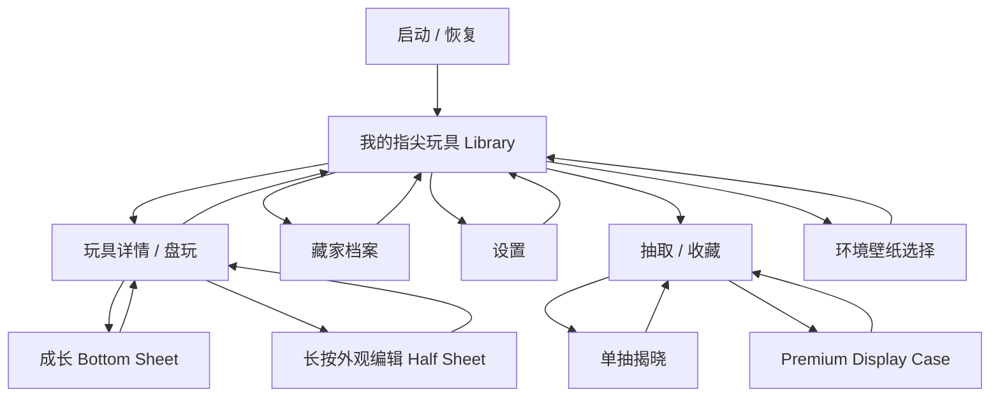
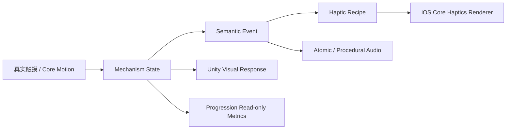
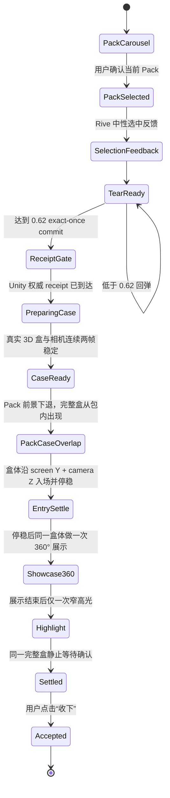

# Fidgeting App 产品设计圣经

> 本文是 `unity/FidgetingApp` 的产品、体验与视觉设计权威入口。它描述“应该做成什么”；实际代码、场景、测试、构建、安装与真机验收状态只由 [IMPLEMENTATION_STATUS.md](IMPLEMENTATION_STATUS.md) 证明。

## 0. 文档元数据与使用规则

| 字段 | 值 |
| --- | --- |
| 文档版本 | `1.0.0` |
| 状态 | 持续维护的 Canonical Design Authority |
| 最后对话同步 | 2026-08-27（Asia/Shanghai） |
| 对话覆盖范围 | 2026-08-01 至 2026-08-18；严格限定 `cwd=/Users/jiawei.zhou/Documents/Fidgeting app` |
| 覆盖规模 | 2026-08-16 冻结盘点为 280 个任务记录：27 个用户主任务、253 个关联子任务／审查／支持任务；后续新增任务纳入后，当前索引为 29 个主任务、683 条去除注入上下文后的用户消息事件 |
| shipping 产品 | `unity/FidgetingApp`；iOS 名称 `Fidget Spinner`；Bundle ID `com.jiaweizhou.fidgetspinner.codex` |
| 当前实现证据基线 | [IMPLEMENTATION_STATUS.md](IMPLEMENTATION_STATUS.md) 最后同步 2026-08-27；本文不会把请求或预览自动写成“已集成”或“已批准” |
| 语言 | 中文为主；保留类名、API、参数名、状态名和产品 ID |

### 0.1 权威关系

发生冲突时，按以下顺序裁决，低优先级来源不得覆盖高优先级来源：

1. 仓库根目录 [AGENTS.md](../../../AGENTS.md) 的产品、安全、物理与发布硬约束。
2. 用户较晚、明确且针对当前产品的决定或批准。
3. 用户针对具体 shipping Unity／shipping SwiftUI 预览的视觉批准。
4. 当前运行时代码、场景接线、自动化测试和 [IMPLEMENTATION_STATUS.md](IMPLEMENTATION_STATUS.md) 的集成证据。
5. Codex、子任务或外部参考提出的方案；没有用户接受证据时，只能标为 `Current Request` 或 `Pending Approval`。

构建成功、签名成功、安装成功、启动成功，以及“推手机”之类执行授权，均不自动等于视觉批准或真机手感接受。

### 0.2 双轴状态

| 轴 | 状态 | 精确定义 |
| --- | --- | --- |
| `DecisionState` | `Locked` | 用户已明确接受，或属于 AGENTS 硬约束；后续不得静默改变 |
|  | `Approved` | 用户已明确批准当前概念／设计方向；仍须由真实 shipping 实现预览完成最终视觉门禁，不能据此提升 `DeliveryState` |
|  | `Current Request` | 当前要实现的方向明确，但还没有对应最终视觉／手感接受 |
|  | `Pending Approval` | 已有候选，需要用户针对准确 shipping 预览批准 |
|  | `Superseded` | 曾经有效，但被较晚方案替代；只留在历史附录 |
|  | `Rejected` | 用户明确否决；不得重新混入当前规格 |
| `DeliveryState` | `Specified` | 只有本设计要求或专项规格 |
|  | `Partially Integrated` | 有部分 runtime、接线或测试，但未满足完整 Definition of Done |
|  | `Integrated & Tested` | runtime、场景／coordinator 接线、自动化测试均有证据 |
|  | `Installed` | 已进入签名 shipping App 并安装；仍不代表真机接受 |
|  | `Device Accepted` | 用户已在目标 iPhone 上明确接受该项视觉或手感 |

### 0.3 来源和要求 ID

- 可执行要求使用稳定 ID：`FDB-<DOMAIN>-NNN`。现有 ID 不因排序变化而重编号；修改语义时更新同一条，另起需求时新增 ID。
- 对话来源写为 `[T01]`—`[T30]`，完整索引见第 12 章；不记录临时 rollout 路径。
- 专项文档写为 `[S-*]`，批准 shipping 图片写为 `[V01]`—`[V09]`。
- `Locked` 必须能回溯到用户明确原话、AGENTS 硬约束或已经冻结的产品契约；`Integrated & Tested` 必须回溯到状态文档中的代码、接线和测试证据。

## 1. 产品愿景与不可破坏原则

Fidgeting App 是一款可持续扩展的高级数字指尖玩具收藏与体感交互 App。它不是自动播放的陀螺动画集合，也不是把网页调参面板包进手机；核心价值是把实体高级 EDC 玩具的金属质感、预压、脱档、跨档、吸附、惯性和停稳，转换为可信、可反复把玩的视听触体验。[T03][T04][T07][T13][T22]

| ID | 当前要求 | DecisionState | DeliveryState | 来源 |
| --- | --- | --- | --- | --- |
| FDB-PRD-001 | 所有新玩具只加入唯一 shipping App，不新增 Unity 工程、Bundle ID 或并存手机 App。 | Locked | Installed | AGENTS；[T22]；[S-STATUS] Build 39 |
| FDB-PRD-002 | 体验优先模拟真实机械因果：用户先输入，机构才运动；机械状态先变化，反馈随后由语义事件产生。 | Locked | Integrated & Tested | AGENTS；[T04][T07]；[S-HAPTIC] |
| FDB-PRD-003 | 零输入时转子、推牌、扇牌和盲盒机构都必须静止；Reset 后角速度严格为零。 | Locked | Integrated & Tested | AGENTS；[T03][T22]；[S-HAPTIC] |
| FDB-PRD-004 | 视觉必须服务于“可触摸的真实物件”：结构、材质、灯光、相机、声音和 Haptic 共同描述同一个质量与表面。 | Locked | Partially Integrated | [T08][T11][T12][T20][T22] |
| FDB-PRD-005 | 产品不声称制造级 CAD 精度；尺寸有实物依据，预览与实现可验证，推断项必须标明。 | Locked | Specified | [T08][T17][T25] |
| FDB-PRD-006 | 所有成长、外观、抽取和收藏奖励不得修改机械物理、惯性、碰撞、Haptic 授权或真实输入收益边界。 | Locked | Integrated & Tested | [T13][T18][T22]；[S-BADGE] |
| FDB-PRD-007 | 设计变化必须先展示真实 shipping 实现预览；视觉批准后才能进入包含该视觉变化的手机安装。 | Locked | Integrated & Tested | AGENTS；[T22]；[S-STATUS] |

## 2. 设计偏好、产品定义与拒绝准则

本章是新方案进入设计、制作和发布流程前的决策框架。它不是“高级感、好看、顺滑”之类通用建议，而是从 27 个主任务中反复出现的用户修改、批准、否决与真机反馈提炼出的项目偏好。后续实现若与本章冲突，应先停止扩展并回到这里裁决。

### 2.1 核心产品定义

Fidgeting App 不是一般陀螺模拟器，也不是把 UI、小游戏、抽卡和模型预览拼在一起的功能 Demo。它是一个以“真实可感的数字玩具”为核心、以收藏和长期关系为外层的产品：

1. **模型是物件本体**：真实比例、机械轴心、层级、材质和 artwork 让用户相信它能被拿在手里。
2. **输入与物理建立因果**：只有真实触摸或设备动作授权运动；预压、脱档、跨档、吸附、惯性和停稳连续可解释。
3. **Haptic 与音效让机构可感**：它们读取同一机械状态和语义事件，不独立“演戏”，不以热闹掩盖错误物理。
4. **相机、灯光与环境让物件被看懂**：构图展示结构和表面，背景提供空间而不抢主角。
5. **成长记录真实关系**：等级、Combo、Badge、皮肤和离线回收记录持续把玩，但不购买物理优势，也不伪造活跃。
6. **收藏与展示延长价值**：抽取、Gallery 和 Premium Display Case 让已拥有内容有展示意义；它们服务玩具，不反客为主。

只增加功能却不加强上述闭环的方案，应默认视为范围扩张；只有用户明确要求后才能成为当前产品规格。

| ID | 锁定偏好／产品定义 | 后续实现的判定方式 | DecisionState | DeliveryState | 来源 | 置信度 |
| --- | --- | --- | --- | --- | --- | --- |
| FDB-PREF-001 | 主角永远是可触摸、可理解、可收藏的数字物件，而不是设置面板、任务列表、商城或动画特效。 | 首屏、详情和核心循环中，3D 玩具的可见性、可操作性和反馈因果必须高于辅助系统。 | Locked | Specified | [T01][T03][T08][T13][T22] | 高；多轮明确要求 |
| FDB-PREF-002 | “高级感”来自正确比例、结构、表面、灯光、声音和手感共同成立，不靠金色、发光、玻璃叠层或粒子数量。 | 去掉装饰特效后，模型仍应凭轮廓、材质、机械层级和响应读成高级 EDC。 | Locked | Specified | [T08][T11][T12][T18][T20][T22] | 高；多次否决廉价／粗糙表现 |
| FDB-PREF-003 | 收藏、成长和抽卡只能延长对玩具的关系，不能取代真实盘玩。 | 购买、AUTO、预览和程序设姿不增加手动机制优势，不伪造 Badge／有效日／真实输入 XP。 | Locked | Specified | [T13][T18][T22]；[S-BADGE] | 高；明确规则 |
| FDB-PREF-004 | 单 App、统一目录、统一体验框架比“每款独立 Demo”更重要。 | 新内容必须复用 catalog、导航、设置、成长、展示盒和发布身份。 | Locked | Specified | [T01][T09][T11][T22]；[S-STATUS] Build 39 | 高；明确决定与退役证据 |

### 2.2 视觉与模型偏好

| ID | 锁定偏好 | 可验证标准 | DecisionState | DeliveryState | 来源 | 置信度 |
| --- | --- | --- | --- | --- | --- | --- |
| FDB-PREF-005 | 优先使用项目已有的真实／已批准模型、`.blend` 源、FBX、正式贴图、shader 和 artwork；不得用简化替代品或临时 primitive 冒充 shipping 内容。 | shipping scene 中的 Renderer、材质和内容 ID 可回溯到正式资产；placeholder、纯色替图、运行时临时几何在发布清单中为 0。 | Locked | Specified | [T08][T09][T11][T17][T20][T22][T25][T26] | 高；反复明确 |
| FDB-PREF-006 | 原始细节要被理解后保留：轴承、指盖、牌角、轨道、磁体、背面、刻蚀与装配层级不能因“做得更干净”而被抹掉。 | top/hero/oblique/low/back 逐项对照正式源；结构件有正确 parent、pivot、厚度和遮挡关系。 | Locked | Specified | [T08][T11][T20][T22]；[S-FAN] | 高；有自动门禁 |
| FDB-PREF-007 | 材质应读成真实金属、树脂、亚克力、织物或牌面，而不是平涂塑料。 | 金属有受控宽高光、粗糙度和微表面；暗部仍见层次；无纯白剪切、无随机高光点、无纯色替代贴图。 | Locked | Specified | [T11][T12][T20][T22]；[V01][V02][V03] | 高；批准与否决均有证据 |
| FDB-PREF-008 | 产品比例与机械轴心高于“每张卡看起来一样大”。 | 物理尺寸或权威 bounds 决定 framing；真实轴心投影稳定，模型不拉伸、不被统一 scale 伪放大。 | Locked | Specified | [T08][T11][T20][T22]；[S-STATUS] 轴心／双叶比例审计 | 高；明确修复请求 |
| FDB-PREF-009 | 相机要展示产品，而不是制造戏剧性畸变。 | Hero 能读到主结构；top/left/right/low 不裁切；长物件无横向透视压缩；跨产品切换不发生无依据的尺度跳变。 | Locked | Specified | [T06][T11][T12][T20][T22]；[V01][V03] | 高；多轮构图反馈 |
| FDB-PREF-010 | 灯光与背景必须帮助读取轮廓、材质和深度，不能抢主角。 | 主体亮部不剪白、暗部不糊死；背景低细节低饱和；平台、投影、IBL 与环境方向一致。 | Locked | Specified | [T12][T20][T22]；[V02][V04] | 高；批准方向 |
| FDB-PREF-011 | 收藏盒本身也要像真实高级产品包装，不能像粗糙原型、游戏宝箱或每款各做一套临时资产。 | 六款共享同一正式 prefab、相机、材质结构和 contentSlot；磁吸推牌真机接受基线像素级不回归。 | Locked | Specified | [T22]；[V07]；[S-STATUS] Build 36/37 | 高；有真机接受 |
| FDB-PREF-028 | 新建或修改 3D 模型必须执行 12 关可追溯流水线：原始参考、分析、建模合同、拆件、白模、几何验收、材质、渲染层、环境、导出、Unity 对齐和真实 shipping 构图逐关明确审批；拒绝版本永久保留，上游变化使下游过期。Blender/CLIAnything 是默认确定性路线，Rodin 只可作为独立概念支线。 | 任意 Unity 输出能反向追到导出包、Blender revision、claim 与参考图区域；每关都在 `pipeline.json`／`history.ndjson` 留下哈希和用户决定；第 12 关批准前 `shippingReady=false` 且不得推送手机。 | Locked | Tooling Integrated & Tested · Model Rebuild Pending | [T30]；[S-MODEL]；2026-08-20 standardized model provenance round | 高；用户明确要求固定流程与重建四款 Rotor |
| FDB-PREF-029 | 任何产品图、场景图、banner、概念图或 shipping 预览中的玩具主体，必须直接使用当前已批准的同一模型资产、其真实 scene/prefab、既有真实 shipping 捕捉，或可追溯的 Blender/FBX revision；不得由助手/生成式工具凭空重画、补件、增层、删层、改轮廓、改 pivot、改机械结构或以“氛围图”替代真实模型。单张 banner 不要求为了重新取景而启动 Unity：允许把既有真实捕捉中的模型作为受保护像素区，与另行设计的背景、灯光气氛、文字和 label 确定性合成；生成式图只可作与模型分离、明确标记的环境／灯光／版式灵感，且未经用户逐张批准不得进入产品任何位置。 | 任何候选图必须逐项核对 renderer/FBX/Blender revision、层数、轮廓、轴心、机构与牌面；任一主体不一致即标为 rejected concept，禁止导入 Unity、Native UI、banner、展示盒、Marketing 或 DesignBibleAssets。复用既有捕捉时，模型覆盖区必须能通过像素比较证明未被重绘或生成式修改；本轮 1179×654 banner 的受保护模型区 `max channel delta = 0`。 | Locked | Specified · Banner Composition Verified | 用户当前 Cursor thread（ID 未暴露）；2026-08-22 model-fidelity rejection + deterministic banner composition round | 最高；用户明确“永远不要胡乱加自己胡编乱造的设计图”，并明确单张 banner 无需重新启动 Unity |
| FDB-PREF-030 | 模型工作台默认只显示用户当下必须确认的证据映射，不要求用户理解内部 12 关、revision、hash、validation、source ledger 或完整 unknown 清单；模型选择与一句可理解的当前进度保留，完整溯源、测试和关卡状态放进默认收起的“技术细节”。磁吸推牌 Gate 4 不再使用宽泛 A/B、C/D 二选一，而应展示精确局部裁切、窄边界描线、连续帧运动箭头和孔槽编号。 | 默认视图只显示相对固定／直线滑动／旋转三项映射、四张局部证据板和一个具体确认问题；无旧 A/B 固定选择、无自动批准按钮、技术细节默认收起；大图可通过可见返回、Escape、backdrop 与浏览器 Back 返回工作台。内部 `pipeline.json`／`history.ndjson` 及 12 关门禁保持不变。 | Locked | Tooling Integrated & Browser Tested · Gate 4 Rev 8 Ready for Review | source task `b968679a-4069-41e7-a7fc-47cf5366bae2`；2026-08-22 workbench UX simplification + motion evidence correction round；[S-MODEL] | 最高；用户明确否决复杂界面和旧 A/B/C/D 框架，但不否决流水线严谨性 |
| FDB-PREF-031 | 模型溯源工作台必须是仓库级单一持久工作区。左侧模型选择、`当前正在做什么`、`当前 Gate NN/12`、`已批准 X/12`、完整 12-Gate 路线图及七个固定页签不得随 revision 消失或换序。页签固定为参考原图→分析（截图/视频）→尺寸→交互 CAD→白模→贴图与材质→Unity 灯光与成品，并显示当前／已批准／过期／被退回／未开始。过期与被退回证据保留为可展开历史。 | localStorage 保存模型、页签、Gate、滚动／视图和已打开素材；reload、Back/Forward 与 `?model=&tab=&gate=&asset=` 深链恢复上下文；显式选择不跳回 earliest problem；桌面和 390 px 移动端无页面横向溢出。 | Approved · Locked · Supersedes FDB-PREF-030 Navigation Visibility | Tooling Integrated & Browser Tested | source task `1b3149ec-568f-4d60-8360-845b1005b33a`；2026-08-27 persistent workbench correction；`tools/model-provenance-explorer/workspace-navigation-core.mjs` | 最高；用户明确要求导航与记忆为硬约束 |

### 2.3 交互、物理、Haptic 与声音偏好

| ID | 锁定偏好 | 可验证标准 | DecisionState | DeliveryState | 来源 | 置信度 |
| --- | --- | --- | --- | --- | --- | --- |
| FDB-PREF-012 | 真实输入授权优先于“看起来一直有动感”。 | 零输入／Reset／Library／AUTO／程序设姿不会给真实机构注入速度、Detent、声音或 Haptic。 | Locked | Specified | AGENTS；[T03][T04][T07][T22] | 高；硬约束 |
| FDB-PREF-013 | 响应要快，但不能靠扩大无边界热区、过度吸附或任意手势收尾制造“灵敏”。 | 输入延迟、命中率、误触率、breakaway、capture 与 cancel 分开测试；Orbit 和双指手势仍可达。 | Locked | Specified | [T03][T04][T06][T19][T20][T22] | 高；多轮手感修改 |
| FDB-PREF-014 | 每一枚 Haptic 和 click 都应能指出对应机械事件；少而准优于密而假。 | 事件日志能从 Detent/Breakaway/Capture/Collision 回溯到同帧反馈；停指静默，高速不堆 player。 | Locked | Specified | AGENTS；[T04][T07][T22][T24]；[S-HAPTIC] | 高；硬约束与专项规格 |
| FDB-PREF-015 | 拒绝“热闹但假”的反馈：持续震动、无事件粒子、重复 click、独立嗡声、自动收尾、过强镜头晃动和抢占输入。 | 无语义事件时反馈计数为 0；声音与 Haptic 不写物理；Reduce Motion 可得到稳定终态。 | Locked | Specified | [T04][T07][T13][T16][T20][T22][T24] | 高；多次否决与测试 |
| FDB-PREF-025 | 尽量利用设备陀螺仪、用户加速度、手指拨动速率与可用力度等真实输入，把数字玩具还原为可信物理世界，而不是只播放预设动画。 | 每种输入必须能追溯为一个经校准、归一化、限幅的机械量或状态，再由状态变化产生语义事件和反馈；设计评审必须展示这条因果链。 | Locked | Specified | [T27] 用户后续明确决定；[T04][T22]；[S-HAPTIC] | 高；用户明确锁定 |
| FDB-PREF-026 | 真实感需要可调校但有边界的产品参数；配置应表达机械手感，不把传感器原始数值或底层 Haptic 参数直接暴露给用户。 | 每项设置有单位／归一化语义、推荐默认值、有效范围、clamp、持久化和验收点；同一值不在 runtime、scene 与 native 重复漂移。 | Locked | Specified | [T27] 用户后续明确决定；[T04][T23]；AGENTS | 高；用户明确锁定 |
| FDB-PREF-027 | 禁止用原始传感器值直触发反馈，也禁止用无输入自转、随机震动、随机音效或无机械事件特效伪造真实感。 | 零输入和无语义事件测试中，真实机构速度及 Haptic／音频／视觉事件计数均为 0；原始输入层不得引用 renderer。 | Locked | Specified | [T27] 用户后续明确决定；AGENTS；[T03][T04][T07] | 高；用户明确锁定 |

### 2.4 UI、动效与信息层级偏好

| ID | 锁定偏好 | 可验证标准 | DecisionState | DeliveryState | 来源 | 置信度 |
| --- | --- | --- | --- | --- | --- | --- |
| FDB-PREF-016 | UI 应退后一步，让产品成为视觉中心；沉浸感必须有意图且可操作。 | 去掉非必要容器后，主操作、当前产品、状态与返回路径仍清楚；UI 不遮模型关键结构。 | Locked | Specified | [T06][T12][T15][T16][T22] | 高；多轮 UI 修改 |
| FDB-PREF-017 | Dark Mode + 克制 Liquid Glass + Oxanium 是既有语言；Glass 表达层级，不是每个卡片的装饰滤镜。 | 只有容器根有真实玻璃；子卡静态、对比达标；旧系统和 Reduce Transparency 有明确回退。 | Locked | Specified | [T15][T16][T18][T22]；[S-UI] | 高；shipping 方向 |
| FDB-PREF-018 | 信息层级由字号、位置、留白和真实状态建立，拒绝无关装饰、堆叠 icon、描边、发光、胶囊和模板化组件。 | 每个视觉元素能说明导航、状态、机械或奖励之一；无法说明者删除。文本 CTA 不混入装饰 icon。 | Locked | Specified | [T13][T15][T16][T18][T22] | 高；反复明确 |
| FDB-PREF-019 | 媒体必须等比、构图有目的、无无意义留白；不能为“塞进卡片”拉伸图片。 | 原始宽高比校验通过；cover/fit 选择有语义；焦点在裁切安全区，容器不留空 gutter。 | Locked | Specified | [T15][T16][T22]；[S-UI]；[S-STATUS] Build 39 | 高；明确修复 |
| FDB-PREF-020 | 动效追随手势与状态，强调一次明确变化；拒绝无法中断的模板动画和持续抢眼循环。 | Commit/Cancel/Reduce Motion 可测；动画结束状态与业务状态一致；遥测不触发整页重建。 | Locked | Specified | [T06][T12][T13][T16][T21][T22] | 高；多轮性能／动效证据 |

### 2.5 收藏、成长、抽卡与展示边界

| ID | 锁定偏好／边界 | 可验证标准 | DecisionState | DeliveryState | 来源 | 置信度 |
| --- | --- | --- | --- | --- | --- | --- |
| FDB-PREF-021 | 成长应奖励真实盘玩和长期熟悉，不把 App 变成任务清单。 | 核心详情随时可直接盘玩；任务、Badge 和离线结算不抢占输入，不强制领取，不伪造活跃。 | Locked | Specified | [T13][T18][T22] | 高；明确规则 |
| FDB-PREF-022 | 抽卡和商店是收藏入口，不是核心机械付费墙。 | 奖池不含物理／XP 增益；券、价格、保底与交易由权威数据驱动；无假按钮和假价格。 | Locked | Specified | [T22]；[S-GACHA]；[S-STATUS] Build 39 | 高；明确决定 |
| FDB-PREF-023 | 揭晓与展示必须继续尊重真实模型；不能为稀有度牺牲产品可读性。 | 奖品在可读阶段无遮挡，光色面积受限；盒体始终保持完整装配；相机不因 rarity 改变产品比例。 | Locked | Specified | [T22][T31]；[S-GACHA]；2026-08-24 no-exploded-reveal decision | 高；用户明确替代旧散开方向 |
| FDB-PREF-024 | 经济系统深度是否继续扩大，取决于它是否加强收藏关系而不干扰核心盘玩。 | 对蓝图、合金屑、定制和付费 SKU 的新增需独立产品决策与端到端验收。 | Current Request | Specified | [T22]；[S-GACHA] | 中；推断，不是已批准扩张 |

### 2.6 接受／拒绝／需要批准决策表

| 方案领域 | 可以直接进入设计／实现的特征 | 明确拒绝的反模式 | 必须先获用户批准或真机验证的灰区 |
| --- | --- | --- | --- |
| 新模型／模型修复 | 复用正式源资产、保留真实尺寸与机械层级、通过多视角门禁 | primitive 替身、纯色代贴图、错误轴心、额外悬浮环、用截图反推锁定尺寸 | 任何可见几何、比例、pivot、artwork、材质变化先出 shipping 多视角；手感再上 iPhone |
| 材质与灯光 | 表面类别明确、宽柔高光、暗部有层次、环境一致 | 纯白剪切、塑料平涂、随机亮点、为了“高级”全局染金／霓虹 | 新 shader、曝光、反射、灯位、环境主题先做当前 shipping scene 预览 |
| 相机与构图 | 按真实 bounds／尺寸 framing，Hero 能读结构，多角度不裁切 | 所有模型等大、长物件透视压扁、用戏剧畸变掩盖比例错误 | 详情、Library、展示盒的 FOV／角度／fit 改动先视觉批准；真机检查安全区与手持视差 |
| 输入与物理 | 真实输入先校准、归一化并映射为 torque／target／breakaway／orbit 等可解释机械量；帧率无关、可取消 | 自转、原始传感器直驱、随机力、自动开关动画、无界热区、任意拖动直接全开、UI 动画写物理 | 输入曲线、dead zone、clamp、阈值／阻尼／速度／热区变化需要测试；最终手感必须真机接受 |
| Haptic 与声音 | 同一机械状态产生同一语义事件并同帧协调 Haptic／音效／视觉；停指静默，高速有受控退化 | raw input 直震、随机震动／音效、持续 loop、重复 click、Haptic/音频各自猜档位 | Recipe 强度、锐度、音高、声部、高速阈值和传感器映射必须 iPhone 实听实摸 |
| UI 与动效 | 产品优先、Dark/Liquid Glass、原生控件、清晰层级、可中断 | 图标堆叠、装饰描边、模板胶囊、重复玻璃、图片拉伸、无意义 gutter | 原生 UI、布局、字体、图片裁切、转场、Reduce Motion 变化先 shipping SwiftUI 预览 |
| Pack carousel | 六档 Pack 保持同一 authored 尺寸；当前选中档可做克制的小幅视觉放大；中心 Pack 是最高点，左右各档随距离逐级稍降并向各自外侧倾斜；一次拖动最多切一档；按实际 release 位移跨固定阈值后吸附，否则回原档 | 不同 tier 资产永久大小不一、选中态夸张放大并破坏间距、侧项向中心内扣、深 U／倒向弧线、用 predicted fling 跳多档、未达阈值也换档 | 选中／未选中 scale、间距、逐级落差、向外倾角、阈值与 spring 节奏先经 shipping SwiftUI 预览；阈值手感与误触最终在 iPhone 验收 |
| 成长／Badge | 只读真实盘玩、幂等奖励、辅助层级、可关闭 | AUTO 刷成就、购买物理增益、假完成率、强制领取、任务遮挡盘玩 | 新节奏、奖励动画、Badge 视觉先预览；跨级、迁移、性能需真机长用 |
| 抽卡／经济 | Unity 权威、券 only、真实价格、可恢复收据、奖品只为收藏 | 假 catalog、假价格、页面打开即 StoreKit、重复发奖、付费机械优势 | 新货币／蓝图关系需用户产品决定；真实交易与后台恢复必须 sandbox＋真机 |
| Premium Display Case | 单一正式盒、推牌基准、contentSlot、8% 留白、真实奖品 | 每款临时盒、假 2D 奖品、游戏宝箱、彩色 UI 投射、粗糙内胆 | 盒体、相机、fit、蚀刻、灯光改动先逐款 shipping 预览；六款分别真机接受 |
| 性能与发布 | 60 FPS 目标、离屏停更、正式脚本单 App 覆盖、证据归档 | 用 30 FPS 掩盖回归、并发污染 Unity、编译成功冒充验收 | 视觉先批准；触感、热、内存、长时滚动必须目标 iPhone 验证 |

### 2.7 使用规则与置信度

- 标为“锁定”的偏好有用户明确表达、重复否决、AGENTS 硬约束或具体 shipping／真机批准支撑。
- 标为“推断”的内容只能帮助评估，不得据此扩展范围；本版唯一明确推断项是上表末项。
- 如果新请求与锁定偏好冲突，以用户较晚且明确的新决定为准，同时把旧项改为 `Superseded` 或 `Rejected`，保留来源。
- 如果候选同时符合“可接受特征”和“灰区”，仍执行灰区门禁；自动化、编译、安装不能跳过预览或真机接受。

## 3. 信息架构与核心旅程

### 3.1 页面与返回关系

| ID | 当前要求 | DecisionState | DeliveryState | 来源 |
| --- | --- | --- | --- | --- |
| FDB-IA-001 | Library 是六款玩具的统一入口；详情页负责盘玩与 Reset，不建立每款独立 App。 | Locked | Installed | [T01][T22]；[S-STATUS] Build 39 |
| FDB-IA-002 | Library 顶部品牌写作小写 `fidgeting`；标题直接显示当前模型，副标题只保留皮肤／材质与简化等级。 | Locked | Installed | [T06][T15][T22] |
| FDB-IA-003 | Library、藏家档案和设置等覆盖面板使用可点、可下拖关闭的顶部 notch；详情、档案与设置均有明确返回路径。 | Locked | Installed | [T15][T16][T22] |
| FDB-IA-004 | Reset 属于当前玩具详情操作，不占独立主导航目的地。 | Locked | Installed | [T03][T22] |
| FDB-IA-005 | 点击底部成长卡进入“成就／Badge／外观”；藏家档案集中承载 Rank、7 日节奏、跨玩具成就与收藏。 | Locked | Installed | [T13][T18][T22] |
| FDB-IA-006 | 详情页长按命中模型进入统一外观编辑 Half Sheet，而不是跳入独立编辑页面。 | Locked | Installed | [T19][T22] |
| FDB-IA-007 | 抽取页使用两个顶层 Tab：“抽取／兑换”和“收藏”；规则为二级入口，单抽操作固定底部。 | Locked | Installed | [T22]；[S-GACHA]；[S-STATUS] Build 39 |
| FDB-IA-008 | 环境选择为有限壁纸轮播：当前页居中缩小、前后页露边、单一主 CTA；不得演变为无边界素材浏览器。主题数量可按已批准产品方向扩展，但仍不得循环复制或变成无边界素材浏览器。 | Locked | Integrated & Tested · Visual Approval Pending | [T12][T22][T29]；[V05] |
| FDB-IA-009 | 首次从 Library 进入详情只展示一次 Quick Start；完成或跳过后不重复打断。 | Locked | Integrated & Tested | [T13][T22] |

### 3.2 Library 横向切换

- 手指左滑：当前产品同向向左退出，下一产品从右进入；右滑完全镜像。
- Unity 的 shipping 模型与原生分页必须共享同一 swipe session，不在异步加载完成后瞬切，也不依赖固定猜测窗口。
- 默认“随形微光”环境的近黑底保持连续；旧模型的低饱和色场跟随当前页离场，新模型色场从相反方向随下一页进入。拖动阶段直接跟手，松手沿现有约 `0.22 s` 的 ease-out 落稳；不得在页面提交后才整屏瞬切颜色。[T29]
- 每张 Library 卡使用实时 3D 模型约 45° 产品角；Page Control 表达目录位置，不恢复底部五张旧缩略图栏。
- 跨产品尺度由真实 Renderer bounds、物理尺寸和 framing profile 共同决定；“同样 scale”与“同样屏占比”都不是目标。

## 4. 统一体验设计系统

### 4.1 视觉语言

| ID | 当前要求 | DecisionState | DeliveryState | 来源 |
| --- | --- | --- | --- | --- |
| FDB-UI-001 | 全局以纯黑／中性深灰为底，使用低对比、克制、产品级暗色界面；不得任意加入高饱和“AI 色”。 | Locked | Installed | [T12][T15][T16][T18][T22] |
| FDB-UI-002 | 原生层使用 SwiftUI Liquid Glass；旧系统回退系统材质。真实玻璃只放在需要层级分离的容器根部，子卡不重复叠毛玻璃。 | Locked | Installed | [T15][T16][T22]；[S-UI] |
| FDB-UI-003 | 产品级文本按钮只显示文字，不加入装饰 icon；系统导航、状态或机械模式可以使用语义明确的原生图标。 | Locked | Installed | [T15][T22]；[S-GACHA] |
| FDB-UI-004 | 默认不加描边、发光边框和多余容器；用层级、留白、材质与透明度建立关系。 | Locked | Installed | [T15][T16][T18] |
| FDB-UI-005 | 全局拉丁字体使用 Oxanium；不自定义 tracking／kerning；中文回退系统字体，数字优先等宽。 | Locked | Installed | [T15][T18][T22] |
| FDB-UI-006 | 数值 headline 必须强于标签；Speed、Intensity、Frequency 名称固定在半圆下方，不能被模型背景吞掉。 | Locked | Installed | [T13][T22] |
| FDB-UI-007 | 蓝／绿／紫／金只表达 Standard／Refined／Signature／Heirloom 稀有度或明确状态，不作为全页装饰色。 | Locked | Installed | [T18][T22]；[S-GACHA] |
| FDB-UI-008 | 图标和容器四周保留可感知呼吸空间；所有触摸目标遵守 iPhone 可达性与 safe area。 | Locked | Installed | [T15][T16]；[S-UI] |
| FDB-UI-009 | 所有图片保持原始宽高比：封面用等比 `scaledToFill/cover + clipped`，完整图用 `fit`；绝不拉伸、不留无意义白边。 | Locked | Installed | [T15][T22]；[S-UI]；[S-STATUS] Build 39 |
| FDB-UI-010 | Bottom Sheet 激活时必须遮挡底层操作并有 notch；关闭后才恢复底层点击与可访问性。 | Locked | Integrated & Tested | [T16][T22]；[S-STATUS] |
| FDB-UI-011 | Dropdown、Menu、Segmented Control、Slider 等优先使用原生 SwiftUI 组件，不搭建临时调参侧栏或网页式面板。 | Locked | Installed | [T04][T15][T16] |
| FDB-UI-012 | Reduce Motion 关闭高频轨道、视差、强位移动效，保留短淡化与可理解终态；Reduce Transparency 保持层级和可读性。 | Locked | Partially Integrated | [T12][T13][T15][T22]；[S-UI] |

### 4.2 仪表、Combo 与成长反馈

| ID | 当前要求 | DecisionState | DeliveryState | 来源 |
| --- | --- | --- | --- | --- |
| FDB-UI-013 | 底部三联仪表不重叠：中央 Speed/RPM 为唯一 Hero，左右 Intensity/Frequency 为弱一级翼表。 | Locked | Installed | [T13][T22] |
| FDB-UI-014 | 主表使用 180° 半圆、真实 RPM、20 Hz 大号等宽数字、活动弧与无超调响应；磁吸推牌不得伪装 RPM。 | Locked | Installed | [T13][T22] |
| FDB-UI-015 | Peak 只使用语义色和局部扫掠／光晕；独立火苗和覆盖翼表的高频火焰已移除。 | Locked | Installed | [T13][T22] |
| FDB-UI-016 | Combo 以数字为主、无边框无胶囊；普通增长紧凑，10/20/30/50 里程碑使用模型平面上的分层环、雾与咬合轨道。 | Locked | Installed | [T13][T22]；[V06] |
| FDB-UI-017 | 进度轨道与里程碑线宽一致，等级端点清楚，完成／当前／未完成依靠填充和透明度区分；动画克制。 | Locked | Installed | [T13][T18][T22] |
| FDB-UI-018 | 离线结算无“领取”CTA；自动关闭后恢复原页面，再把 XP 粒子飞向当前单品身份组内的真实玩具等级环。左上全局 Collector Rank 数字不是单品 XP 的飞行终点。 | Current Request | Integrated & Tested | [T13][T22]；[S-STATUS]“页面级 XP 回收”待批准；2026-08-18 compact level UI round |
| FDB-UI-019 | Fanatics Live／Mobbin 只作为移动端层级证据：同一决策区一个高对比 Primary（目标 `52 pt` 高／`26 pt` 圆角），Secondary 使用中性 tonal／glass 且默认不复制 outline；Filter Chip 为 `32 pt` 可见／`44 pt` 热区，Status Tag 为 `24–28 pt` 静态信息；页面间距统一到 `4 pt` 网格（主 inset `20 pt`、sheet `16 pt`、stack `8 pt`、section `24 pt`）。抽卡底栏只保留单行“单抽”Primary，票券 metadata 外置，“十抽后续开放”改静态信息。 | Current Request | Integrated & Tested | source task `01a01292-9e95-78b2-9b51-eef638ecd42f`；2026-08-18 guideline confirmation round pending；[S-UI]；[S-STATUS]；真实 shipping-source Simulator 预览待用户确认，未推送手机 |
| FDB-UI-020 | Library 陀螺选择／轮播页顶部把当前单品的紧凑 `32 pt` 等级环（`2 pt` 轨道）与“镜钢四翼／三叶金属”等产品名组成一个身份锁定组；材质／皮肤名作为第二级信息下移并保持明确间距。左上 Profile 只显示一个全局 Collector Rank 数字，不显示头像、圆环或进度轨道，保留至少 `44 pt` 点击热区；它不能随当前玩具等级或 accent 改变。详情页不是紧凑 Badge 入口的承载页面。 | Current Request | Shipping UI Implemented & Tested · Visual Approval Pending | source tasks `019fd558-a113-70a1-8059-3c90cf96f927`、`01a01423-4ba3-72f0-b004-da2596d81f10`；2026-08-18 compact level UI round；真实全屏 shipping SwiftUI 预览 `Artifacts/AdaptiveBackdropPreview/WithUICompactLevels/product-identity-library-contact-sheet.png` 待确认，确认前不推手机 |
| FDB-UI-021 | 任何新增或修改的 shipping UI 必须先复用 `FidgetProductUIComponents.swift` 的组件和 token；业务 View 只组合状态与内容。缺少 primitive 时先进入组件库，再由业务层使用。所有 native root 应用 `productDesignSystem()`；业务层禁止手写 Primary／Secondary、玻璃、heading、tag、card、字号、间距、圆角、pressed motion 和 action state。 | Locked | Integrated & Tested · Visual Approval Pending | source task `504719bf-a4a3-44c2-b1f3-a3bd342e5ae3`；2026-08-24 component-library hard-rule round；AGENTS component-library gate；shipping preview pending，未推送手机 |

### 4.3 动效节奏

- 常规切换追随手指；Commit 后才完成余下位移，Cancel 回到原位。
- 详情进入用同一时间轴推进相机、远中近景和承托：当前批准节奏为约 `0.68 s`，从峡谷／都市入口进入内部空间。[V04]
- 长按外观编辑的相机轻弹总长 `0.22 s`：`0.075 s → 1.035×`、`0.150 s → 0.992×`、`0.220 s → 1.000×`；它只改 framing，不改模型 Transform 或物理。
- 反向输入停转目标为 `300 ms / ease-out`；实验翻转 `360° / 400 ms / ease-out / 10% overshoot` 默认关闭。
- 动效必须可中断、可重入，不得积压旧 generation；20 Hz 遥测更新不能重建大面积视觉树。

## 5. 输入、物理、音频与 Haptic 系统

### 5.1 唯一反馈数据流

`Tick`、`Detent`、`Snap`、`Pop`、`Burst`、`Breakaway`、`Capture` 是产品语义，不是 Apple Core Haptics event type。任何新代码不得从 raw touch、raw acceleration 或 UI 直接调用 `IosHaptics`。

真实输入映射必须在机制层可解释，不能把“传感器数值变化”本身当作产品事件：

| 真实输入 | 物理映射／调校边界 | 可产生的机制状态或语义 | 禁止做法 |
| --- | --- | --- | --- |
| 手指拨动位移、速率、方向 | 屏幕／世界坐标转换、dead zone、单帧限幅、响应曲线、torque 或目标位置、frame-rate independent damping | Rotor 角速度、Slider/Fan 手指目标、Breakaway、DetentCrossed、Capture、Release | 触摸一发生就震；按手指停留时长持续震；忽略方向与实际行程播放固定动画 |
| 可用 pressure／力度估计 | 设备能力检查、归一化 `0…1`、噪声滤波、clamp；无 pressure 时使用可解释的速率／行程 fallback | 输入力度、势垒负载、Combo Intensity、快速收尾授权 | 把 raw pressure 当 Haptic intensity；无能力设备随机补力度 |
| 陀螺仪 attitude／rotation rate | 进入页校准零点、unwrap／积分、灵敏度 preset、soft clamp、离屏停止、触摸互斥 | Camera Orbit、Device Twist、环境视差、重新校准 | wrapped Euler 相减；任意姿态变化直接发 Haptic；陀螺仪移动手指下机械轴 |
| `userAcceleration` | 去重力、进入／退出迟滞、方向／幅值阈值、cooldown、最大事件率 | Shake、惯性重量、RattleImpulse | raw accelerometer 直接震动；持续加速度无限连发；用随机震动补“重量” |

调校参数必须位于 App 产品语义层：例如“拖动响应”“陀螺仪灵敏度”“棘轮咬合”“Intensity/Sharpness preset”，而不是展示未解释的 sensor scale、Core Haptics primitive 或彼此覆盖的底层常量。默认值、serialized scene/prefab、native fallback 与测试验收点遵守同一 source of truth。

### 5.2 通用输入与机械要求

| ID | 当前要求 | DecisionState | DeliveryState | 来源 |
| --- | --- | --- | --- | --- |
| FDB-INT-001 | 自由轮只从明确触摸／设备输入获得角速度，随后按帧率无关 half-life 阻尼衰减。 | Locked | Integrated & Tested | AGENTS；[T03][T22]；[S-HAPTIC] |
| FDB-INT-002 | Reset 后角速度为零；历史 motor、idle loop、fallback 或展示动画不得给真实 Rigidbody 注入自转。 | Locked | Integrated & Tested | AGENTS；[T03][T22] |
| FDB-INT-003 | 通用触控兜底热区半径为屏幕短边 `36%`，可见模型约 `32%`；两侧保留约 `14%` Orbit 空白区。 | Locked | Integrated & Tested | [T03][T22]；[S-PLAN] |
| FDB-INT-004 | 模型碰撞体优先于屏幕兜底；中心死区和单帧角度限幅保留，旋转热区不得吞掉空白 Orbit。 | Locked | Integrated & Tested | [T03][T06] |
| FDB-INT-005 | Rigidbody 轴向约束是旋转权威；实验翻转期间才能临时切换为运动学动画。 | Locked | Integrated & Tested | [T03]；[S-HAPTIC] |
| FDB-INT-006 | 磁吸机构在 breakaway 以下保持当前井；跨过阈值才移动，低速时吸附最近档并以零速度结束。 | Locked | Integrated & Tested | AGENTS；[T04][T22]；[S-HAPTIC] |
| FDB-INT-007 | 物理档位数与 Haptic 档位数必须读取同一个 mechanism config，不得维护两份默认值。 | Locked | Integrated & Tested | AGENTS；[T04] |
| FDB-INT-008 | Shake 只读 `userAcceleration`，使用进入／退出迟滞和 cooldown；重力分量不得触发。 | Locked | Partially Integrated | AGENTS；[T04][T22] |
| FDB-INT-009 | Device Twist 使用展开后的 attitude 或积分 rotation rate；禁止 wrapped Euler 直接相减。 | Locked | Partially Integrated | AGENTS；[T04] |
| FDB-INT-010 | Core Motion 在进入页面建立当前姿态零点，离屏停止更新；触摸机构期间冻结视差，结束后重建参考。 | Locked | Partially Integrated | [T04][T12][T22] |
| FDB-INT-011 | 陀螺灵敏度只提供低／中／高三档，共享控制 Input Angle、Response、Lead 和 Orbit，并跨启动保存。 | Locked | Installed | [T04][T23]；[S-STATUS] |
| FDB-INT-012 | 长按模型阈值 `0.55 s`、移动不超过 `12 pt`；拖动、双指、空白长按和 Library 预览不得误触。 | Locked | Installed | [T19][T22] |
| FDB-INT-013 | 所有真实输入先经过能力检查、校准、坐标变换、滤波／迟滞、归一化与限幅，再映射为 torque、target、load、orbit 或 breakaway authorization。 | Locked | Partially Integrated | [T27] 用户后续明确决定；[T04][T22]；[S-HAPTIC] |
| FDB-INT-014 | 手指拨动速率、方向、累计行程和可用力度必须共同服务可解释机械状态；缺少 pressure 的设备只能使用确定性 fallback，不得随机补值。 | Locked | Partially Integrated | [T27] 用户后续明确决定；[T03][T20][T22][T24] |

### 5.3 Haptic Recipe 与设置

| ID | 当前要求 | DecisionState | DeliveryState | 来源 |
| --- | --- | --- | --- | --- |
| FDB-HAP-001 | Haptic 必须沿“输入 → 机械状态 → 语义事件 → Recipe → iOS Renderer”链路输出。 | Locked | Integrated & Tested | AGENTS；[T04][T22]；[S-HAPTIC] |
| FDB-HAP-002 | 日常设置只暴露有产品意义的力度、锐度、节奏、衰减、速度跟随、棘轮咬合和惯性，不暴露 Core Haptics 底层事件参数。 | Locked | Installed | [T04][T23]；[S-HAPTIC] |
| FDB-HAP-003 | `DETENT LAB` 独占四个预设：Vault、Camera Dial、Watch Bezel、Silk Ratchet；Camera Dial 默认 `12 / 1.0 / 0.72`。 | Locked | Installed | [T04][T23]；[S-PLAN] |
| FDB-HAP-004 | 预设、Intensity、Sharpness 与其他设置实时生效、节流试听并自动保存；保存并返回当前玩具路径明确。 | Locked | Installed | [T23]；[S-STATUS] |
| FDB-HAP-005 | 低速 Detent 使用离散 transient；跨档率超过 `30/s` 时才切到单个 continuous 高速纹理，避免 player 堆叠。 | Locked | Integrated & Tested | [T04][T22]；[S-HAPTIC] |
| FDB-HAP-006 | `userAcceleration ≥ 0.3g` 可触发独立低锐度惯性重量触点，最大 `8/s`，不得抢占 Detent。 | Locked | Partially Integrated | [T04]；[S-PLAN] |
| FDB-HAP-007 | Programmatic pose、Library、AUTO、Reset、预览和恢复状态全部静默，不伪造用户授权反馈。 | Locked | Integrated & Tested | [T04][T22]；[S-HAPTIC] |
| FDB-HAP-008 | Badge 解锁只产生 `BadgeUnlocked` 语义事件；展示层不得直接发 Haptic。 | Locked | Integrated & Tested | [T18][T22]；[S-BADGE] |
| FDB-HAP-009 | 原始 touch、attitude、rotation rate、pressure 或 acceleration 不得直接触发 Haptic／音效／视觉；三类反馈只消费同一机械状态产生的语义事件。 | Locked | Partially Integrated | [T27] 用户后续明确决定；AGENTS；[T04][T07][T22] |
| FDB-HAP-010 | App 允许在产品语义层配置真实感：preset、响应曲线、dead zone、threshold、clamp、Intensity／Sharpness 与速度跟随均有有效边界和持久化；底层 primitive 不直接暴露。 | Locked | Partially Integrated | [T27] 用户后续明确决定；[T04][T23]；[S-HAPTIC] |

### 5.4 音频系统

| ID | 当前要求 | DecisionState | DeliveryState | 来源 |
| --- | --- | --- | --- | --- |
| FDB-AUD-001 | 音频只消费真实机械速度与语义事件，不写 Rigidbody、不授权 Haptic。 | Locked | Integrated & Tested | [T07][T22] |
| FDB-AUD-002 | 棘轮每跨一个真实档位，同帧播放一次 `48–52 ms` 原子 click；5 个微 EQ／微音高变体，旋转玩具 12 声部。 | Locked | Integrated & Tested | [T07][T22]；[S-PLAN] |
| FDB-AUD-003 | click 不使用 timeline、sequence 或 scheduler；高速只改变真实事件密度与单击重量，不继承 Haptic `30/s` 模式切换。 | Locked | Integrated & Tested | [T07]；[S-PLAN] |
| FDB-AUD-004 | 自由轮使用低噪程序化切风／合金声，节奏严格为 `RPM × 叶片数 ÷ 60`，音高跟随真实 `20…400 RPM`。 | Locked | Integrated & Tested | [T07][T22]；[S-PLAN] |
| FDB-AUD-005 | shipping 音色为“明亮合金 100%／整体 +9 半音”；三层范围 `1125…1810 / 2588…4161 / 4669…7508 Hz`。 | Locked | Installed | [T07][T22]；[S-PLAN] |
| FDB-AUD-006 | 主段最长 `65 ms` 或在下一 blade-pass 前归零；静止严格静音，不允许连续 oscillator 形成嗡声。 | Locked | Integrated & Tested | [T07]；[S-PLAN] |
| FDB-AUD-007 | 默认总音量 `0.50`，mixer callback 即时生成，参数响应约 `4 ms`，DSP buffer `256 samples`。 | Locked | Installed | [T07]；[S-PLAN] |

## 6. 六款玩具逐款规格

### 6.1 共同模板与验收

每款玩具都必须同时交付：产品角色；真实或锁定尺寸；机械轴心与层级；正／背面 artwork；Library 与详情相机；材质／灯光；手势、物理、声音和 Haptic；成长、Badge、展示盒和抽取表现；状态与来源。任何外观变化的 shipping 预览至少覆盖 top、authored hero、left/right oblique、low-angle；贴纸变化还要覆盖 pictogram、text 和 thin-line。

2026-08-20 用户明确指出当前四款 Rotor 几何与参考目标差异过大。`blue-classic`、`metal-three-blade`、`gold-four-wing`、`graphite-two-lobe` 当前运行资产只作为历史对照保留，统一进入 `rebuild_requested`；旧模型继续运行，直到替代模型完成 [FDB-PREF-028] 的 12 关。既有 [V09] 仅保留材质语言与展示灯光的批准范围，新几何不能自动继承该视觉批准。当前为“替代几何待重建、视觉批准待确认、未推送手机”。

同日的石墨双叶复审进一步确认：此前归在“原始参考”的五张独立产品／零件／爆炸图实际是 Codex 助手生成的目标与推导图，并非用户原始输入；它们不得继续以 `user-reference` 或 `external-reference` 身份支撑尺寸和结构 claim。历史第 4 关拆件可保留为概念对照，但第 5 关 Unity 白模没有忠实执行该拆件结构，且第 6 关从未产出同一 Blender revision 的六视图、Workbench、尺寸、Pivot 与爆炸验收。该否决只改变溯源与重建状态，不替换当前 shipping 资产。

同日，用户把 Obsidian 中的抖音笔记与亲自拍摄的 `IMG_5961.MOV` 明确指定为磁吸推牌同款参考；两者允许存在不同定制颜色和花纹，但不能据此自动认定几何、尺寸、材质或内部机构完全相同。第一关必须保持用户视频、外部笔记抽帧和后续网络探索三类来源独立；用户视频中的声音、手持比例、侧面厚度和运动角度可在第二关形成带可信度的 claim，但颜色／花纹只先登记为外观变体。旧 `magnetic-slide-tile` shipping 模型继续运行，第 12 关明确批准前不得被新几何替换。

| 产品 ID | 显示名 | shipping Scene | Mechanism |
| --- | --- | --- | --- |
| `blue-classic` | 经典蓝色 | `Assets/Scenes/FidgetSpinnerDemo.unity` | Rotor |
| `metal-three-blade` | 三叶金属 | `Assets/_Fidgeting/Scenes/ThreeBladeEDC.unity` | Rotor |
| `gold-four-wing` | 镜钢四翼 | `Assets/_ImportedSpinner/Scenes/ImportedSpinner.unity` | Rotor |
| `graphite-two-lobe` | 石墨双叶 | `Assets/_TwoLobeBar/Scenes/TwoLobeBar.unity` | Rotor |
| `magnetic-slide-tile` | 磁吸推牌 | `Assets/_EDC/Scenes/MeshyEDC.unity` | Linear Slider |
| `magnetic-fan-card` | 磁吸扇牌 | `Assets/_FanCard/Scenes/MagneticFanCard.unity` | Fan |

### 6.2 经典蓝色 `blue-classic`

| ID | 当前要求 | DecisionState | DeliveryState | 来源 |
| --- | --- | --- | --- | --- |
| FDB-BLU-001 | 作为最易理解的入门 Rotor：视觉直读三叶、中心指盖和旋转质量，不使用隐藏 motor。 | Locked | Installed | [T01][T03][T22] |
| FDB-BLU-002 | 保留蓝色金属身份与真实轴承／指盖层级；额外装饰轴圈不得与真实机械件竞争。 | Current Request | Integrated & Tested | [T08][T20][T22]；[S-STATUS] 轴圈候选待批准 |
| FDB-BLU-003 | Library 与详情按圆形 Rotor framing；旋转触控、Orbit、自由轮／棘轮模式与四款 Rotor 一致。 | Locked | Installed | [T06][T22] |
| FDB-BLU-004 | 成长、Badge、贴纸和展示盒读取 `blue-classic` 自己的数据，不借用三叶金属状态。 | Locked | Installed | [T13][T18][T22] |

### 6.3 三叶金属 `metal-three-blade`

| ID | 当前要求 | DecisionState | DeliveryState | 来源 |
| --- | --- | --- | --- | --- |
| FDB-TRI-001 | 产品角色是精密、明亮、可长期升级的主力金属 Rotor；Blender 源保留，Unity 负责装配与运行时。 | Locked | Installed | [T08][T09][T11][T17][T22] |
| FDB-TRI-002 | 三叶过渡圆润、无锯齿；动态转子、轴承外圈、固定指盖同轴，机械原点不随不对称 bounds 漂移。 | Locked | Integrated & Tested | [T08][T11][T20][T22] |
| FDB-TRI-003 | 顶盖可见中心是相机与贴纸共同焦点；旋转时 framing 不呼吸、不把非对称 AABB 当焦点。 | Current Request | Integrated & Tested | [T11][T18][T22]；[S-STATUS] |
| FDB-TRI-004 | 十档皮肤依次为原生雾银、枪灰拉丝、夜航刻度、钨金蜂巢、冰银回纹、蓝钢水波、赤铜回路、钛虹热变、星陨黑曜、镜铬极光。 | Locked | Installed | [T13][T18][T22] |
| FDB-TRI-005 | 皮肤只改变正式可见金属表面与纹理；不得添加悬空等级环、外露轴承球、刻度块或配重块，不改物理。 | Locked | Integrated & Tested | [T13][T18] |
| FDB-TRI-006 | 贴纸是顶盖表面共形激光刻痕，来源与缩略图共享稳定 ID；当前 V21 居中修复仍待批准，旧 V20 不再是当前证据。 | Pending Approval | Integrated & Tested | [T18][T22]；[S-STATUS] |

### 6.4 镜钢四翼 `gold-four-wing`

| ID | 当前要求 | DecisionState | DeliveryState | 来源 |
| --- | --- | --- | --- | --- |
| FDB-GLD-001 | 产品角色是镜面、雕塑感强的四翼高阶 Rotor；高光受控，不出现纯白剪切或廉价塑料感。 | Locked | Installed | [T08][T11][T20][T22] |
| FDB-GLD-002 | 可见主体、轴承外圈、固定指盖与真实旋转轴同心；不得用非对称外包围盒重新定位机械原点。 | Current Request | Integrated & Tested | [T20][T22]；[S-STATUS] 轴心修复待批准 |
| FDB-GLD-003 | 模型参考直径 `85 mm`；Library／详情按真实产品尺度取景，不用额外固定世界距离。 | Current Request | Integrated & Tested | [T20][T22] |
| FDB-GLD-004 | 真实指盖和轴承可以保留；额外 crown trim、bezel、shadow gap 或悬浮同心钢圈全部禁止。 | Current Request | Integrated & Tested | [T20][T22]；[S-STATUS] 轴圈候选待批准 |
| FDB-GLD-005 | Dragon Scale 只能作为该 catalog 槽位的受控主体替换；不得新建第七个 shipping App 或破坏原 ID 数据。 | Locked | Installed | [T20][T22]；[S-STATUS] Build 37 |

### 6.5 石墨双叶 `graphite-two-lobe`

| ID | 当前要求 | DecisionState | DeliveryState | 来源 |
| --- | --- | --- | --- | --- |
| FDB-GRA-001 | 产品角色是紧凑、克制、重量集中的双叶 EDC；表面为细腻石墨／珠砂金属。 | Locked | Installed | [T08][T11][T20] |
| FDB-GRA-002 | 历史运行基线记录为约 `50 × 24 × 18.68 mm`、圆形指盖约 `Ø24 mm`；该数值尚未关联到本轮可验证的用户原始参考，在第 3 关重批前只能作为历史假设，不能直接驱动新几何。 | Pending Revalidation | Historical Runtime Only · Rebuild Requested | [T20][T22][T30]；[S-MODEL] |
| FDB-GRA-003 | 详情与 Library 的历史 framing 使用 `50/85` 比例且模型根 world scale 为 `1`；替代几何的最终比例必须等待第 3 关批准后重新验证。 | Pending Revalidation | Historical Runtime Only · Rebuild Requested | [T20][T22][T30] |
| FDB-GRA-004 | 双叶轮廓、中心轴承与固定指盖应保持同轴；不得添加可见额外轴圈、碰撞或装饰质量。具体轮廓、厚度和零件界面必须重新绑定真实参考区域。 | Current Request | Historical Runtime Only · Rebuild Requested | [T20][T22][T30] |
| FDB-GRA-005 | 音频 blade-pass 按真实两叶计算；成长、Badge 和展示盒仍使用独立 `graphite-two-lobe` 数据。 | Locked | Installed | [T07][T13][T22] |
| FDB-GRA-006 | 现有五张 AI 目标／拆件推导图不得冒充用户原图；第 1 关必须先恢复真实输入或由用户明确指定新的权威目标。第 5 关 Blender 白模必须直接承接已批准的第 4 关 part tree／exploded plan；第 6 关同源六视图、Workbench、尺寸、Pivot 与爆炸图齐全前不得进入材质。 | Locked | Specified · Stage 1 Missing | [T30]；2026-08-20 graphite provenance rejection round；[S-MODEL] |

### 6.6 磁吸推牌 `magnetic-slide-tile`

| ID | 当前要求 | DecisionState | DeliveryState | 来源 |
| --- | --- | --- | --- | --- |
| FDB-SLD-001 | 产品角色是可慢搓、可感受预压和清脆跨档的六档线性磁吸 EDC，不伪装成转子。 | Locked | Installed | [T04][T22][T24] |
| FDB-SLD-002 | 六个稳定井、中心距 `13.6 mm`、总行程 `68 mm`；默认第 3 井，左行程 `27.2 mm`、右行程 `40.8 mm`。 | Locked | Integrated & Tested | [T22][T24]；[S-PLAN] |
| FDB-SLD-003 | 手指目标质量 `55 g`，弹簧 `100 N/m`、阻尼 `5.0 Ns/m`、脱档 `0.44 N`、磁峰 `0.42 N`。 | Locked | Integrated & Tested | [T22][T24]；[S-PLAN] |
| FDB-SLD-004 | 捕获使用 `150 N/m`、`5.8 Ns/m`、`4 mm` 半径、`45 mm/s` 入井上限；完成速度严格为零。 | Locked | Integrated & Tested | [T22][T24]；[S-PLAN] |
| FDB-SLD-005 | 触摸时长不得驱动 sustained 反馈；手指停住即静默。30 ms 半衰期速度滤波以 `≤25 mm/s × 80 ms` 进入慢搓，以 `>40 mm/s × 40 ms` 退出。 | Locked | Integrated & Tested | [T22][T24]；[S-PLAN] |
| FDB-SLD-006 | 慢搓进入势垒 `55%–95%` 后，沿跨档方向速度上限由 `22` 降至 `5.5 mm/s`。 | Locked | Integrated & Tested | [T22][T24] |
| FDB-SLD-007 | 同一次接近只在负载 `0.72 / 0.84 / 0.94` 发三个有限触点；降到 `0.55` 以下才重置。 | Locked | Integrated & Tested | [T22][T24] |
| FDB-SLD-008 | 真实 `DetentCrossed` 发两枚有限脉冲：`0 ms 0.82/0.76`、`30 ms 0.38/0.48`，总长不超过 `60 ms`；Breakaway/Capture 不补第二次触觉。 | Locked | Integrated & Tested | [T22][T24] |
| FDB-SLD-009 | 同一 Detent 事件驱动 `0.18 mm` 横向、`0.05 mm` 高度、`0.08°`、24 Hz 衰减轻颤；半衰期 `24 ms`、硬上限 `80 ms`。 | Locked | Integrated & Tested | [T22][T24] |
| FDB-SLD-010 | 每个授权跨档播放一次 `766 Hz` 合金 click；6 声部可叠加，Breakaway/Capture/Library/AUTO/Reset 静默。 | Locked | Integrated & Tested | [T07][T22][T24] |
| FDB-SLD-011 | 详情固定正面 + 30° 顶视、长轴水平、约占可用宽度 `72%`；Library 使用独立距离补偿。 | Locked | Installed | [T20][T22]；[V01][V02] |
| FDB-SLD-012 | 隐形触摸体 `94 × 32 × 58 mm`，可见主体约 `80 × 16.86 × 47.18 mm`；命中体不得进入质量与磁力计算。 | Locked | Integrated & Tested | [T22][T24] |
| FDB-SLD-013 | 亮银金属与深色树脂分层、内部细面和柔光棚拍是当前方向；已批准的金属／柔光证据只锁定对应材质语言，不替代后续完整模型批准。 | Current Request | Integrated & Tested | [T20][T22]；[V01][V02]；[S-STATUS] |
| FDB-SLD-014 | `magnetic-slide-tile` 替代几何必须执行 12 关流水线。`50 × 31 × 12 mm` 与直推 `21 mm` 仍只作 `user-authorized-provisional` 数字规格。Gate 5 rev 3 与 Gate 6 rev 1 已批准；Gate 6 evaluated geometry digest 固定为 `85bd7dd237c6822c72e575c9a23085eec9a2f28d7afea3a5bf0f13fdc4ebd90f`。Gate 7 rev 1–6 均已否决或被替代并不可变保留。Gate 7 rev 7 必须保持 `deep blood red, not pink`、bright crystal clear-cap、零 emission／clipping、rev 2／3 clean motif、上下独立 artwork slots 和打开 `+21 mm` 时下片图案可见；clean motif SHA-256 仍为 `8250df70d2286849db353862283b0d3db9c66e1ac92bed3795bcb5377a431c36`，并继续标为 `user-authorized-prior-material-design-reuse` 与 `notNewExactTraceClaim=true`。黑色 decorative top-face perimeter 必须通过独立 external mask 与 editable setting 连续延伸到顶面完整外周：宽 `64 px`、minor axis 的 `10.322581%`、视觉映射约 `3.2 mm`、四边 outer inset `0 px`；与 clean motif 用 `MAXIMUM` 合成，不得改 geometry。该黑色 mask 只覆盖装饰顶面；结构竖直 side wall 与 visible metal rim 保持 silver。准确 HALOOPLAYER 产品材料证据仍只确认 `Steel`，pure silver 不是生产材料 claim。rev 7 silver lookdev 使用 warm-neutral `0.97/0.965/0.94`、metallic `1`、roughness `0.03`、anisotropy `0.14 @ 0.08`、coat `0.06 @ 0.02`、零 emission 与受控微划痕。rev 6 灰蓝观感必须按 mirror metal 反射蓝色 studio world 诊断；rev 7 改用 neutral studio，并增加 D65 `6504 K`、fixed `EV 0`、neutral ground bounce、neutral white balance 与白／18% 灰／黑 reference cards 的 daylight diagnostic。CIELAB neutral chroma、`b*` blue bias、`L*` 与 clipping 必须通过。不得改变 Gate 6 mesh、bounds、`[0,-9.5,0]` point axis、隐藏 enclosure、两体边界或 30 档 specified-only 状态。用户于 2026-08-25 以原文“可以”批准 Gate 7 rev 7；该批准锁定材质边界与 lookdev，不代表 Unity 已集成或真机已验收。 | Locked | Gate 1–7 Approved · Gate 7 Rev 1–6 Rejected/Superseded/Preserved · Unity/Device Pending | [T30]；source task `b968679a-4069-41e7-a7fc-47cf5366bae2`；2026-08-25 Gate 7 rev 7 approval “可以”；`slider-gate07-r007-user-approval-r001` |
| FDB-SLD-015 | 替代模型的旋转棘轮模式必须覆盖完整 `360°`，每 `12°` 一个 detent，因此每圈恰好 `30` 档。该旋转要求不替代当前 shipping 的六档线性推牌状态；物理旋转档位与 Haptic 跨档最终必须读取同一机制设置。隐藏齿、棘爪、滚珠、弹簧与耦合结构继续 unknown，不得由档位数量反推。 | Locked | Specified Only · Runtime/Haptic/Hardware Validation Pending | source task `b968679a-4069-41e7-a7fc-47cf5366bae2`；2026-08-24 Gate 6 approval round；user-authoritative `slider-ratchet-30-detent-requirement-r001` |
| FDB-SLD-016 | Gate 8 rev 1 必须使用已批准 Gate 7 rev 7 材质和不变 geometry，以受控中性灯光清楚展示结构：Hero、左右斜视、低角及 Beauty／Clay／Normal／Depth／Roughness 必须齐全；bright neutral silver-white、full black face perimeter、blood red、clean motif、lower plane、point axis、side reflection 与 seam 均须可读，shipping 材质 emission 为 `0` 且高光不剪白。Unity 后续反射仅指定为 URP 17.5 local reflection probes + skybox/HDRI、probe blending、box projection 与 atlas；realtime probe 只在需要时更新，不每帧更新。这是 approximate cubemap reflection，不是 ray-traced／per-pixel true mirror；水晶 transmission／iridescence 需 Shader Graph 或 custom approximation。Gate 8 不改 Unity，Gate 9／11 才验证，真机验收继续 pending。用户于 2026-08-25 以原文“可以吧，然后你继续”批准 Gate 8 rev 1；该批准只锁定 Blender 灯光与 pass，不代表 Unity 已集成或真机已验收。 | Locked | Gate 1–8 Approved · Unity Reflection Specified Only · Unity/Device Pending | source task `b968679a-4069-41e7-a7fc-47cf5366bae2`；2026-08-25 Gate 8 rev 1 approval “可以吧，然后你继续”；`slider-gate08-r001-user-approval-r001`；`slider-unity-scene-reflection-plan-r001` |
| FDB-SLD-017 | Gate 9 必须用 Gate 8 获批的完全相同 geometry、material、四灯 rig、`EV 0`、`6504 K` white balance 与 reflection-card transforms，对比 neutral control 和 canonical shipping-like environment；只有 world、ground 与环境反射输入可变。目标环境沿用 `FDB-SCN-001/002` 和 `MeshyEDC.unity`：近黑、低饱和、从上向下的稳定光场、统一暗色承托面与静态 `0.012` 细颗粒，不增加径向光晕或新视觉方向。rev 1 因从未展示 slide-open appearance 已被用户判定 incomplete/rejected，并须不可变保留。rev 2 必须新增真实 Blender open evidence：上片只沿 `+Y` 精确移动 `21 mm`，rotation 在所有 open 图片均为 `0°`；下片 matrix 固定、clean lower plane 与隐藏机构不变。neutral／shipping open pair 必须同机位；shipping open Hero／oblique 必须同时容纳两片；near-top 必须让 exposed lower artwork 足以评审；layer closeup 必须展示两片 silver/environment reflection；closed→open sequence 使用 `0/7/14/21 mm` 且全程无 spin。上下 artwork mask 继续独立替换。Blender reflection 仅为 preview，不是 Unity Reflection Probe 集成。模型优化仍保留 `4,096` triangles 单一近景模型，不创建 high/low 或 LOD。用户于 2026-08-25 以原文“可以的，可以的。然后开始继续下一步吧。”批准 Gate 9 rev 2；该批准锁定环境与 open pose，不代表 Unity 已集成。 | Locked | Gate 9 Rev 1 Rejected/Preserved · Gate 9 Rev 2 Approved · Blender Preview Only · Unity/Device Pending | source task `b968679a-4069-41e7-a7fc-47cf5366bae2`；2026-08-25 Gate 9 rev 2 approval “可以的，可以的。然后开始继续下一步吧。”；`slider-gate09-r001-user-revision-request-r001`；`slider-model-optimization-r001`；`slider-gate09-canonical-environment-r001` |
| FDB-SLD-018 | Gate 10 export 必须从获批 Gate 9 rev 2 派生 clean authoritative Blend、FBX、GLB、独立 collision FBX 与 hash manifest。Blend 保持毫米建模单位；FBX／GLB 重导 bounds 必须为 `0.031 × 0.050 × 0.012 m`。两片 exterior mesh 合计固定 `4,096` triangles；每个半圆保持 `256` 段、最大 turn `0.703125°`、最大 chord error `0.000291783 mm`，不得在 Gate 10 静默加面。Gate 10 rev 1 因评审图中圆弧看似分面被用户否决并不可变保留。rev 2 显式保持 side-wall smooth normals、flat top/bottom caps 与 hard cap-side seams；FBX 使用 `mesh_smooth_type=FACE`，GLB 传输 `NORMAL/TANGENT/TEXCOORD_0`；同机位轮廓差为 `0 px`。rev 2 的技术 export 证据继续有效且不可变，但用户因默认评审充满 FACE／shading parity 等术语、截图缺少空间位置而否决该 presentation。rev 3 默认界面只问“圆弧看起来还会不会一节一节？”；主评审只显示一张橙框定位完整模型图和一张同位置约 `4×` 实际前后放大图，所有相机／光线／曝光／crop 完全相同。实际前后 p99 差异仅 `0.333 RGB level`，不得伪造“修复前一格一格”的画面；必须明说差异很小，并以中性银色轮廓连续性供评审。技术数据默认收进“技术细节”；collision 完全移出主评审。默认 pose、hierarchy、point axis、独立 artwork packs 与 Gate 11 ASTC specification 保持不变。用户于 2026-08-25 以原文“继续吧”批准 Gate 10 rev 3；该批准只允许进入隔离 Gate 11，不代表 Unity shipping 或真机批准。 | Locked | Gate 10 Rev 1 Rejected/Preserved · Rev 2 Technical Export Valid/Presentation Rejected · Rev 3 Approved · Unity Shipping/Device Pending | source task `b968679a-4069-41e7-a7fc-47cf5366bae2`；2026-08-25 Gate 10 approval “继续吧”；`slider-gate10-export-shading-r002`；`slider-gate10-plain-review-r003` |
| FDB-SLD-019 | Gate 11 必须使用获批 Gate 10 的同一 FBX、同一相机，分开比较外形、图案和材质／反光；`Assets/_EDC/Scenes/MeshyEDC.unity` 与现有 shipping model 必须保持 hash 不变。Unity 导入必须保持 `0.050 × 0.031 × 0.012 m`、两片 render mesh、`4,096` triangles、两片各 `128` triangles collision、closed zero-motion、`[0,0,+0.0095] m` point axis、`-Z 0.021 m` slide metadata 与 `30 × 12° specified-only`。rev 1 的“pattern placement accepted”继续只锁图案坐标；rev 1／2／3 都必须不可变保留。用户于 2026-08-26 明确否决 rev 3 整体视觉：Unity 正面过粉过亮、银色像灰白塑料、晶体缺少深度与克制虹彩、黑色外圈过厚且死黑；图案位置继续保留。rev 4 不得改 mesh、UV、图案 transform 或面数；mesh digest=`c4c135c0d5ef1016bb7dd4b401a2aa0402332191d3797a7fc840ceafce26d834`，UV digest=`bb184ed4e9f6700c08bfba1e79f9a8f41c3f40ef69930e3b7e29911a62341733`。`MagneticSilverShippingR3` 使用 warm-neutral `0.97/0.965/0.94`、metallic `1`、roughness `0.03`、reflection strength `0.98`、diffuse lift `0.015`、连续 neutral finite-softbox/probe reflection 与零 emission；`MagneticCrystalShippingR3` 使用 blood-red `0.72/0.46/0.47`、roughness `0.20`、clearcoat `0.92 @ 0.055`、iridescence `0.20`、depth variation `0.26`、refraction cue `0.12` 和零 emission。上下 motif R 通道逐字节不变；为匹配 Blender 视觉宽度，Unity transport 的 editable perimeter 只向内从 `64 px` 缩至 `42 px`，outer inset 仍为 `0 px`，不改变 Gate 7 Blender 源 mask。rev 4 同机位 clay silhouette IoU=`0.9860`、material silhouette IoU=`0.9869`、object SSIM=`0.7190`；blood-red median RGB Blender／Unity=`124/71/73` 与 `109/55/57`，DeltaE76=`16.06`；银色亮度梯度比=`0.627`；7° crystal view response DeltaE76=`1.0`；无 clipping。默认工作台只显示四张大图：外形与圆边、图案位置、材质与反光近景、最终整体／热图；左边始终 Blender、右边始终 Unity，技术数据默认收起，审批问题只能问“修正后的 Unity 物体现在是否像同机位的 Blender 目标？” | Locked | Gate 11 Rev 1/2/3 Rejected or Superseded/Preserved · Rev 4 Ready for Full Visual Review · Gate 12 Blocked · Runtime/Haptic/Device Pending | source task `5597ef47-f407-4f64-80ed-b93e455ad8ab`；2026-08-26 rev 3 rejection + rev 4 material parity round；`slider-gate11-rev3-user-rejection-r004`；`evidence/11-unity-parity/rev-004/gate11-rev4-final-board.png` |
| FDB-SLD-020 | Gate 12 rev 1 来自真实 `Assets/_EDC/Scenes/MeshyEDC.unity`，并通过默认关闭候选保护现有正式模型；这些安全接线和九张历史证据继续不可变保留。但用户明确否决 rev 1：“模型与材质…Blender 渲染的模型和纹理和 Unity 的最终成品差距太大了，感觉不是一个东西.” 因此 rev 1 不得作为 shipping 视觉批准，不得启用候选默认值，也不得构建、安装或推送手机。旧 `EDC_Root` 继续默认 active，rev 1 候选继续 inactive；Gate 12 必须保持 blocked，直到 Gate 11 rev 4 获得明确 Blender↔Unity 视觉批准。候选 runtime input 与 Haptic 仍未接线；当前 shipping 六档线性机制不变。 | Locked | Gate 12 Rev 1 Rejected/Preserved · Candidate Default Disabled · Gate 11 Rev 4 Approval Required · Build/Install/Device Pending | source task `5597ef47-f407-4f64-80ed-b93e455ad8ab`；2026-08-25 exact rejection；2026-08-26 Gate 11 rev 4 review pending；`evidence/12-shipping/rev-001/gate12-shipping-board.png` |

| FDB-SLD-021 | 磁吸推牌外观权威链固定为：用户原始／同款产品参考 → Blender 实现 → Unity 实现。Blender 不得再作为最终外观标准自证。2026-08-26 三方复核确认最早偏差发生在 Gate 7：原图血红面具有碎裂亮暗、透明层次与局部虹彩，银边具有分层环境反射；Gate 7 rev 7 Blender 已将两者压成均匀平涂血红与大面积平灰银，Gate 11 Unity 又继承并加重该偏差。几何、面数、轴心、滑动语义、clean motif、上下图案坐标与独立替换能力继续锁定不变；Gate 7 rev 8 仅为“原图标准 / Blender 当前 / Unity 当前”权威审计，未生成或批准新材质。Gate 8–11 全部 stale，Gate 12 继续 blocked；旧 shipping model 默认启用，未构建、安装或推送手机。下一决定只问是否同意按原图退回 Gate 7 重做 Blender 材质。 | Current Request | Gate 7 Rev 8 Authority Audit Ready for Review · Gates 8–11 Stale · Gate 12 Blocked · Build/Install/Device Pending | source task `5597ef47-f407-4f64-80ed-b93e455ad8ab`；2026-08-26 authority-chain correction；`evidence/07-material/rev-008/gate07-rev8-three-way-authority-audit.png` |
| FDB-SLD-022 | 用户于 2026-08-26 以原文“退回，我们要优先保证模型的质量”明确批准 Gate 7 回退。该决定只批准按原始实物图重做 Blender 材质，不批准新材质本身，也不解锁 Gate 8 以后流程。Gate 7 rev 9 必须保持 geometry digest=`85bd7dd237c6822c72e575c9a23085eec9a2f28d7afea3a5bf0f13fdc4ebd90f`、物体矩阵、`4,096` triangles、尺寸、轴心、滑动／旋转语义和既有上／下／外圈 Mask 的路径、hash、位置与独立替换能力。用户实拍 frame 01／05／10 是外观主标准；官方同款图只辅助判断材质行为。rev 9 使用 polished silver `baseColor 0.78/0.77/0.74`、metallic `1`、roughness `0.075`，并用中性明暗 studio reflection bands 展示连续亮暗反射；晶体使用 deep blood red `0.18/0.003/0.008`、roughness `0.028–0.085`、IOR `1.52`、coat `0.35 @ 0.05`、transmission `0.07–0.24`、thin film `365–455 nm @ IOR 1.38`、18-scale mosaic 与 74-scale detail，产生局部透明层次、内高光 breakup 和克制角度虹彩；完整黑色外圈使用 `0.018/0.020/0.024`、metallic `0.24`、roughness `0.18`、coat `0.55`，不得死黑。所有 shipping 材质 emission=`0`，不使用 bloom 或曝光补偿。钢色归一必须记录像素区域、筛选规则、样本量和 RGB scale，不声明未知生产化学。Gate 7 rev 9 只进入 `ready_for_review`，批准问题固定为“现在 Blender 看起来像原来的实物了吗？”；Gate 8–11 保持 stale，Gate 12 保持 blocked/rejected，旧 shipping model 继续默认，不运行 Unity、build、install 或 phone push。 | Current Request | Gate 7 Rev 9 Material Ready for Review · Visual Approval Pending · Gates 8–11 Stale · Gate 12 Blocked/Rejected · Old Shipping Default · No Unity/Build/Install/Phone | source task `5597ef47-f407-4f64-80ed-b93e455ad8ab`；2026-08-26 exact rollback “退回，我们要优先保证模型的质量”；`evidence/07-material/rev-009/gate07-rev9-source-fidelity-review.png`；`evidence/07-material/rev-009/gate07-rev9-material-closeups.png` | 2026-08-26 Gate 7 rev 9 review pending |
| FDB-SLD-023 | 用户于 2026-08-26 原文确认：“我暂时确认了 rev 9，但是我希望你下一次再找我确认的时候，能把轴心旋转的角度也带上.” rev 9 因此只记为 provisional visual acceptance，不是 Gate 7 正式批准；自动写入的 rev 107 `stage-approved` 由 rev 108 明确纠正。Gate 7 rev 10 继续修正下片独立图案和血红晶体：下片实拍直见区来自 frame 03／05／10，遮挡区只按官方同款哥特语言重建并单独标注，不能冒充精确描摹；上下 Mask hash 必须不同且可独立替换。晶体使用深血红局部明暗、`28` scale granular variation、`85` scale microflake、`0.72–0.79` threshold、`0.70` mix、coat `0.48 @ 0.035`、roughness `0.022–0.11`、transmission `0.05–0.30`，保持 zero emission／zero bloom。下一评审必须同时标明世界轴点 `[0,-9.5,0] mm` 与 `+Z`，分别展示 `0°`、`12°`（detent 1）和 `36°`（detent 3），直写 `360° / 12° = 30`，不得以 `45°` 为主姿态；每个 spin pose 的 translation 与 pivot drift 均为 `0 mm`。滑开必须另图展示 `[0,+21,0] mm / 0°`。轴心十字不得遮挡主要材质。geometry digest=`85bd7dd237c6822c72e575c9a23085eec9a2f28d7afea3a5bf0f13fdc4ebd90f` 与 base matrices 不变。 | Current Request | Gate 7 Rev 9 Provisionally Accepted · Rev 10 Ready for Review · Gates 8–11 Stale · Gate 12 Blocked · Build/Install/Device Pending | source task `48cadb34-5f07-4487-9d74-3f0c79ad38d7`；2026-08-26 provisional acceptance and axis-review instruction；`evidence/07-material/rev-010/source-fidelity-review-board.png`；`evidence/07-material/rev-010/axis-angle-evidence-board.png` | 2026-08-26 Gate 7 rev 10 review pending |
| FDB-SLD-024 | 用户确认三段新实拍与目标为同一机构、仅花纹和纹路不同，并要求逐帧理解机构；原文为“三段视频拍摄的是与目标完全相同的产品，仅花纹和纹路不同。视频用于逐帧确认轴心、滑轨、单向推动、最大行程、任意角度旋转和棘轮玩法。”该分类锁定为 Gate 01 用户输入。Gate 02 rev 3 当前待确认解释为：两片受复合轴心／纵向轨迹约束；机构承载片 `M` 为手持承载件并更可能承担固定点，活动盖片 `C` 由拇指驱动；从闭合止点只朝一个外向方向打开并可原路关闭；可见最大行程约 `0.38–0.46L`、峰值约 `0.50L`，现有 `21 mm` 只与范围相容而非视频新测；旋转强支持 `12°` 每档／`30` 档每圈，视频直接覆盖可逆 `0↔180°` 和约 `170°`，完整 `360°` 仍为用户权威陈述；部分与近最大滑位均见旋转，所有精确槽位是否可转未知；反向滑回成功，未证明机械卡死。`M` 的干净正常外观面与反向暴露的螺丝／轨道／珠列机构面必须分开描述。隐藏轴销归属、槽壁截面、耦合和公差继续 unknown。该新上游输入使旧 Gate 02 与 Gate 03–11 批准／artifact stale；Gate 7 rev 9/10 只保留外观 provisional history，不得覆盖机构证据；Gate 12 继续 blocked/rejected，旧 shipping model 默认，未改 Blender／Unity，未构建、安装或推送手机。 | Intake Classification Locked · Mechanism Interpretation Pending | Gate 01 Approved · Gate 02 Rev 3 Ready for Review · Gates 03–11 Stale · Gate 12 Blocked/Rejected · Old Shipping Default · Device Pending | source task `48cadb34-5f07-4487-9d74-3f0c79ad38d7`；2026-08-26 frame-by-frame mechanism intake；`evidence/02-analysis/rev-003/three-video-timeline-board.png`；`plate-identity-board.png`；`one-way-slide-sequence-board.png`；`rotation-and-audio-board.png`；`axis-slot-hypothesis-board.png`；`contradiction-board.png` |
| FDB-SLD-025 | `FDB-SLD-024` 的 Gate 02 rev 3 用户表达已被取代：逐帧 manifests、裁切、tracking、音频瞬态、计算和来源链继续作为折叠技术证据；默认用户层只显示最多七条结论、可信度、单行影响、未知项和一个决定，不显示截图墙。rev 4 当前结论为：单一外向滑开并原路关闭；轴心／纵向轨迹复合约束；行程约 `0.38–0.46L`、峰值约 `0.50L`；`30 × 12°` 分档；部分与近最大滑位可旋转；固定点位于承载片仍为中等可信候选。当前轮廓只使用透视校正 `L/W=1.52–1.62`，沙盒取 `1.57`；实体长、宽、厚和毫米行程均为 unknown，只可由用户在空白可编辑字段录入。用户层必须提供 pointer 驱动“机构手感沙盒”，实时显示行程、角度、档位和状态，并可调滑动／旋转阻力、档位吸附、breakaway、阻尼、半衰期、行程与止点；reset 后角速度必须为零且不得自转。沙盒只模拟动作滞后、吸附和声音，不声明真实 Newton force、磁力或手机 Haptic。 | Current Request · Decision Pending · Supersedes FDB-SLD-024 Review Presentation | Gate 02 Rev 4 Ready for Review · Gates 03–11 Stale · Gate 12 Blocked/Rejected · Blender/Unity/Build/Install/Device Not Started | source task `1b3149ec-568f-4d60-8360-845b1005b33a`；2026-08-26 Gate 02 reporting correction；`evidence/02-analysis/rev-004/mechanism-review-conclusions.json` |
| FDB-SLD-026 | 用户退回 Gate 02 rev 4，并以参考帧权威修正机构所有权：固定上片 transform 始终为 identity；活动下片承担平移和旋转；下片轴心固定在活动下片上，随外滑改变世界位置；下片绕已平移轴心旋转，pivot drift=`0`；下片反面有左右两条纵向滑轨／珠列区，两条均随下片运动。上片只可显示半透明虚线“接触候选区”；隐藏随动件、槽壁和耦合不得虚构。rev 5 沙盒默认以 `0.72` opacity 显示半透明内部层，提供 opacity 控件，并实时显示下片平移、轴心世界位置、角度、档位和状态。结论层仍无截图墙；技术证据默认收起；尺寸只用 `L/W=1.52–1.62`、行程 `0.38–0.46L`／峰值 `0.50L` 和空白可选实测字段。`0°/12°/36°` 分档姿态保持零平移，`+0.21L/0°` 滑动姿态单独表达。 | Current Request · Decision Pending · Supersedes FDB-SLD-025 Rev 4 Mechanism Ownership | Gate 02 Rev 5 Ready for Review · Gate 01 Approved · Gates 03–11 Stale · Gate 12 Blocked/Rejected · Blender/Unity/Build/Install/Device Not Started | source task `1b3149ec-568f-4d60-8360-845b1005b33a`；2026-08-26 fixed-upper/moving-lower correction；`evidence/02-analysis/rev-005/mechanism-review-conclusions.json` |
| FDB-SLD-027 | 用户退回 Gate 02 rev 5：真实浏览器不能可靠旋转，并要求可缩放 CAD 式机构工程图。复现确认旧测试直接向 SVG 派发合成 PointerEvent，绕过真实 viewport hit testing；在 `756×469` 可视区中，旧 `520×560` SVG 的拖拽起点和轴心可落在视口外，且没有独立的大旋转环命中区。rev 6 必须使用真实 mouse/touch 坐标验证：大圆环随下片轴心平移，可沿环切向拖动；滑动／旋转／平移图纸模式清晰；zoom/pan 后、非零滑位和移动端均可旋转；键盘支持 `0°→12°→36°`、反向分档和零速 reset。默认用户层使用同步矢量顶视、侧视和 A–A 双轨／轴心剖面，并可显示仅含证据零件与未知占位符的组件树。绿/青实线=`实测或用户输入`，琥珀=`视频比例/推断范围`，红虚线=`隐藏候选/未知`。胶囊相切点、中心线、双轨、平移轴心、30 档环、闭合缝隙、台阶、层厚与行程限制均需标注；每个尺寸显示 `实测 / 视频比例 / 用户输入 / 未知`。15 个可选物理字段默认空白，缺值显示 `? / 待实测`，仅在输入完整时计算 L/W、行程/L、厚度栈余量和轨道边缘余量。 | Current Request · Decision Pending · Supersedes FDB-SLD-026 Rev 5 Interaction | Gate 02 Rev 6 Ready for Review · Gate 01 Approved · Gates 03–11 Stale · Gate 12 Blocked/Rejected · No Blender/Unity/Build/Install/Phone | source task `1b3149ec-568f-4d60-8360-845b1005b33a`；2026-08-26 real-rotation failure and CAD review requirement；`evidence/02-analysis/rev-006/cad-review-contract.json`；`workbench-browser.png` |
| FDB-SLD-028 | 用户在 Gate 02 rev 6 实施中追加权威玩法修正：“滑动与旋转可同时操作”。默认用户交互不得再把滑动和旋转拆成互斥模式。活动下片为 2-DOF 直接操控：同一次 mouse/touch 拖动保留抓取局部点，沿固定上片长轴的分量改变 `s`，围绕已平移下片轴心的切向分量同时改变 `θ`；斜向／曲线拖动必须让行程与角度实时共同变化且无跳变。大圆环只作精确旋转副手柄；平移图纸仍可单独切换。所有用户授权滑位均可旋转是用户权威玩法规则；视频单独只证明部分与近最大滑位可转，两者不得混写。线性摩擦／止点和旋转 breakaway／detent／阻尼并行计算；角度吸附不得阻止继续滑动，行程 clamp 不得阻止继续旋转。reset 必须返回 `s=0`、`θ=0`、线速度=`0`、角速度=`0`。顶视、侧视、A–A、移动轴心、双轨和 2-DOF path trace 必须共享该复合 transform。 | Current Request · Decision Pending · Supersedes FDB-SLD-027 Separate Default Slide/Rotate Modes | Gate 02 Rev 6 Compound CAD Ready for Review · Gate 01 Approved · Gates 03–11 Stale · Gate 12 Blocked/Rejected · No Blender/Unity/Build/Install/Phone | source task `1b3149ec-568f-4d60-8360-845b1005b33a`；2026-08-26 simultaneous 2-DOF correction；`evidence/02-analysis/rev-006/register_compound_correction.mjs` |
| FDB-SLD-029 | 用户退回 Gate 02 rev 6 并纠正轴心与参考入口。轴心刚性固定在活动底片一个端点，即归一化胶囊下端圆帽中心；由 `L/W` 胶囊相切构造得到 `axisLocalToLower=[centerX,bottomY-radius]`，不得使用任意像素或已否决毫米值。该局部坐标在所有滑动／旋转姿态中恒定；底片整体平移时，`axisWorld` 只增加相同 translation；底片旋转时绕该端点轴旋转且 axis drift=`0`。不存在轴心相对底片滑动的第三自由度；明确标签为“轴心只随底片整体移动，不在底片上滑动”。双侧轨道只表达上下片相对约束，不得暗示轴心自行穿行轨道。rev 7 继续支持同一 gesture 的 simultaneous `s+θ`。用户同时要求恢复联网同款资料：默认评审顶层必须并列 `结论 / 交互 CAD / 原图与拆解参考`；参考页签一键展示三段用户视频和关键时间、HALOOPLAYER 官方弹簧球件／自由旋转／内部拆解／直推图、NXEDC 候选／打开／内部图、官方机构板和既有内部裁切，并显示 `用户实拍 / 官方同款 / 外部候选`、原始 URL、仓库路径和完整归档打开动作。逐帧 tracking math 继续单独收起。 | Current Request · Decision Pending · Supersedes FDB-SLD-028 Free-Looking Axis Presentation | Gate 02 Rev 7 Ready for Review · Gate 01 Approved · Gates 03–11 Stale · Gate 12 Blocked/Rejected · No Blender/Unity/Build/Install/Phone | source task `1b3149ec-568f-4d60-8360-845b1005b33a`；2026-08-26 endpoint-pivot and reference-access correction；`evidence/02-analysis/rev-007/endpoint-pivot-reference-contract.json` |

| FDB-SLD-030 | 用户退回 Gate 02 rev 7 的“只展示参考”方式。步骤一必须先将全部用户输入、Obsidian 帧、NXEDC、HALOO 官方同款、三段银色同款视频及其逐帧／音频证据、相关既有截图和 Chrome Hearts 艺术补充写入 schema-backed `mechanism-evidence-contract.json`。每条机构约束必须记录 value/range、归一化单位、`user-authoritative / video-measured / inferred / unknown`、可信度、来源 asset IDs、frame/PTS 区域、决策说明与下游消费者。默认评审显示不超过七条“结论已如何应用”、来源→约束覆盖矩阵和每张参考卡的 `已应用到`；完整来源一键可达，逐帧技术证据单独收起。Gate 02 批准前不得生成或启用 CAD。批准后 CAD、Blender、Unity、Haptics、tests 和 shipping review 必须只读取该合同并记录其 SHA-256；复制机构默认值或合同漂移必须失败。当前 locked candidates 仍为：上片固定、底片活动、端点轴刚性属于底片且不局部滑动、同时 `s+θ`、底片反面双侧轨道、单向外开并原路关闭、`0.38–0.46L`／峰值 `0.50L`、360° 用户权威、`30×12°`、部分/近最大滑位视频支持；隐藏耦合、物理尺寸、力值和公差保持 unknown。 | Current Request · Decision Pending · Supersedes FDB-SLD-029 Review Workflow | Gate 02 Rev 8 Ready for Review · Gate 01 Approved · Gates 03–11 Stale · Gate 12 Blocked/Rejected · CAD/Blender/Unity/Build/Install/Phone Not Started | source task `1b3149ec-568f-4d60-8360-845b1005b33a`；2026-08-26 source-to-constraint correction；`evidence/02-analysis/rev-008/mechanism-evidence-contract.json`；contract SHA-256 `3b3f494805b2241f865bfdad5ec32a64ea95d03165714b55a272d81f0c1437a2` |

| FDB-SLD-031 | 机械建模曾采用：参考研究 → 结构交互 CAD → 独立手感 Simulator → Blender。该顺序已被 FDB-SLD-038 取代。 | Superseded by FDB-SLD-038 | Historical Only · Standalone Simulator Is Not a Blender Prerequisite | source task `1b3149ec-568f-4d60-8360-845b1005b33a`；2026-08-26 historical sequence |

| FDB-SLD-032 | 用户用两张权威选图否决 rev 10 的“固定上片／活动底片／轴心世界位置随底片移动”。rev 11 曾采用固定底座、固定轴、底座双轨与活动顶片。 | Superseded by FDB-SLD-033 · Rejected Rev 11 Ownership | Historical Gate 02 Rev 11 · Preserved Internal | source task `1b3149ec-568f-4d60-8360-845b1005b33a`；2026-08-26；contract SHA-256 `2f685c464db042392f4535fb5705f404e4c6e746adb590b9c020849f7a3cf40a`；`evidence/02-analysis/rev-011/mechanism-evidence-contract.json` |

| FDB-SLD-033 | 用户否决 rev 11 的“轨道固定属于底座”细节。当前结构：`BottomExterior` 固定，前后用户可见/触摸表面都光滑且无外露轨道；`FixedAxis` 嵌入底部且局部/世界中心恒定；`RotatingCarrier` 是绕固定轴旋转但不平移的内部圆形层，并以左右侧避空容纳随动接触；`CarrierFollowerLeft/Right` 与 `TopPlate` 背面的 `TopGrooveLeft/Right` 两条内凹纵槽接触。顶片与载体共享 θ，并沿载体旋转后的局部槽轴执行 `Top=R_fixedAxis(θ)·T_local(s)`；s 与 θ 可同时变化。正常操作中顶片必须覆盖轴心；最大行程的真实最小盖轴余量必须参数化并保持 unknown，不能猜。直接拖动必须保留顶片局部抓取点，并在 0°/90°/180°/270°及 zoom/pan 后保持抓取点与指针屏幕方向一致。组件树固定为 BottomExterior、FixedAxis、RotatingCarrier、CarrierFollowerLeft/Right、TopPlate、TopGrooveLeft/Right、UnknownContacts。 | Partially Accepted · Structural Principle Retained by FDB-SLD-034 · Closed Stop Missing | Historical Gate 02 Rev 12 · Preserved Internal | source task `1b3149ec-568f-4d60-8360-845b1005b33a`；2026-08-26 rotating-carrier/top-groove correction；`evidence/02-analysis/rev-012/mechanism-evidence-contract.json` |

| FDB-SLD-034 | 用户确认 rev 12 的固定底壳、固定轴、旋转载体、顶片背面双槽和 `R_fixedAxis(θ)·T_local(s)` 原理正确，并补充强制闭合硬限位：`s=0` 是 `θ=0°` 时顶片与底片胶囊外轮廓精确重合的闭合态；合法行程严格为 `0≤s≤sMax`。指针、键盘、参数与 API 请求的负行程都必须钳制为 0；屏幕向下回闭减少 s，在闭合处继续向下不得穿透底片。闭合处手势的向内分量只钳制平移，切向分量仍可改变 θ；非零 θ 时 s 仍不得为负。顶视、侧视、A–A 和状态面板必须显示闭合线、`闭合 0` 和钳制指示。该规则只属于硬 CAD 运动学，不包含 bounce、force、softness、damping、friction、sound 或 Haptic。 | Superseded by FDB-SLD-035 · Numeric-Only Stop Explanation Rejected | Historical Gate 02 Rev 13 · Preserved Internal | source task `1b3149ec-568f-4d60-8360-845b1005b33a`；2026-08-26 hard closed-stop correction；`evidence/02-analysis/rev-013/closed-stop-user-correction.md`；`evidence/02-analysis/rev-013/mechanism-evidence-contract.json` |

| FDB-SLD-035 | 用户否决 rev 13 仅以数值域解释止点。当前权威结构保留固定光滑底壳、固定轴、旋转载体、左右随动点、活动顶片和顶片背面双槽，但两条槽必须具有显式有限起止点。`sMin=0` 是随动点接触槽起点且 `θ=0°` 上下胶囊轮廓重合；`sMax=grooveEnd−grooveStart` 是随动点接触槽终点，不得复制独立 magic max。最大端点仍须保持双侧啮合并覆盖固定轴；端点截面、啮合深度、真实毫米槽长和物理最小盖轴余量继续为 unknown。CAD 必须采样 30 个 12° 档位与全行程代表点；`TopPlate` 的层级/Z 始终高于 `BottomExterior`。允许外伸，但底片不得裁切、遮罩、包含或视觉包裹顶片。两端越界只钳制平移，旋转仍可操作。 | Superseded by FDB-SLD-036 · Groove-Only Maximum Rejected | Historical Gate 02 Rev 14 · Preserved Internal | source task `1b3149ec-568f-4d60-8360-845b1005b33a`；2026-08-27 finite-groove endpoint correction；`evidence/02-analysis/rev-014/finite-groove-user-correction.md`；`evidence/02-analysis/rev-014/mechanism-evidence-contract.json` |

| FDB-SLD-036 | 用户明确 CAD 截图中的红圆是固定属于 `BottomBase`、以 `FixedAxis` 为圆心的 `MinimumOverlapDisk`，不是轴点或底壳外轮廓。每个合法姿态都必须满足 `MinimumOverlapDisk ⊆ TopPlateFootprint(s,θ)`；顶片边界接触圆盘是极限，任何切入或露红都无效。有限槽端仍是候选上限，但实际 `sMax(θ)=min(grooveEndpointLimit, overlapContainmentLimit(θ))`。当前 normalized capsule 中，逆 `R_fixedAxis(θ)` 后圆盘不变且顶片只剩局部 s 平移，所以包含上限对 θ 不变。当前审核比例将红圆半径编码为 `W/2=0.318471L`、物理 mm unknown；因此 `sMax=min(0.46L,1−0.32L−0.318471L)=0.361529L`，限制来源为最小重叠圆盘。解析 capsule containment 是主门禁，另以 360 个 1° 角度 × 5 行程样本验证；负余量姿态必须在进入前钳制，内部强制无效姿态须真实闪红，不得用 SVG clip 或层级隐藏露出。 | Approved · Locked · Supersedes FDB-SLD-035 Maximum Logic · Retains Finite Groove as Candidate Bound and FDB-SLD-033 Structure | Gate 02 Rev 15 Approved · Simulator Paused/Not Delivered · Gate 03–11 Stale · Gate 12 Rejected · No Blender/Unity/Build/Install/Phone | source task `1b3149ec-568f-4d60-8360-845b1005b33a`；2026-08-27 用户在完成交互证据后以原话“对了”批准；合同 SHA-256=`b4318452f163ef7c105c826d4466a739a1dd0d942d4d74d921c29c39e02a84f2`；`evidence/02-analysis/rev-015/minimum-overlap-disk-user-screenshot.png`；`evidence/02-analysis/rev-015/minimum-overlap-disk-user-correction.md`；`evidence/02-analysis/rev-015/mechanism-evidence-contract.json` |
| FDB-SLD-037 | 请求批准前仍须具备交互证据，但最终批准权属于用户最新明确聊天指令。批准可在工作台或聊天中给出；聊天决定覆盖陈旧或冲突的工具状态，并以原文写入 workflow history。工作台按钮不是必要条件。用户随后暂停 Simulator：任何已写草稿仅保留为 internal/superseded，不得注册、展示、推进 Gate 03 或触发 Blender/Unity。 | Approved · Locked · Latest Chat Overrides Tool State | Gate 02 Approved · Simulator Paused/Not Delivered · Gate 03 Stale · No Blender/Unity/Build/Install/Phone | source task `1b3149ec-568f-4d60-8360-845b1005b33a`；2026-08-27 用户原话“最终以我在对话里和你确认为准”及后续 Simulator 中断指令 |
| FDB-SLD-038 | 稳定用户流程固定为三阶段：①参考 + 交互形式（Gate 01–04）：证据、机构 CAD、轴/轨道/限位/复合运动学及真实尺寸合同；②Blender 建模 + 贴图（Gate 05–10）：白模、几何、材质/图案、灯光/环境准备与导出；③Unity + 场景 + 渲染（Gate 11–12）：导入一致性、运行时交互接线、反射/环境、真实 shipping 场景与最终渲染评审。总数始终为 12 Gates，定义不变。独立手感 Simulator 不再是 Blender 前置条件；旧草稿为 internal/superseded，仅在用户后续要求时可作为 Unity 交互验证工具。Gate 02 CAD 已批准；Gate 03 因真实物理尺寸未提供而 blocked。 | Approved · Locked · Supersedes FDB-SLD-031 Sequence | Gate 02 Approved · Gate 03 Blocked on Physical Dimensions · No Blender/Unity/Build/Install/Phone | source task `1b3149ec-568f-4d60-8360-845b1005b33a`；2026-08-27 用户原话“确定交互形式后，是开始建模+贴图的流程，然后 Unity+场景+渲染.” |
| FDB-SLD-039 | Gate 03 先前要求 15 项字段，既过严又遗漏轴心位置与旋转载体直径，现被废止。初始视觉/机械 Blender 建模只由 9 项核心实测阻塞：闭合 L/W/T、顶片厚、底片厚、最大直推行程、固定轴心距最近圆端、旋转载体直径、闭合接缝/间隙。每项必须记录 mm、测量方法/来源、不确定度，并可关联测量照片。双槽中心距/宽/深、轴径、上下台阶高和可见随动件尺寸为可选；隐藏时保持 unknown。工作间隙、加工余量和制造公差属于后续制造验证，不阻塞初始 Blender。总厚堆叠、轴/载体包络、行程相对有限槽/最小重叠圆盘为硬一致性检查；L/W 相对视频 1.52–1.62 仅警告，不覆盖实测。 | Approved · Locked · Supersedes 15-Field Gate 03 Blocker | Gate 03 Measurement Contract Rev 8 · 0/9 · Blocked · No Blender/Unity/Simulator | source task `1b3149ec-568f-4d60-8360-845b1005b33a`；2026-08-27 measurement-gate correction；`evidence/03-contract/rev-008/measurement-modeling-contract.json` |
| FDB-SLD-040 | 用户原话“你直接来吧…leverage 我们之前所有做过的工作，包括图案，材质，灯光和细节调整.” 曾授权用哈希关联旧证据建立临时建模合同，不把数值冒充生产实测。Gate 03 rev 9 使用闭合 `50×31×12 mm`、接缝 `0.25 mm`、上下片各 `5.875 mm`、轴心距 `16 mm`、载体直径 `23 mm` 与最大行程 `18.076433121 mm`。该授权仍证明可以使用临时范围，但其双槽/旧 hierarchy 已被后续四轨 + 凸起轴座纠正替代。 | Superseded by FDB-SLD-042 · Historical Provisional Boundary Preserved | Gate 03 Rev 9 / Gate 04 Rev 11 Historical · Gate 05 Rev 4 Rejected | source task `1b3149ec-568f-4d60-8360-845b1005b33a`；2026-08-27；`evidence/03-contract/rev-009/`；`evidence/04-architecture/rev-011/` |
| FDB-SLD-041 | Gate 05 rev 4 曾从 Gate 02 rev 15 合同 `b4318452…84f2` 重建，并使用固定底壳、固定轴、旋转载体、双槽与最小重叠圆盘。用户在真实 GLB/CAD 白模评审中指出圆形覆盖代理被错误实体化为凹坑，且 builder 未消费真实四轨/凸起轴座机械合同。该轮 blend、GLB、图像和 validation 只保留为失败证据；禁止恢复其凹坑、双槽和旧 hierarchy。 | Rejected · Superseded by FDB-SLD-042 | Historical Gate 05 Rev 4 Evidence Preserved · No Blender Rebuild · Old Shipping Unity Default | source task `1b3149ec-568f-4d60-8360-845b1005b33a`；2026-08-27 用户明确拒绝；`evidence/05-blockout/rev-004/` |
| FDB-SLD-042 | 当前机械合同固定为四轨 + 凸起轴座：`MovingTop` 背面四条有限纵轨，外二负责前后直推，内二连接 `RotatingCarrier` 的左右 follower 路径；`BottomExterior` 外表面光滑，`FixedAxisBoss` 是向上凸起的独立模块，`recessedAxis=false`。球件候选直径 `2–3 mm`；单轨宽度估计 `1.8–3.0 mm`，未经新批准不得超过 `3 mm`。球材料/数量、弹簧布局、槽截面/深度、预载、工作间隙、余量和公差保持 unknown。`MinimumOverlapDisk` 仅为连续包含验证，不得成为可见几何。Gate 03 rev 10 可使用 AIST 日本成人手宽 B03 P25–P75 与同深度视频帧产生 `anthropometric video estimate`；当前 L=`46.8–57.8 mm`、W=`30.8–35.7 mm`，厚度低置信，全部不得称生产实测。未来 Blender 生成必须消费合同 SHA-256 `5aee7181…7ea`，并对轨数/职责、正凸起、无凹坑、球径、轨宽和 hash fail closed。 | Current Request · User-Authoritative Mechanism · Estimate Boundary Locked | Gate 02 Approved · Gate 03 Rev 10 Ready for Review · Gate 04 Stale · Gate 05 Rejected · Gates 06–11 Stale · Gate 12 Rejected · No Blender/Unity/Device | source task `1b3149ec-568f-4d60-8360-845b1005b33a`；2026-08-27 latest explicit correction；`evidence/02-analysis/rev-016/mechanism-evidence-contract.json`；`evidence/03-contract/rev-010/anthropometric-video-measurement-report.json` |
| FDB-SLD-043 | 用户明确将四轨、凸起轴座、球候选、载体与轨宽纠正归类为白模反馈，并要求直接重建 Gate 05，不再回到 CAD／尺寸审批页。Gate 03 rev 11 继续使用 `50×31×12 mm`、`18.076433121 mm` 行程、`16 mm` 轴偏移、`23 mm` 载体、`2.5 mm` 球候选和 `2.4 mm` 槽宽作为 `user-authorized-provisional`；全部非生产实测。Gate 04 rev 13 只消费合同 `5aee7181…7ea`，不发明新结构。 | Approved · Locked · Latest Chat Authority | Gate 03–04 Approved/Consumed · Gate 05 Authorized | source task `1b3149ec-568f-4d60-8360-845b1005b33a`；2026-08-27 current task correction；`evidence/03-contract/rev-011/authorized-provisional-modeling-contract.json`；`evidence/04-architecture/rev-013/approved-four-track-raised-axis-architecture.json` |
| FDB-SLD-044 | Gate 05 rev 5 白模固定了 `BottomExterior`、正凸起 `FixedAxisBoss`、圆形 `RotatingCarrier`、左右 follower、球候选及四条顶片背面有限槽的正确 hierarchy 与复合运动。用户随后只否决底片顶面：rev 5 的环形内凹／低面错误。rev 5 证据完整保留，不得作为当前评审或恢复其凹面。 | Partially Approved · Structure/Kinematics Accepted · Bottom Top Recess Rejected · Superseded by FDB-SLD-045 | Historical Gate 05 Rev 5 Preserved | source task `1b3149ec-568f-4d60-8360-845b1005b33a`；2026-08-27 用户原话“Gate 05 rev 5 structure is correct but rejects one visible geometry detail”及 `evidence/05-blockout/rev-005/` |
| FDB-SLD-045 | Gate 05 rev 6 的 `BottomExterior` 顶面必须是跨完整可见顶皮的连续平面；只允许独立 `FixedAxisBoss` 正向凸出。底片禁止 circular dish、depression、pocket、bowl、inset、负深度或 recess Boolean。`RotatingCarrier`、followers 和 balls 必须隐藏在该平面下；顶片背面四槽、`R_fixedAxis(θ)·T_local(s)`、有限端点与 `MinimumOverlapDisk` 包含规则保持不变。当前平面 Z=`5.875 mm`；1 mm 网格 `1218` 点最大偏差=`0.000 mm`，门限=`0.001 mm`；513 个上表面顶点均为 `5.875 mm`。rev 5/6 独立 blend 比较确认只有 `BottomExterior` 改变，并删除 `_BottomExteriorUpperRim`。 | Ready for Visual Review · Not Approved | Gate 05 Rev 6 Ready for Review · Gates 06–11 Stale · Gate 12 Rejected · Old Shipping Unity Default · No Material/Simulator/Unity/Build/Install/Phone | source task `1b3149ec-568f-4d60-8360-845b1005b33a`；2026-08-27；合同 SHA-256=`5aee71817c2c033ed92b770126ba0ecb6d79c2f032d786743b214b79078a47ea`；`evidence/05-blockout/rev-006/` |

### 6.7 磁吸扇牌 `magnetic-fan-card`

本款任何几何、轴心、滑轨、磁体、材质、牌面或预览变更，必须先遵循 [FanCardModelingGuardrails.md](FanCardModelingGuardrails.md) 和机器合同 `ArtSource/FanCard/fan_card_guardrails.json`；本节只做产品摘要，不复制或重算其坐标权威。

| ID | 当前要求 | DecisionState | DeliveryState | 来源 |
| --- | --- | --- | --- | --- |
| FDB-FAN-001 | 三片刚性牌单片 `63.5 × 88.9 × 3.5 mm`，层间空气 `1.0 mm`，AABB 不相交。厚度由用户从 `2.5 / 3.5 / 4.5 mm` 三张真实 Blender 对比中选定。 | Locked | Blender Gates 06–09 Approved · Shipping Rebuild Pending | 当前 Cursor thread；2026-08-24 Gate 03 rev 5 选择、Gate 06 rev 2 六视图批准、Gate 08 rev 2 Cycles 复核；[S-FAN] |
| FDB-FAN-002 | 当前展示视角共同轴心位于半径 `9.5 mm` 的右下圆角圆心；底片固定、中片 `45°q`、顶片 `90°q`。 | Locked | Blender Gates 06–09 Approved · Shipping Rebuild Pending | 当前 Cursor thread；2026-08-24 Gate 03 rev 5 选择、Gate 06 rev 2 六视图批准；[S-FAN] |
| FDB-FAN-003 | 四个全局稳定档为 `q=0, 1/3, 2/3, 1`；相邻层最大 `45°`，总展开 `90°`。 | Locked | Integrated & Tested | [T20][T22]；[S-FAN] |
| FDB-FAN-004 | TopCard 与 MiddleCard 背面各一条 45° 实体轨道和 3 枚磁体；BottomCard 无轨道，随动件只在 MiddleCard 与 BottomCard。 | Locked | Integrated & Tested | AGENTS；[T20][T22]；[S-FAN] |
| FDB-FAN-005 | 完整暗槽外轮廓含 `6.2 mm` 槽宽与圆头，距圆角牌身始终 `≥6.0 mm`。圆角放大后，用户明确批准 follower／轨道基准从 `(-49,-27)` 同步移动到 `(-43.31,-21.31) mm`，保持原牌身相对位置与 `7.590 mm` 实测净距。 | Locked | Source Guardrail Passed · Blender Geometry Approved · Shipping Rebuild Pending | 当前 Cursor thread；2026-08-24 Gate 03 rev 5、Gate 06 rev 2；source-only guardrail `ALL PASS (7.590 mm)`；AGENTS；[S-FAN] |
| FDB-FAN-006 | 金属网宽 `4.25 mm`，必须真实开孔并能看见下方磁体；轨道和网由 Blender 实体几何输出。 | Locked | Integrated & Tested | [T20][T22]；[S-FAN] |
| FDB-FAN-007 | 三张暖银面在轴孔处保持完整牌角；只显示一枚半径 `2.07 mm`、可见高 `0.65 mm` 的低矮抛光轴承帽。 | Locked | Installed | [T20][T22]；[S-FAN]；[S-STATUS] Build 37 |
| FDB-FAN-008 | 禁止环境亮斑穿孔、同心悬浮圆环、额外垫圈和带 Renderer 的结构轴标记。 | Locked | Integrated & Tested | [T20][T22]；[S-FAN] |
| FDB-FAN-009 | 每次由 Library 进入详情只在整组 `AAA` 与底／中／顶 `Q/K/A` 两种状态中 50/50 选择；不得逐层乱抽。 | Locked | Installed | [T20][T22]；[S-FAN] |
| FDB-FAN-010 | A/Q/K 使用 Oxanium 700 relief；每片左上与右下角标共享同一 rank mesh，右下整组旋转 180°，背面不复制正面字样。 | Locked | Integrated & Tested | [T20][T22]；[S-FAN] |
| FDB-FAN-011 | 手指目标沿当前展开质心的屏幕切线连续积分；真实机械仍绕右下轴孔，不要求用户画圆。 | Locked | Integrated & Tested | [T20][T22] |
| FDB-FAN-012 | 慢推参数：breakaway `0.050`、spring/damping `96/6.0`、magnetic/friction `6.4/0.38`；逐档跟随手指幅度。 | Locked | Integrated & Tested | [T20][T22]；[S-PLAN] |
| FDB-FAN-013 | 快速参数：breakaway `0.024`、spring/damping `220/5.2`、magnetic multiplier/friction `0.50/0.16`、max speed `5.0 s⁻¹`。 | Locked | Integrated & Tested | [T20][T22]；[S-PLAN] |
| FDB-FAN-014 | 只有快速／强力长划授权端点收尾；任意拖动不得退化为均速开／关动画。反向快速滑动可清脆收回。 | Locked | Partially Integrated | [T20][T22]；[S-STATUS] 真机待验 |
| FDB-FAN-015 | 每个真实 Detent 播放比基准低约 `2.6` 半音的厚合金 click，8 个 2D 声部；Haptic `0.92→1.00 / 0.76→0.90`。 | Locked | Integrated & Tested | [T07][T20][T22] |
| FDB-FAN-016 | 正面／Hero 看不到轨道；背面轨道清楚但不贴边；低角能读到三片厚度与两道空气层。 | Locked | Installed | [T20][T22]；[V03] |
| FDB-FAN-017 | 正面牌面只保留有明确扑克牌语义的 rank、角标黑桃和中央条纹黑桃；移除没有机械、等级或收藏含义的三枚装饰蚀刻点。层间 follower bearing 属于隐藏机构，任何正面／Hero 都不得出现亮点或“小孔”错觉。 | Locked | Exact-Geometry Lookdev Approved · Runtime Not Integrated | 当前 Cursor thread；2026-08-24 Gate 07 rev 4；`ArtSource/ModelPipeline/magnetic-fan-card/evidence/07-material/rev-004/exact-material-contact-sheet.png` |
| FDB-FAN-018 | 暖银牌面使用用户从细／中／粗三档真实 Blender 近景中选定的中珠喷语言：近看可读到连续微颗粒和轻微凹凸，宽高光仍保持，不得退化为均匀光滑的数字 3D 平面。shipping Unity 配方为 smoothness `0.24`、珠喷 bump `0.13`、环境反射 `0.28`、无 SH 地板和假 studio 高光。 | Locked | Visual Approved · Installing | 当前 Cursor thread；2026-08-27 用户先否决过强 digital 反光和过暗曝光，再以原话“可以，然后看看能不能推进 app 里面吧。”批准当前 shipping 预览；`Docs/DesignBibleAssets/fan-card-shipping-hero-20260827.png` |
| FDB-FAN-019 | 每片外轮廓使用 `1.0 mm` 黑色结构边框；黑边与暖银牌面之间加入 `0.8 mm` 暖金镶边，过渡使用 `0.38 mm` 平缓 bevel。正反面保持同一制造逻辑；不得退化为 2D 金线、发光描边或悬浮装饰环。 | Locked | Visual Approved · Installing | 当前 Cursor thread；2026-08-27 用户原话“可以，然后看看能不能推进 app 里面吧。”；`Docs/DesignBibleAssets/fan-card-shipping-hero-20260827.png` |
| FDB-FAN-020 | 牌身、暖金镶边与暖银牌面的可见圆角统一使用每个 `90°` 象限 `72` 段；旧 Blender `12` 段、Unity 约 `24` 段及 48 段提案均不得继续作为 shipping 视觉。碰撞代理保持每象限 `8` 段，避免把不可见物理网格同步膨胀。该拓扑升级不得改变 `63.5 × 88.9 × 3.5 mm`、`9.5 mm` 半径、轴心、层距、背轨、artwork 或交互。 | Locked | Visual Approved · Installing | 当前 Cursor thread；2026-08-26 用户选择 `72`；2026-08-27 用户原话“可以，然后看看能不能推进 app 里面吧。” |
| FDB-FAN-021 | 可见产品只能有一套权威视觉网格：Blender 负责牌身、金边、银面和 A/Q/K relief，并输出侧壁／bevel 的平滑或加权自定义法线、平面 cap 的硬边；Unity 只导入同一 FBX 的网格与法线、分配材质并挂接既有 runtime／collision。禁止 Unity 另行 `CreateRoundedBoxMesh`／`CreateRoundedSurfaceMesh` 生成第二套 shipping 外观。暖银 shader 禁止使用 object-space `softPanel`／`reflectedBand` 伪造竖光；高光必须来自真实主光、环境和粗糙度。 | Locked | Visual Approved · Installing | 当前 Cursor thread；2026-08-27 用户原话“可以，然后看看能不能推进 app 里面吧。” shipping `MagneticFanCard.unity` 从 `evidence/10-export/rev-003/magnetic-fan-card.fbx` 导入；`FanCardAcceptanceTests` 23/23 |

## 7. 跨产品成长、Badge 与外观系统

### 7.1 玩具成长和藏家等级

| ID | 当前要求 | DecisionState | DeliveryState | 来源 |
| --- | --- | --- | --- | --- |
| FDB-GRW-001 | 六款玩具分别持久化 XP、Lv、装配阶段、AUTO 与外观；切换产品不得混用。 | Locked | Installed | [T13][T22] |
| FDB-GRW-002 | 每款 Lv.1–100，总曲线终点 `84,000 XP`；目标节奏约每天 12 分钟、约 14 天完成。 | Locked | Integrated & Tested | [T13][T22] |
| FDB-GRW-003 | XP 只来自真实输入后的实际绝对机械行程 × 归一化力度；Reset、Library 预览和未授权运动不计。 | Locked | Integrated & Tested | [T13][T22] |
| FDB-GRW-004 | 主装配里程碑为 Lv.1/20/50/75/100；小惊喜为 Lv.5/10/20/35/50/65/75/90/100。 | Locked | Installed | [T13][T18][T22] |
| FDB-GRW-005 | Combo 要求 Speed、Intensity、Frequency 同时达标；停顿 `2.4 s` 断连，XP 档为 `1.08×/1.18×/1.30×`。 | Locked | Integrated & Tested | [T13][T22] |
| FDB-GRW-006 | 后台离线收益最短 5 分钟、最长 16 小时；当地 22:00–08:00 部分有 25% 夜间加成。 | Locked | Integrated & Tested | [T13][T22] |
| FDB-GRW-007 | AUTO 只影响离线速度，当前单一 shipping 值 `1.75×`；不改变手动收益，不获 Collector/Combo 加成。 | Locked | Installed | [T13][T22]；[S-PLAN] |
| FDB-GRW-008 | Collector Rank 1–30 与单玩具等级分离；有效日需真实触摸 ≥60 s 且完成交互 ≥3 次。 | Locked | Integrated & Tested | [T13][T18][T22] |
| FDB-GRW-009 | 任意 7 日达 5 个有效日获得节奏奖励；Rank 30 全局 `+10%`、主玩 `+20%`，与 Combo 合计上限 `1.50×`。 | Locked | Integrated & Tested | [T13][T22] |
| FDB-GRW-010 | 收藏经验占比低且有总上限，购买不得替代真实把玩。 | Locked | Integrated & Tested | [T13][T22] |
| FDB-GRW-011 | 左上 Profile 只显示 Collector Rank 1–30 的单个数字；全局进度留在可点击进入的藏家档案内，不在 Library 顶栏重复画圆环。当前玩具的 Lv.1–100 只显示在单品身份与成长区域。两套系统独立持久化，但单品跨越权威玩具里程碑时通过 `RecordToyLevel` 幂等贡献藏家经验。 | Current Request | Integrated & Tested · Visual Approval Pending | source tasks `019fd558-a113-70a1-8059-3c90cf96f927`、`01a01423-4ba3-72f0-b004-da2596d81f10`；2026-08-18 compact level UI round；UI/source contract 1/1 Passed |

### 7.2 Badge

| ID | 当前要求 | DecisionState | DeliveryState | 来源 |
| --- | --- | --- | --- | --- |
| FDB-BDG-001 | 每款玩具 21 枚 Toy Badge；Collector 13 枚；另有 4 个 UTC 周挑战模板与周期总章。 | Locked | Integrated & Tested | [T18][T22]；[S-BADGE] |
| FDB-BDG-002 | 机制统一为动力、积累、技巧、Combo、实际专注；名称按 Rotor/Slider/Fan 适配，不按显示字符串猜机制。 | Locked | Integrated & Tested | [T18][T22]；[S-BADGE] |
| FDB-BDG-003 | Badge 难度等级为 Ignition、Overdrive、Apex、Singularity；不得伪造玩家完成百分比。 | Locked | Installed | [T18][T22]；[S-BADGE] |
| FDB-BDG-004 | AUTO、Library 预览和程序运动不累计 Badge；技巧缺失历史数据时从零开始，不伪造完成。 | Locked | Integrated & Tested | [T18][T22]；[S-BADGE] |
| FDB-BDG-005 | 奖励按 Badge ID 或 `templateId@cycleIndex` 幂等；迁移批量解锁只显示汇总。 | Locked | Integrated & Tested | [T18][T22]；[S-BADGE] |
| FDB-BDG-006 | 全部 Badge 统一使用对称、尖端朝上的圆角六边形。2026-08-21 起以用户确认的 Challenge + Legacy 六枚参考为唯一视觉母版：已获得态固定为宽幅冷色珍珠银缎面金属外框、连续且圆润的物理 bevel、窄深色过渡内唇、深斜面和下沉黑色细粒皮革内底；章内只保留图标，图标采用珍珠银面、宽软 bevel、清晰石墨侧壁、真实厚度和左上矩形 softbox 反光。图形必须由可制造、闭合、几何对称的单体或可信穿插件构成，不得用松散碎片、扁平线稿或无物理依据的连接。等级／分类只改变克制的薄荷、冰蓝、淡紫或中性月光银偏光，不改变六边形结构；未获得态整体压为黑灰。短名与里程碑数字合并为章外最多两行，进度条继续位于文字下方。 | Locked | Concept Visual Approved · Integrated Into Shipping SwiftUI · Real Simulator Preview Generated · Visual Re-Approval Pending · Not Pushed to Phone | source task `019fd599-d02f-7d82-877f-0e8474568412`；2026-08-21 用户以“挺好的”批准五页 40 枚概念图鉴；实现交接包 `ArtSource/BadgeSystem/ChallengeLegacyApproved20260821/`；Claude Code 已接入 `Assets/Plugins/iOS/BadgeArtwork/` 并生成真实 shipping SwiftUI 预览（`Artifacts/BadgeSpecial/NativeB10/`），批准前不推手机 |
| FDB-BDG-007 | Badge 列表每行 3 枚、1:1 artwork、统一 padding；只在 Sheet 根使用玻璃，cell 使用可缓存静态 surface。 | Current Request | Integrated & Tested | [T18][T22]；[S-STATUS] Build 31 预览待批准 |
| FDB-BDG-008 | 分享卡不得包含用户名、设备 ID、精确位置或其他个人数据。 | Locked | Specified | [T18]；[S-BADGE] |
| FDB-BDG-009 | 紧凑 Toy Badge 入口只出现在 Library 陀螺选择／轮播页：直接读取当前模型的 Toy Badge payload，最多三枚正式 `ProductRarityBadge` 在模型下方、分页点上方直接横向排列，每枚图标下一行短名；完全不显示“单品成就”、已获得／总数、`2/6` 或承载它们的大横向卡片。当前横排相对上一版上移 `16 pt`，以 TabView 底部 `60 pt` inset 与分页点保持清楚分组；点击整组仍进入既有 Badge 图鉴 `initialSection: 1`，不创建第二套阈值、奖励或假完成度。 | Current Request | Shipping UI Implemented & Tested · Visual Approval Pending | source task `019fd558-a113-70a1-8059-3c90cf96f927`；2026-08-18 Library top-light / raised Badge round；真实全屏 shipping SwiftUI 预览 `Artifacts/ProductIdentityNativePreview/product-identity-library-contact-sheet.png` 待确认，确认前不推手机 |
| FDB-BDG-010 | 正式 40 枚资产必须全部按 `FDB-BDG-006` 母版重画，不允许只替换外框后继续复用旧扁平 glyph。每枚图标必须直接表达其真实成就语义；同一里程碑系列以节点数、叶瓣数、闭合层级或结构复杂度渐进，不以单纯换色冒充独立图形。所有正圆必须保持正圆，全部图标使用同一光学安全区、同一厚度／bevel／侧壁／反光规则，并在 3 列手机缩略图尺寸下仍能辨认。 | Locked | 40/40 Concept Visual Approved · 40 Unlocked PNG Integrated Into Shipping Badge Catalog · Collector Slab 3D Binding Rebuilt · Shipping Preview Awaiting Visual Approval | source task `019fd599-d02f-7d82-877f-0e8474568412`；2026-08-21 full-catalog approval and asset handoff round；`ArtSource/BadgeSystem/ChallengeLegacyApproved20260821/badge-asset-manifest.json` 为稳定 ID 映射；Claude Code 已按 manifest 接入 `BadgeCatalogV2.AssetName` 与 `Assets/Plugins/iOS/BadgeArtwork/`，并交出真实 shipping SwiftUI 预览（`Artifacts/BadgeSpecial/NativeB10/`），批准前不得手机 build／install |

### 7.3 皮肤与贴纸

| ID | 当前要求 | DecisionState | DeliveryState | 来源 |
| --- | --- | --- | --- | --- |
| FDB-APP-001 | 外观编辑保留实时 3D 模型，以“皮肤／贴纸”两栏、两列圆角 Grid 展示当前、锁定与可装备项。 | Locked | Installed | [T18][T19][T22] |
| FDB-APP-002 | 贴纸目录含“无贴纸”与 24 个稳定 ID；Grid thumbnail、iOS bundle 和 Unity decal 读取同一视觉源。 | Locked | Installed | [T18][T22] |
| FDB-APP-003 | 贴纸／蚀刻必须贴合所属刚性表面，无悬浮、穿模、跨层、Collider、Rigidbody 或质量。 | Locked | Integrated & Tested | [T18][T20][T22] |

### 7.4 30 日留存、首局节奏与连续有效日

本节记录 2026-08-21 用户要求写入产品权威文档的首局、挑战、Streak 与抽取节奏。它把“即时手感 → 操作反馈 → XP／等级 → 功能与外观 → 连续有效日／长期收藏”定义为同一条留存链；所有时间均指真实前台盘玩时间，不把菜单停留、Library 预览、AUTO、后台或无输入运动计入。以下规则已完成产品决策，但仍是规格；没有运行时、UI、测试或真机证据前不得称为已实现。

首局目标节奏如下。时间窗是体验目标，不允许通过自动旋转、假输入、赠送未发生的操作统计或连续弹窗强行命中：

| 首次进入后的目标时间 | 用户看到／完成的事情 | 产品目的 |
| --- | --- | --- |
| `0–3 s` | 直接看到可操作的入门 Rotor，只用一句短提示要求用户拨动；不先展示商城、成长说明或长教程。 | 立即进入核心玩具。 |
| 首次真实输入后 `1–2 s` | 同一机械事件产生可辨的运动、音效与 Haptic。 | 建立“输入 → 机构 → 反馈”的第一因果。 |
| `5–10 s` | 逐步出现当前速度与单次峰值；不得遮挡玩具或抢占输入。 | 给出第一层即时操作评价。 |
| `15–30 s` | 首次形成可理解的 Combo，并在真实输入 XP 下达到约 Lv.2–3。 | 让用户理解连续操作与成长关系。 |
| `45–60 s` | 活跃用户目标达到约 Lv.5；开放外观编辑、赠送第一张贴纸，并永久开放第二款 Rotor。 | 在第一分钟给出功能、外观与内容广度奖励。 |
| 真实盘玩满 `3 min` | 首日开放抽取，赠送一次新手单抽；该抽 exact-once、保证获得尚未拥有的奖品，并在揭晓后直接提供装备／查看入口。 | 第一局闭合收藏循环。 |
| 真实盘玩满 `5 min` | 获得第一款完整皮肤；五分钟奖励走确定性路径，不再额外发一抽。 | 奖励更深停留而不稀释抽取价值。 |
| 首次退出前 | 明确预告 Day 2 的磁吸推牌 `24 h` 完整试用。 | 给 D1 一个具体、可兑现的返回理由。 |

| ID | 当前要求 | DecisionState | DeliveryState | 来源 |
| --- | --- | --- | --- | --- |
| FDB-RET-001 | 留存奖励固定为五层：`0–2 s` 机械视听触即时反馈；`5–20 s` 速度、峰值、Combo、Perfect 与个人纪录；`30–60 s` XP／等级；`3–5 min` 功能、外观与首抽；`3–30 d` 连续有效日、节奏周、挑战与收藏身份。后层只能建立在真实盘玩上，不能用奖励动画替代核心玩具。 | Approved | Specified | source task `01a02367-ddb9-7da1-a8ad-e1b6f0d08973`；2026-08-21 retention lifecycle round |
| FDB-RET-002 | 首局按上表渐进披露。成长曲线的前段需要让真实活跃用户约一分钟到 Lv.5，但 `FDB-GRW-002` 的 Lv.100／`84,000 XP` 总曲线在另行批准前不变；XP 继续严格遵守 `FDB-GRW-003`，不得用时间驻留、AUTO 或程序运动升级。首局只允许在 Lv.5 与首抽附近出现两次主要揭晓，禁止每级弹窗中断盘玩。 | Approved | Specified | source task `01a02367-ddb9-7da1-a8ad-e1b6f0d08973`；2026-08-21 first-session pacing round |
| FDB-RET-003 | 挑战首先提供真实操作评价：速度、单次峰值、Combo、Perfect、个人最佳和相对个人历史表现。没有服务端权威分布、明确定义的同模型／同机制／同 App 版本 cohort、足够样本和反作弊前，禁止“超过 98% 玩家”等全服百分位；本地计算只能明确写作“你的历史前 2%”等个人百分位。固定 Apex／Singularity 阈值不是玩家百分位。 | Approved | Specified | source task `01a02367-ddb9-7da1-a8ad-e1b6f0d08973`；2026-08-21 truthful challenge feedback round；延续 `FDB-BDG-003` |
| FDB-RET-004 | `FDB-GRW-008—009` 的“真实触摸 ≥60 s 且真实交互 ≥3 次”为唯一有效日，任意 7 日完成 5 个有效日仍是主要节奏奖励。另显示连续有效日 Streak，但断签只重置连续数字，不回收已得奖励、等级、券、外观或收藏；每完成一个 5/7 节奏周可获得一次断签保护，最多持有一次。 | Approved | Specified | source task `01a02367-ddb9-7da1-a8ad-e1b6f0d08973`；2026-08-21 streak round |
| FDB-RET-005 | 长期确定性奖励为：连续 3 个有效日获得一张现有目录贴纸；完成 5/7 节奏周获得一张现有抽取券；连续 7 个有效日获得一个现有外观二选一；连续 14 个有效日自选一款现有皮肤；连续 30 个有效日获得带真实日期／关系记录的 30 日 Collector Slab 铭牌和一次保证自选收藏奖励。随机抽取不得成为 D7／D14／D30 的唯一回报。 | Approved | Specified | source task `01a02367-ddb9-7da1-a8ad-e1b6f0d08973`；2026-08-21 deterministic retention reward round |
| FDB-RET-006 | 首日真实盘玩满 `3 min` 赠送一次 exact-once、保证新奖品的新手单抽。其后唯一免费恢复规则为每 `24 h` 恢复 1 张现有抽取券、最多储存 3 张；券只有在当日完成有效日条件后才能用于免费单抽。5/7 节奏周继续额外发 1 张同类型券，不新增“高级券”。此前讨论的“10 分钟一抽”“每小时直接一抽、最多十抽”均不采用；不得与 24 小时恢复叠加。 | Approved | Specified | source task `01a02367-ddb9-7da1-a8ad-e1b6f0d08973`；2026-08-21 draw-cadence consolidation round |
| FDB-RET-007 | Day 0 的 Library 展示全部玩具及未来可得方式；未拥有玩具允许一次 `20–30 s` 真实机制试用，但试用、预览和 AUTO 不推进 XP、Badge、有效日或抽取资格。入门 Rotor 永久可用，约 Lv.5 永久开放第二款 Rotor；Day 2 开放磁吸推牌 `24 h` 完整试用。推牌永久拥有只能来自明确直购、Collector Edition 或同款 `10/10` 蓝图打造之一；“第二天永久免费”不得与付费永久解锁并存。 | Approved | Specified | source task `01a02367-ddb9-7da1-a8ad-e1b6f0d08973`；2026-08-21 toy access and trial round；蓝图仍受 `FDB-GAC-007` 经济决策约束 |
| FDB-RET-008 | 目标 Session 分三层：最低有效体验 `60–90 s`、主流单次体验 `3–5 min`、爱好者深度体验 `8–12 min`。产品以可持续短时盘玩和 5/7 节奏为目标，不要求用户每天连续使用 12 分钟，也不以延长菜单停留或在线挂机冒充 Session 深度。 | Approved | Specified | source task `01a02367-ddb9-7da1-a8ad-e1b6f0d08973`；2026-08-21 session target round |

## 8. 环境、2.5D 布景与页面进入

| ID | 当前要求 | DecisionState | DeliveryState | 来源 |
| --- | --- | --- | --- | --- |
| FDB-SCN-001 | 默认环境为“随形微光”：近黑、中性深色底上叠加从屏幕上方入射的低饱和纵向光场，带轻微暗角与 `0.012` 强度的静态细颗粒；颗粒固定在屏幕像素空间且不得读取时间，横滑与静止时均不能闪烁。不得再以模型中部为中心形成径向圆晕。色相由当前 shipping 玩具身份色和真实材质采样共同决定，统一限制在 `S ≤ 0.20 / V ≤ 0.58`，主光强度为 `0.26`、稳定副色权重为 `0.16`。顶部保持完整受控色相与明度，光束向下逐渐展开，同时以 `1.25` falloff 将底部明度降至 `0.08`、色彩保留降至 `0.18`；模型和 UI 必须始终是主角。 | Current Request | Integrated & Tested · Visual Approval Pending | [T29]；source task `01a01423-4ba3-72f0-b004-da2596d81f10` + `019fd558-a113-70a1-8059-3c90cf96f927`；2026-08-18 top-down light + static grain round；真实六场景、分页过渡与完整 Library UI 预览待确认 |
| FDB-SCN-002 | 承托平台属于场景空间，不是漂浮 UI 卡；模型、平台、灯光、IBL 与投影要形成同一物理环境。 | Locked | Installed | [T12][T22] |
| FDB-SCN-003 | 2.5D 层级从远到近分开；近景位移较大且同向，远景较小且反向，模型与平台作为一组。 | Locked | Installed | [T12][T22] |
| FDB-SCN-004 | 进入详情时相机向内部推进，近景向两侧退出、远景分层放大；退出过程可逆且不瞬切。 | Locked | Installed | [T12][T22]；[V04]；[S-STATUS] Build 29 |
| FDB-SCN-005 | 赛博主题复用相同高度／深度和相机语法，以技术建筑与平台替换峡谷，不抢模型视觉。 | Locked | Installed | [T12][T22] |
| FDB-SCN-006 | 环境壁纸为有限四页：默认“随形微光”，另保留“星岩峡谷”“霓虹都市”和“矿脊台座”；长按当前环境进入 iPhone 式选择器，当前快照居中缩至约 60–70%，邻页露边，边界不循环。 | Current Request | Integrated & Tested · Visual Approval Pending | [T12][T22][T29]；[V05] 只批准选择器结构；source task `01a01423-4ba3-72f0-b004-da2596d81f10`；2026-08-18 四主题 round |
| FDB-SCN-007 | 选择器只保留一个主 CTA，不同时放 X、check 和重复确认控件；关闭回到当前选中玩具。 | Locked | Installed | [T12][T22]；[V05] |
| FDB-SCN-008 | Core Motion 的环境视差以当前持机姿势为零点，软限幅、离屏停止；Reduce Motion 提供静态退化。 | Locked | Partially Integrated | [T04][T12][T22] |
| FDB-SCN-009 | Library 横滑时近黑底与“从上向下”的光源方向保持固定，旧／新两组色相只按原生分页的 signed page offset 在水平方向交接；当前页颜色读取真实 renderer，未加载的相邻页使用稳定产品色预置。旧场景完成色相交接后，新场景的模型进场期间必须保持新色；环境缓存按 `theme + modelId` 隔离，禁止落点跳色、回闪旧色或把纵向光束重新变成随模型移动的圆晕。 | Current Request | Integrated & Tested · Visual Approval Pending | [T29]；source tasks `01a01423-4ba3-72f0-b004-da2596d81f10`、`019fd558-a113-70a1-8059-3c90cf96f927`；2026-08-18 top-down light round |
| FDB-SCN-010 | “矿脊台座”为第四个可选环境：使用无产品色相注入的低饱和单色灰阶渐变，载体采用远景 digital collage 而非纯自然摄影；下方约三分之一以少量真实岩纹片段、简化雕塑体、两至三层切纸／透明几何切面、明确抠图边缘、轻微错版阴影和静态细颗粒拼成有侧面、高度、层理与不对称质量分布的矿脊。峰顶只提供很小的视觉接触面，运行时以 `-0.034` 纵向纹理偏移把 shipping 玩具精确落在该窄点，形成轻微倾斜、不稳定但可信的平衡；同一底板采样出的中性 IBL、场景主光与 `0.42` 接触阴影统一塑形。禁止纯自然地貌、写实近景／纪录片式岩石、俯视黑色多边形、规则圆台、对称 pedestal 或霓虹幻想景观。不得新增 Collider／Rigidbody、改写角速度、机构、输入、音频或 Haptic。 | Current Request | Integrated & Tested · Visual Approval Pending | [T29]；source task `01a01423-4ba3-72f0-b004-da2596d81f10`；2026-08-18 distant digital-collage correction round；六款 shipping Unity 壁纸与四页原生选择器预览待确认，未推送手机 |

## 9. 商店、抽卡经济与 Premium Display Case

### 9.1 经济与商店

| ID | 当前要求 | DecisionState | DeliveryState | 来源 |
| --- | --- | --- | --- | --- |
| FDB-GAC-001 | Unity 是 catalog、余额、概率、保底、抽取结果、收据和拥有状态的唯一权威；SwiftUI 不二次 roll。 | Locked | Integrated & Tested | [T22]；[S-GACHA]；[S-STATUS] |
| FDB-GAC-002 | 首批 shipping 只开放单抽；十抽保留权威能力但 UI 显示“后续开放”。 | Locked | Installed | [T22]；[S-STATUS] Build 39 |
| FDB-GAC-003 | 抽取券是唯一抽取消耗；不得余额不足时自动改用齿轮币。 | Locked | Installed | [T22]；[S-GACHA]；[S-STATUS] Build 39 |
| FDB-GAC-004 | 进入商店不得初始化 StoreKit；只有用户主动进入充值，才加载商品与监听交易。 | Locked | Installed | [T22]；[S-GACHA]；[S-STATUS] Build 39 |
| FDB-GAC-005 | 商品价格必须来自 App Store `displayPrice`；没有 SKU、entitlement 和 availability 时不得伪造价格、上新日期或购买按钮。 | Locked | Partially Integrated | [T22]；[S-GACHA] |
| FDB-GAC-006 | 抽取结果只包含收藏／外观内容，不提供 XP、物理、概率或成长增益。 | Locked | Integrated & Tested | [T22]；[S-GACHA] |
| FDB-GAC-007 | 图纸是产品定向材料，目标规则为同款 `10/10` 可打造；与通用合金屑的迁移／并行关系仍需单独产品决定。 | Current Request | Specified | [T22]；[S-GACHA] |
| FDB-GAC-008 | 交易／抽取请求使用稳定 request ID、pending 状态与可重入恢复；动画完成前不提交 Gallery，新旧回调不得重复发奖。 | Current Request | Partially Integrated | [T22]；[S-GACHA]；[S-STATUS] |
| FDB-GAC-009 | 抽取入口的 Pack 采用同一短宽可撕 foil 袋型，目标宽高比约 `0.68–0.72`（含封边），以中深烟熏珍珠灰银／石墨银／深铝银为主体；当前获批视觉基准为用户再次明确选择的 V3：保留柔和膜面起伏、包装内部完整可读但不过度发光的圆角方盒四角轮廓，以及连续流体三角环的低对比单线热箔陀螺符号，不再沿用 V6 的平整硬盒和实际三叶产品重画方向。六档差异继续由低饱和银灰、钢蓝、氧化铜、香槟金、局部紫蓝欧泊与窄幅珍珠镭射表达，颜色只作为短线、描边和有限边缘反射，不得扩成廉价的整面多色高光。所有拉丁文字和数字直接使用 App 随包 `Oxanium-VariableFont_wght.ttf`：tier 名称为 Oxanium Semibold `20 px`，系列小字为 Oxanium Medium `14 px`，保持 V3 原位置和字体原生字距，禁止 tracking／kerning、描边、拉伸、压缩或另造字体语言；相较 V3 只放大并提高文字可读性，不改包装比例、盒体暗示、抽象陀螺描线、色调或镭射强度。六档 Pack 展示资产与 prize rarity 严格分离；当前 `launch-series` 明确使用 `STANDARD` Pack，未知 series 安全回落 `STANDARD`，不得从 receipt rarity 推断 Pack 以免提前泄露结果或静默改变经济语义。当前展示资产覆盖 `STANDARD / REFINED / SIGNATURE / CHASE / GRAIL / 1 OF 1` 六档，但名称、数量、概率与现有四档 runtime 的映射尚未锁定；Pack 可为 2D 拟真资产，奖品揭晓仍保持真实 3D 契约。 | Approved | Integrated & Tested | source thread `01a00fbd-4d5b-7630-8f86-8f3253e31663`；2026-08-17 V7 concept approval round；[S-UI]；[S-STATUS]；shipping SwiftUI 预览待批准，未推手机 |

### 9.2 揭晓状态机

| ID | 当前要求 | DecisionState | DeliveryState | 来源 |
| --- | --- | --- | --- | --- |
| FDB-GAC-010 | Pack 撕开后由同一 assembled Portrait 真盒连续出现并保持奖品可见。Gate 02 rev 5 的“入场优先”结构与 rev 6 克制因果光效已获批准：真盒沿 screen Y + camera-depth Z 入场，Pack 下退；盒体明显越过 Pack 且入场进入减速尾段后，可在一个短暂、有界、可调 overlap window 内提前启动同一刚性盒体的 local-Y `360°`。入场仍是主动作，overlap 结束后 translation 锁定并继续完成单次 360°；随后一次严格裁切在盒体 silhouette 内的窄高光并静止等待“收下”。Pack 漏光只在开口 seam 内；arrival rim、rotation rim 与 final sheen 都由盒体 object-local／UV mask 裁切，最终 sheen 不使用外部 Point Light，也没有外扩 settle halo。禁止无界多轴同时运动、X 漂移、roll、pitch、独立 scale、相机／背景／toy motion、rarity 色、粒子、VFX Graph、Bloom 依赖、爆炸、shake、持久光循环、split 与 proxy。overlap 起点／时长／rotation onset、Z 行程、光效参数与 shipping 总时长均未锁。 | Locked · Gates 04–09 Approved | Gate 10 Rev 1 Ready for Review · Gate 11+ Blocked · 9/12 | Gate 04 approval `41d7bd78-e4a8-4b3d-986d-3a07b2421f5b`；Gate 09 approval `04560468-01da-4a1f-8bc8-a324966490d6`；Gate 10 event `d93631b1-61dc-4f8f-8ee5-24e61d38a790`；见 `FDB-DSP-038—045` |
| FDB-GAC-011 | 揭晓必须使用真实 3D 奖品和 Unity 展示盒，不用 SwiftUI 假盒或 2D 产品替身。 | Locked | Installed | [T22]；[S-GACHA] |
| FDB-GAC-012 | 收藏盒在产品揭晓、shipping animation、native UI、Unity presentation 和用户视觉审批 preview 中始终为 assembled whole case。part tree、exploded plan 与 Gate 06 exploded geometry 只允许作为内部技术证据；可保留在 `artifactIds`，但不得进入 `reviewArtifactIds`、主预览、拆层、重组、assembly scrub 或产品动画。高光最多一次且必须裁切在盒体内部；完成后同一盒体与奖品保持可见，奖品不得 idle 自转或获得独立角速度。 | Locked | Whole-Case Invariant Preserved · Gates 07–09 Approved · Gate 10 Rev 1 Review Pending · 9/12 | [T31]；Gate 09 approval `04560468-01da-4a1f-8bc8-a324966490d6`；Gate 10 event `d93631b1-61dc-4f8f-8ee5-24e61d38a790`；未推送手机 |
| FDB-GAC-013 | 背景／中断／关闭必须恢复原产品、相机、节点 parent/pose/scale/active，不重复扣券或发奖。 | Locked | Partially Integrated | [T22]；[S-GACHA]；[S-STATUS] |
| FDB-GAC-015 | 历史编排为 Pack carousel → selection Rive → 撕包 → magnetic holder → Unity 收藏盒；该 holder 中转已被后续“真实盒直接从 Pack 内出现”决定替代。 | Superseded | Historical Implementation | source task `01a01292-9e95-78b2-9b51-eef638ecd42f`；被 FDB-GAC-024 替代 |
| FDB-GAC-016 | 六档 Pack 必须共用相同 authored frame 与原始比例，不得让某个 tier 永久更大；用户当前选中的档位允许在同一 frame 上做克制的小幅 presentation 放大，用于表达焦点。 | Locked | Integrated & Tested | [T27] 2026-08-18 先锁定同规格、后明确要求选中档稍大；后者替代“选中态也完全等 scale”；[S-STATUS] |
| FDB-GAC-017 | Carousel 的选中 Pack 必须处于最高点；左侧各档随距离逐级向左、向下排列并向左外倾，右侧镜像向右、向下排列并向右外倾。不得让侧项向中心内扣，也不得形成中心最低或方向反转的弧线。 | Locked | Integrated & Tested | [T27] 2026-08-18 中心最高、左右向外排列明确修正；[S-STATUS] |
| FDB-GAC-018 | 一次 release 最多切换相邻一档。以实际拖动位移而非 predicted fling 判定：达到 `56 pt` 固定阈值才提交到下一／上一档，未达到则以 `0.28 s / 0.82 damping` spring 回到当前档；首尾档必须 clamp，不得越界或跨多档。 | Locked | Integrated & Tested | [T27] 2026-08-18 固定阈值吸附明确决定；[S-STATUS]；iPhone 手感待验收 |
| FDB-GAC-019 | Carousel 中心距固定为 `160 pt`；第一相邻档下落 `8 pt`，第二相邻档下落 `16 pt` 后封顶；最大向外倾角为 `±3.5°`。这组参数保持浅弧、避免 Pack 互相叠压，并让中心最高、左右镜像展开。 | Locked | Integrated & Tested | [T27] 2026-08-18 用户针对 shipping 原生预览明确确认“这个可以的”；[S-STATUS]；该批准仅锁定间距与弧线，后续选中 scale 仍需确认 |
| FDB-GAC-020 | 当前选中 Pack scale 候选为 `0.70`，未选中为 `0.66`，即选中档约放大 `6.1%`；放大只影响 presentation，不改变 Pack artwork、抽取 tier、概率或经济。 | Pending Approval | Integrated & Tested | [T27] 2026-08-18 用户明确要求“当前被选中的这一档，尺寸稍微大一点”；数值由 shipping 候选调校；静态预览与点击后连续视频待用户确认 |
| FDB-GAC-021 | 历史 Pack → magnetic holder 同舞台交叠已被真实 3D 收藏盒直接接力取代；保留的连续性原则是 Pack 完全离场前必须已有真实盒 ready，且不得出现纯黑空帧。 | Superseded | Historical Implementation | [T27]；被 FDB-GAC-024 替代 |
| FDB-GAC-022 | 历史 product-owned magnetic holder 身份层已被移出当前产品流；评级／编号只可来自真实收藏盒权威标签，不再由中间 Rive／SwiftUI holder 预演。 | Superseded | Historical Implementation | [T27]；被 FDB-GAC-024 替代 |
| FDB-GAC-023 | 抽卡页主推 Banner 的目标是建立对真实玩具的购买／收藏欲望，最终交付物是一张完整 raster 图片；真实产品、承托面、相机、材质、灯光、反射与接触阴影必须在同一个参考匹配的 Blender 3D 场景中求解。已批准的扇牌几何、材质与 80 mm 镜头语言继续锁定，但 2026-08-25 用户明确指出“产品 + 半真实承托面”只完成基础 Lookdev，不能作为最终 Banner。当前场景必须同时建立四层：前景只允许不侵入主体安全区的受控粒子与边缘裁切装饰；主体是唯一清晰的扇牌，在电子牌桌上方形成可读悬浮间隙；后景是抽象化黑金高额牌局建筑、水平暖光带和低对比离焦牌／筹码；光效层只使用有动势方向的受控金尘、窄金色轮廓光和一束主体后方体积光。牌桌需以花色／电路镶嵌把玩具的牌桌来源电子化，不得只是复刻真实赌场。文字仍只保留无描边低饱和金色 `FEATURED` 与单行 `MAGNETIC FAN CARD`；禁止随机满屏彩纸、任何进入主体安全区或像产品零件的装饰牌／筹码、遮挡牌面／层隙的 bloom、紫蓝霓虹套版、皇冠／jackpot／货币暗示、虚假价格库存，以及任何生成式产品重画。 | Locked | Banner Raster Unchanged · 3D Toy Scene Rebuilt · 视觉批准待确认，未推送手机 | 当前 Cursor thread；2026-08-27 用户要求用重建模型替换 app 内扇牌玩具。Banner 资源名仍为 `product-banner-magnetic-fan-card`；3D 玩具已切到 Gate 10 rev-003 FBX。未 Build、未安装 |
| FDB-GAC-024 | 撕包 commit 后，Pack 保持前景，直到同 request 的权威 receipt 已到达且真实 Unity 收藏盒、奖品和相机连续两帧 ready；随后 Pack 在 `0.28 s` 内下退，assembled 真盒从其后方出现。不得用固定延迟、2D holder 或对象替换冒充 ready。Reduce Motion 保持同一因果顺序。 | Locked | Integrated & Focused Tests · Shipping Preview Pending | source task `504719bf-a4a3-44c2-b1f3-a3bd342e5ae3`；2026-08-24 Pack-to-real-case handoff；Swift gate 77/77、Swift warnings-as-errors、Unity focused tests passed |
| FDB-GAC-025 | 揭晓完成只表示可确认，不得自动 ACK。最终结果区使用组件库 metadata、Status Tag 与唯一 `ProductPrimaryActionButton("收下")`；点击后按同 request exact-once ACK。关闭、重复点击和旧回调不得重复提交。 | Locked | Integrated & Focused Tests · Shipping Preview Pending | source task `504719bf-a4a3-44c2-b1f3-a3bd342e5ae3`；2026-08-24 acceptance-semantics round；视觉批准待确认，未推送手机 |

### 9.3 统一 Premium Display Case

上图仅保留历史 `Device Accepted` 证据。2026-08-18，用户在当前 feature task 表示“这效果还可以”，并在总控明确确认“这个 collector 是可以的”，因此以下两张真实 shipping Unity 联系表成为当前 Collector Slab 视觉基线；该批准不等于已构建、已安装或 Device Accepted。

2026-08-26，用户选择“正确，批准并继续（推荐）”。pipeline rev 56 / event `41d7bd78-e4a8-4b3d-986d-3a07b2421f5b` 批准 Gate 04 architecture rev 2 / evidence rev 7：同一 assembled rigid case 在 Y+camera-depth-Z 入场减速尾段与 local-Y `360°` 之间只有一个有界 overlap；Pack seam、arrival rim、rotation rim 与 final sheen 均有限并归零，所有 case-light 像素严格裁切在盒体 silhouette 内，outside pixels=`0`，无外扩 halo、外部 Point Light、particle、VFX Graph、Bloom dependency、proxy、split／explode、toy motion、camera／background motion 或 persistent loop。`GachaRevealDirector`／`RevealMotionProfile`／AnimationCurve／MaterialPropertyBlock 负责 Unity runtime；Timeline 只作 preview/scrub；Blender 只负责 geometry／pivot／UV／material zones。shipping 总时长、easing、overlap、Z 行程、light parameters 与相机仍未锁。

pipeline rev 57 / event `ecbf4638-e3db-46e9-9193-0207ca031a17` 随后把 Gate 05 rev 3 登记为 `ready_for_review`。真实 Blender 重验从不可变 rev 2 白模派生，只移除旧 `4.520833 s` 与 Blender motion-owner metadata；evaluated geometry digest 前后均为 `6656ebb6f9003092d2d771a774ec006683347e01c4f12d0c994cc66fc603877f`。bounds=`228 × 304 × 59 mm`、Portrait=`0.75`、标签 Y=`99 mm`、同心圆角 drift=`0.000 mm`、单一闭环管、开放／non-manifold=`0/0`、flood-fill=`384/384`、caller-owned empty `ContentSlot` 与 identity `PresentationRoot` pivot 均未改变。四个 `reviewArtifactIds` 只显示整盒 hero/front、兼容板与 root hierarchy；无 explode、halo、VFX、particle、proxy 或 toy geometry。该节点随后由 Gate 05 approval `6c6e15cb-1479-40ae-9e4e-baa4c62199b2` 锁定。

2026-08-27，用户选择“正确，批准并继续（推荐）”。pipeline rev 61 / event `4263f146-7a0e-4340-94f9-2ca086c0fe18` 批准 Gate 06 geometry rev 3：`228 × 304 × 59 mm` bounds、identity pivot、caller-owned empty `ContentSlot`、connected tube、正向材料体法线、evaluated／vertex／silhouette／winding digests 全部不变；只有 Unity `PresentationRoot` 可驱动同一 assembled case。review-only GLB 与主评审均无 exploded；无 light／proxy／toy geometry。本次批准不授权 shipping Unity、Simulator、构建、安装或手机推送。

pipeline rev 62 / event `1d8218fd-5ea1-44d5-b3fc-3ebc27f6e16f` 把 Gate 07 material rev 2 登记为 `ready_for_review`。该不可变重验证保留历史获批的 frosted polycarbonate、tube edge、black tactile insert、label paper、restrained neutral foil 与 object-local grain；六个 material graph digest、assignment 和 Gate 06 geometry identity 均兼容。真实 Cycles `25` 帧刚性 `360°` 覆盖 front／edge／reverse／front-return；front-return mean channel delta=`0.00136218`，相邻帧 mean-luma 最大变化=`2.565914154`，最小 cardinal tube-highlight contrast=`37.8596`。Unity sheen 兼容诊断在五个方位均为 subject 外 `0 px`、允许材质区外 `0 px`；不含 runtime timing、外扩 halo、Point Light、particles、VFX Graph、Bloom dependency、persistent emission 或新增 geometry。

2026-08-27，用户以原文“材质与扫光批准，标签文字后续由 Unity 替换为真实数据”批准 Gate 07 rev 2。pipeline rev 63 / event `a8813e28-1269-4b82-8c21-af0f1c1fe8e1` 锁定材质响应、分区、object-local grain、透明排序与 mesh-clipped sheen；明确不批准占位标签文字／图案。Blender 只拥有标签 geometry／UV／paper／transparent cover／foil zones；Unity 后续写入真实 product name、edition／finish、acquired date、rarity／level，collectible ID 仅在权威真实值存在时显示。

pipeline rev 65 / approval event `a32e3fa0-85b3-4185-bbe8-fbbf66e95d99` 保存用户选择“灯光方向正确，批准并继续（推荐）”。Gate 08 rev 2 锁定中性灯光方向和禁止项：磨砂壳、闭环管、黑内板与标签材质分区可读；无固定绿偏、rarity light、外部 halo、大 bloom、particles、flash、shake 或 persistent emission。标签文字仍为 placeholder／not approved。Blender key/fill/rim、色温、exposure、FOV、灯宽与 falloff 只作 lookdev candidates；Unity runtime 值继续可调。

pipeline rev 66 / event `3f1705d7-ab8a-4ca1-8153-69e9727bb0a2` 把 Gate 09 environment rev 1 登记为 `ready_for_review`。真实 Blender 5.2 Cycles 使用同一 geometry／material／Gate 08 light／matched camera，对比 neutral control 与静态、低饱和、低细节、无 emission 的磨砂摩擦 shipping-context 环境。最小主体边距=`0.14457208`，背景 p95 绝对 chroma／255=`0.02745098`，最大 mean green excess=`0.31852496`，silhouette 外正向光差 p99=`1.000001`，重复背景 decoded max delta=`0`。mesh-clipped sheen 仍在盒体内；标签内容未批准；Unity environment、IBL intensity、exposure 与 camera 继续可调。Gate 09 等待用户视觉批准；Gate 10+、shipping Unity、Simulator、build、install 与 phone 均未开始。

2026-08-25，用户查看 Gate 05 rev 2 真实材质诊断后明确回复“可以，继续推进”。pipeline API rev 27 批准当前真实 Blender 白模、标签整体下移 `6 mm` 到 Y=`99 mm`，以及盒体、主展示舱、标签三组解析式同心圆角。Gate 06 rev 1 后续 audit 暴露 `ContinuousTubePerimeter` 净 signed material volume=`-52932.982745 mm³`；有限／连续法线不能替代边界方向正确性，因此 pipeline rev 29 将该轮技术否决并原样保留全部证据。合同未锁 face winding，且修复不改变任何 Gate 05 vertex coordinate、object matrix、bounds、管截面、壁厚、标签、同心圆角、part hierarchy 或 silhouette，所以 earliest affected gate 仍为 Gate 06。pipeline rev 30 的 Gate 06 rev 2 只反转闭环管 outer／inner boundary 面绕序：outer signed volume=`81983.867936 mm³` 且法线朝材料外，inner signed volume=`-29050.885191 mm³` 且法线朝 lumen，净 material signed volume=`52932.982745 mm³`。source geometry digest 仍为 `6656ebb6f9003092d2d771a774ec006683347e01c4f12d0c994cc66fc603877f`；vertex-position digest `ced0edf95f8fa6416c5a0e33ebf8dc99fdafcdb3beceac85ee2970bbb2a7682c` 与 six-view silhouette digest `81615c0e5afd59b634dfa2e85040b31b30b9d5ef0ddc9e12462f1b3d1c59f6b4` 前后不变，只有 topology/winding digest 从 `14e4e74d73784314d0411b3e9ee70f06ca115954ef0450dbada10e8fa0837137` 改为 `c29bc1dd8c0f0c52fd4c70d102bcfc2b4007e579795b605adeb21611a3bf7c79`。bounds=`228 × 304 × 59 mm`、Portrait=`0.75`、标签 Y=`99 mm`、R20、drift=`0.000 mm`、开放／non-manifold／bad-contiguous／self-intersection／degenerate=`0`、flood-fill=`384/384`、壁厚约 `2 mm` 全部继续通过。用户随后查看无 exploded 的整盒评审板并明确回复“可以啊，没问题，你继续吧”；pipeline API rev 32 已批准 Gate 06 rev 2，范围为 current geometry rev 2、whole-case-only 与 no-explode。该节点当时为 `6/12`。

同日用户再次明确：不需要 explode 动画，拆件／爆炸只作内部标准，不能成为产品动画或用户主评审。该反馈不构成 Gate 06 rev 2 几何 rejection。pipeline rev 31 仅新增 evidence-only rev 3 评审板 `ArtSource/ModelPipeline/premium-display-case/evidence/06-geometry/rev-002/gate06-whole-case-review-r003.png`，以 `WHOLE CASE ONLY · NO EXPLODE IN APP OR REVIEW` 标题只展示 assembled front／back／top／side、Workbench、dimensions、pivot、concentric、closed-loop、flood-fill 与 normal validation。`reviewArtifactIds` 只指向该板；原 exploded、旧 review 与 contact sheet 继续作为不可变 internal `artifactIds`。该板成为 rev 32 的批准依据；exploded 证据继续仅为内部 artifact。

pipeline rev 33 把 Gate 07 material rev 1 登记为 `ready_for_review`。它从已批准 Gate 06 rev 2 `.blend` 和仓库正式 `PremiumDisplayCase.blend`／`build_premium_display_case.py` 构建：磨砂聚碳酸酯壳体与连续管、黑色触感内板、实体标签纸、透明盖材质区和窄中性银箔；Logo／achievement 仅为中性占位。`Coin_Slab_v15` 只支持材质响应分层与连续高光，不复制 WHATNOT、黄色、笑脸、条码、样例编号或圆形 coin window。所有模型微颗粒使用 object-local 坐标；0/90/180/270/360 检查通过。中性背景无局部噪斑、径向晕或固定绿偏。用户查看 `material-board.png` 后明确回复“挺好的”；pipeline API rev 34 已批准当前材质响应和分区。

历史 pipeline rev 35 曾把 Gate 08 lighting rev 1 登记为 `ready_for_review / 7/12`。该版本从未获用户批准，现只作 rev 2 的历史对照。主评审 `ArtSource/ModelPipeline/premium-display-case/evidence/08-lighting/rev-001/lighting-review.png` 只展示 assembled whole case；附带标签、闭环管角连续高光、黑色内板、Beauty／Clay／Normal／Depth／Roughness 与大字参数表。Blender lookdev 使用 key/fill/rim=`1.00/0.30/0.40`，能量 `2400000/720000/960000`，色温 `5000/6200/5600 K`；Hero 为 `60 mm`、vFOV=`29.862834°`、AgX Medium High Contrast、exposure=`+0.55 EV`。这些不是当前 Unity runtime shutter／ISO／camera／light 参数。

Gate 08 geometry digest `a3d1e9fe3c6d26c957c7ad1584cc489b9091a1a79e435a660aa89bcf6acc3951` 与 material digest `8358cfdb12e49f87adbbafd96f33f2beb3415f9b920cb62732c73173c7799210` 在全部渲染前后不变。高光 clipping 最大值=`0`；标签／背景平均亮度差=`102.394073`；黑内板 median=`21.153601`、`≤4` crush fraction=`0`；Hero 中性样本 mean green excess=`0.99042827`、`>8` fraction=`0`；左右和低角均保留 `>14%` 最小画面边距。grain 0/90/180/270/360、透明排序、Blender audit 与 pass/image checks 均通过。Gate 08 未批准，Gate 09 blocked；shipping Unity 未改，未构建、未安装、未推送手机。视觉批准待确认，未推送手机。

| ID | 当前要求 | DecisionState | DeliveryState | 来源 |
| --- | --- | --- | --- | --- |
| FDB-DSP-001 | 六款玩具共享一个 `PremiumDisplayCase` prefab 和唯一 `contentSlot`；不得每款重做不同包装。 | Locked | Installed | [T22]；[S-STATUS] Build 37 |
| FDB-DSP-002 | 历史磁吸推牌盒体尺寸、正视相机、`RoundedSquareDeep` 内舱与 3D 角度曾是六款基准；该外观基准现已被 Collector Slab 方向替代，仅保留其真机接受证据。 | Superseded | Device Accepted | [T22]；[V03]；[S-STATUS] Build 36 用户真机反馈；被 FDB-DSP-011—015 替代 |
| FDB-DSP-003 | 历史内容 fit 按完整 Renderer bounds 三轴居中并保留 `8%` 留白；该尺寸策略已被“奖品为主角”的 Collector Slab 构图替代。 | Superseded | Integrated & Tested | [T22]；[S-PLAN]；被 FDB-DSP-012 替代 |
| FDB-DSP-004 | 历史六款统一 `RoundedSquareDeep`、`initialEuler=(90,-8,0)`、idle `6 s`；该展示预设已被 Collector Slab 的纵向正面陈列替代。 | Superseded | Installed | [T22]；[S-STATUS] Build 37；被 FDB-DSP-011—012 替代 |
| FDB-DSP-005 | 历史 Blender 源由前板、四紧固件、间隔框、中性胶囊、绒布内衬、后板、外盒、盒盖八层组成；四角紧固件与中央小胶囊方向不再作为当前外观。 | Superseded | Integrated & Tested | [T22]；[S-PLAN]；被 FDB-DSP-011 替代 |
| FDB-DSP-006 | 奖品节点由调用方提供；替换／关闭时恢复原 parent、local pose、scale 和 active，不销毁奖品。 | Locked | Integrated & Tested | [T22]；[S-PLAN] |
| FDB-DSP-007 | 历史正面激光标识显示产品英文名、真实等级与最高 Toy Badge；该信息层级已被顶部实体收藏标签替代。 | Superseded | Installed | [T22]；[S-STATUS] Build 36/37；被 FDB-DSP-013 替代 |
| FDB-DSP-008 | 展示信息必须呈现为受盒体光照的实体印刷、蚀刻或金属箔；彩色 UI 投射与独立 glow 仍被否决，稀有度颜色只允许作为窄幅真实金属材料信号。 | Locked | Integrated & Tested · Visual Approved | [T22]；[S-STATUS] 2026-08-11 否决记录；source thread `019fcbd3-895f-7bf2-82ea-2e6294564425`；2026-08-18 shipping visual approval round；[V08][V09]；Device Accepted pending |
| FDB-DSP-009 | 历史其余五款曾按磁吸推牌基准进入 Build 37，但未获逐款真机视觉接受；该验收路径已由 Collector Slab 六款 shipping 预览门禁替代。 | Superseded | Installed | [T22]；[S-STATUS] Build 37；被 FDB-DSP-011—015 替代 |
| FDB-DSP-010 | 相机按 aspect 反算垂直 FOV，超长 iPhone 不裁左右亚克力；原生查看体验只保留返回、拖转、捏合与复位。拆解、爆炸、重组和 assembly scrub 不进入 shipping animation、native UI、Unity presentation 或用户视觉审批 preview；内部 authoring controller 可保留，但 shipping source 不得调用其 explode／assembly API。 | Locked | Integrated & Source Contract Tested · Visual Approval Pending | [T22][T31]；2026-08-25 whole-case hard gate |
| FDB-DSP-011 | 六款统一展示盒改为纵向 Collector Slab／Magnetic Holder：两片厚实磨砂聚碳酸酯壳体、圆角阶梯边、深色植绒内托、顶部独立实体标签区；移除四个夸张黑色角扣和抢占主体的中央小胶囊。 | Approved | Integrated & Tested · Visual Approved | source thread `019fcbd3-895f-7bf2-82ea-2e6294564425`；2026-08-18 shipping visual approval round；Blender `25 meshes / 8 layers / 216×304×59 mm` 与真实 GPU shipping 预览完成；[V08]；Device Accepted pending |
| FDB-DSP-012 | 下方展示舱的真实 3D 玩具必须成为视觉主角：按完整 Renderer bounds 保持原比例、轴心和结构，不拉伸或替换模型；hero 构图目标约占舱体可见宽度 `68%–72%`，同时保留边缘接触阴影和可读厚度。 | Approved | Integrated & Tested · Visual Approved | source thread `019fcbd3-895f-7bf2-82ea-2e6294564425`；2026-08-18 shipping visual approval round；六款各 `hero/top/left/right/low/phone` 共 36 张真实 GPU shipping 预览完成；[V08]；Device Accepted pending |
| FDB-DSP-013 | 顶部实体标签显示真实英文产品名、edition／finish、首次获得日期、真实 rarity／level；稳定 collectible ID 只有存在权威持久化值时才显示，不得用概念图样例号或当前日期冒充。首次获得日期需要版本化 schema，旧收藏无权威时间时保持未知而非伪造。 | Approved | Integrated & Tested · Visual Approved | source thread `019fcbd3-895f-7bf2-82ea-2e6294564425`；2026-08-18 shipping visual approval round；Gacha／Collector 日期 schema v2、旧数据未知迁移与实体标签已接入；[V08]；Device Accepted pending |
| FDB-DSP-014 | 盒体材质方向为真实磨砂半透明聚碳酸酯、细微边缘刮痕／模压纹、黑色细绒内托与克制柔光；稀有度只通过标签细边和一处窄金属箔带区分，低阶冷银、中阶蓝钛／香槟金、高阶烟紫黑铬，禁止大面积染色和自发光。 | Approved | Integrated & Tested · Visual Approved | source thread `019fcbd3-895f-7bf2-82ea-2e6294564425`；2026-08-18 shipping visual approval round；Blender／Unity 材质、灯光与窄箔已通过真实 GPU 门禁；[V08][V09]；Device Accepted pending |
| FDB-DSP-015 | Collector Slab 中必须使用六款真实 shipping 模型；本轮概念对照中三叶金属、镜钢四翼、石墨双叶批准采用统一的细腻喷砂／磨砂金属响应，但只能调整表面材质、粗糙度、微法线与灯光，不得改变几何、pivot、parent、碰撞或既有交互。其余三款仍保留各自已批准材质，除非另行批准。 | Approved | Integrated & Tested · Visual Approved | source thread `019fcbd3-895f-7bf2-82ea-2e6294564425`；2026-08-18 shipping visual approval round；三款真实材质 source of truth 已更新，几何／pivot／parent／碰撞／交互未改；[V08][V09]；Device Accepted pending |
| FDB-DSP-016 | `Collector Slab` 是展示盒形态家族，不再等同于单一稀有度；家族允许 `Standard Slab`、`Custom Slab`（定制款）与 `Collector Edition Slab`（收藏级）三类。Slab entitlement 与玩具拥有、玩具 rarity、Lv.1–100 成长分别记录；玩家可把已拥有且兼容的玩具装入已拥有的 Slab，但换盒不得改变玩具几何、物理、Haptic、XP、抽取概率或收藏编号。 | Approved | Specified | source task `01a02367-ddb9-7da1-a8ad-e1b6f0d08973`；2026-08-21 Slab product-line expansion round |
| FDB-DSP-017 | `Custom Slab` 是所见即所得的确定性定制：目标可选项为已批准的壳体 finish、内衬、窄幅金属箔、标签版式与个人铭文；具体首发选项和价格仍待单独经济决策。用户文字只能进入明确标记的 `CUSTOM` 字段，不能覆盖官方产品名、rarity、level、首次获得日期、来源或 collectible ID，也不能自行生成 `1 OF 1`、限量数量或官方编号。若出售指定组合，应使用明确直购／定制解锁，不用盲抽逼用户追求一个已明确选择的组合。 | Current Request | Specified | source task `01a02367-ddb9-7da1-a8ad-e1b6f0d08973`；2026-08-21 Custom Slab definition round；首发 SKU／编辑器范围待决定 |
| FDB-DSP-018 | `Collector Edition Slab` 是官方 authored、不可自由改写身份字段的收藏级版本，必须带固定 edition／finish、系列或获得来源，以及真实首次获得时间；可来自长期挑战、收藏里程碑、限时活动、明确付费套装或独立披露的 Slab 奖池，但每条渠道必须另行批准。只有权威库存／服务端真正分配时才能显示限量总数、序号、剩余量或 `1 OF 1`；否则只能使用不伪造稀缺性的命名版次。 | Current Request | Specified | source task `01a02367-ddb9-7da1-a8ad-e1b6f0d08973`；2026-08-21 collectible-grade Slab definition round；发行方式与后端权威性待决定 |
| FDB-DSP-019 | `FDB-RET-005` 的连续 30 个有效日奖励作为首个确定性 `Collector Edition Slab` 候选：exact-once 铸造带真实达成日期的 `30 DAY` 身份铭牌，并允许玩家选择一款已拥有玩具装入；更换陈列玩具不销毁该 Slab entitlement。该成就版不得同时作为普通直购或随机抽取的同款复制品，以保留其留存身份价值；最终铭牌文案和 shipping 外观仍需真实预览批准。 | Current Request | Specified | source task `01a02367-ddb9-7da1-a8ad-e1b6f0d08973`；2026-08-21 30-day collectible Slab round；延续 `FDB-RET-005` |
| FDB-DSP-020 | 数据与 UI 必须分别展示 `toyId`、`slabId`、Slab class、拥有状态、可编辑配置与 provenance；Pack tier、奖品 rarity、玩具 rarity 和 Slab class 不得互相推断。首批变体优先复用已批准 Collector Slab 几何，只改变经过批准的材质、内衬、窄箔和实体标签；任何新几何、相机或 presentation 仍须走真实 shipping 预览与视觉批准门禁。 | Approved | Specified | source task `01a02367-ddb9-7da1-a8ad-e1b6f0d08973`；2026-08-21 Slab data and visual-boundary round；延续 `FDB-DSP-008`、`FDB-REL-003` |
| FDB-DSP-021 | 抽卡中的 Collector Slab 从首个可见帧到“收下”始终是同一 assembled 实例，整体为 `3:4` Portrait。旧 pure-Y turntable、rev 3 复合多轴 best-fit 与 rev 4 screen-Y-only 候选都只保留为历史；当前 motion 由 `FDB-DSP-034` 替代。Gate 04 part tree 与 exploded plan 仍只作内部证据，永不授权拆解。 | Superseded Motion Detail · Whole-Case Invariant Locked | Historical Rev 2/3/4 Evidence Preserved · Replaced by Gate 02 Rev 5 | events `59c8a416-4aef-4322-aac7-861e8adfe90d`、`46d97910-09d5-4557-b837-55b3d0bb0008`；被 `FDB-DSP-034` 替代 |
| FDB-DSP-022 | 展示盒采用环境隔离的产品灯光：保留背景身份，但衰减原产品场景灯与 IBL 对主体的染色；中性 key／fill／rim 优先保证暗色奖品和标签可读。不得把固定墨绿 base color 或宽范围青绿 rarity 点光用于所有场景。赛博环境只保留低饱和蓝色反射提示，关闭时精确恢复原 RenderSettings／灯光。 | Locked | Gates 08–09 Approved · Gate 10 Rev 1 Review Pending | source task `27202658-fa45-4691-b32e-c2208c953ff9`；Gate 09 approval `04560468-01da-4a1f-8bc8-a324966490d6`；Gate 10 event `d93631b1-61dc-4f8f-8ee5-24e61d38a790` |
| FDB-DSP-023 | 当前 Collector Slab 基线不得直接沿用：背景从平色改为连续、低饱和且可解释的磨砂／摩擦表面；顶部标签重新分配字号、行距和留白，使产品名、Logo 与现有雪花状成就标记在 phone hero 可辨；外框不是四条 bar 的拼接或视觉盖缝，而是一根拓扑连通的闭环管状周边。四个 90° 弯头保持中心线与截面相切连续，内部通道贯通四边四角；从任意采样入口 flood-fill 必须访问完整流路，且 mesh 为单一连通材料体、零开放 boundary edge。所有平行 inset 圆角必须按共享 corner center 解析构造，不得用独立 bevel 半径造成漂移。 | Locked | Static Geometry Approved Through Gate 09 · Gate 10 Rev 1 Review Pending · 9/12 | source task `504719bf-a4a3-44c2-b1f3-a3bd342e5ae3`；Gate 10 event `d93631b1-61dc-4f8f-8ee5-24e61d38a790`；历史 artifacts 保留 |
| FDB-DSP-024 | Gate 03 rev 1 的非动效数值继续作为历史输入保存；其 pure-Y motion clause 永久 rejected。Gate 03 rev 2 曾消费 rev 3 claims 并拟合复合 quaternion 路径，但该路径已被用户新的“中间平衡”要求否决，因此 rev 2 合同当前 stale。`228 × 304 × 59 mm`、闭环管、标签、ContentSlot、同心圆角与 PBR 范围作为兼容历史静态输入进入 Gate 03 rev 3，但不会恢复旧 motion、时长或相机权威。 | Historical Static Inputs Preserved · Rev 2 Motion Contract Rejected | Gates 03–09 Approved · Gate 10 Rev 1 Review Pending · 9/12 | rejection event `59c8a416-4aef-4322-aac7-861e8adfe90d`；authority restore `5e2e458c-3a2c-4352-bed2-b5161d0a4f40`；Gate 10 event `d93631b1-61dc-4f8f-8ee5-24e61d38a790` |
| FDB-DSP-025 | Canonical Rive authored 时序、实测四角／center／scale／roll 继续只作参考证据。源 `Coin_Slab_v09-sm` 的 2D mesh deformation、WHATNOT identity、黄色、笑脸、条码与样例编号不进入目标。rev 3 的全路径刚体 best-fit 已被用户以“过多动销元素、抓不住重点”否决；当前只借鉴其 Z-depth 入场感和一次完整翻转，由 `FDB-DSP-034` 以串行阶段重组。 | Superseded Target Mapping · Evidence Boundary Preserved | Rev 3/Contract Rev 2 Historical · Current Gate 02 Rev 5 | events `59c8a416-4aef-4322-aac7-861e8adfe90d`、`46d97910-09d5-4557-b837-55b3d0bb0008` |
| FDB-DSP-026 | Gate 05 rev 1 是真实 Blender 白模，但用户查看后否决其标签位置和独立圆角实现。`228 × 304 × 59 mm`、`184 × 58 mm`、part tree、ContentSlot 与闭环管拓扑仍是有效上游输入；rev 1 文件和 hash 只保留为不可变 before 证据，不得恢复为当前候选。 | Rejected · Superseded | Historical Gate 05 Evidence Preserved | source task `504719bf-a4a3-44c2-b1f3-a3bd342e5ae3`；2026-08-25；pipeline API rev 24；被 `FDB-DSP-027` 替代 |
| FDB-DSP-027 | Gate 05 rev 2 已批准的静态几何继续有效：`228 × 304 × 59 mm`、Portrait、单一闭环管、`180 × 198 × 48 mm` ContentSlot、标签 Y=`99 mm`、三组解析同心圆角与 `≤0.010 mm` drift。Gate 05 rev 3 从该不可变白模重验 Gate 04 rev 7：evaluated geometry digest 仍为 `6656ebb6f9003092d2d771a774ec006683347e01c4f12d0c994cc66fc603877f`，bounds、label、闭环管、ContentSlot 和 `PresentationRoot` identity pivot 均未改变；只移除旧 `4.520833 s`／Blender motion-owner metadata，并明确 runtime timing、easing、Z travel、rotation 与 mesh-clipped light 由 Unity 拥有。reviewArtifactIds 只包含整盒 hero/front、兼容板与 root hierarchy；无 explode、halo、VFX、particle、proxy 或 toy geometry。 | Locked Geometry Compatibility | Gates 05–09 Approved · Gate 10 Rev 1 Review Pending · 9/12 | Gate 05 approval `6c6e15cb-1479-40ae-9e4e-baa4c62199b2`；Gate 10 event `d93631b1-61dc-4f8f-8ee5-24e61d38a790`；2026-08-27；未推送手机 |
| FDB-DSP-028 | 当前对话与 `premium-display-case` 流水线只修改收藏盒盒体及其 presentation。盒内 toy／prize 继续作为调用方拥有、通过 `contentSlot` 附着的真实内容；不得在本任务中修改其几何、材质、artwork、pivot、parent 合同、Collider、Rigidbody、物理、Haptic 或机构。任何 toy 变更必须另起独立 feature 与对应模型流水线审批。 | Locked | Specified · AGENTS Guard Added | source task `504719bf-a4a3-44c2-b1f3-a3bd342e5ae3`；2026-08-26 用户明确“当前对话要解决的是收藏盒的盒体而非 toy 本身”；AGENTS whole-case gate |
| FDB-DSP-033 | Gate 06 rev 2 normals-corrected geometry、signed-volume／flood-fill／whole-case-only 技术结论继续不可变保留；本轮未改 vertex、matrix、bounds、winding、silhouette 或任何 exploded artifact。PresentationRoot 的旧 Y-axis motion overlay 不再是当前 motion contract；Gate 06 rev 3 已按 Gate 04 rev 7 重验证并锁定只有 `PresentationRoot` 驱动同一整盒，内部 exploded 仍不得进入主评审。 | Locked Geometry Decision · Old Motion Overlay Rejected | Gate 06 Rev 3 Approved · Revalidated by `FDB-DSP-040` | historical event `35a4c71f-5668-4788-8935-0d34d1c549e2`；Gate 06 approval `4263f146-7a0e-4340-94f9-2ca086c0fe18` |
| FDB-DSP-029 | Gate 07 rev 1 的 PBR 数值、材质边界、object-local grain 与用户原话“挺好的”继续作为历史材质批准保存。`Coin_Slab_v15` 的旧命名只可作为历史 provenance 标签，真实 child 为 `Coin_Slab_v09-sm`。源 WHATNOT／黄色／笑脸／条码／样例编号仍禁止复制。Gate 07 rev 2 已在获批 Gate 06 rev 3 geometry 与 Gate 04 rev 7 presentation 上 fresh revalidate 并获批准；标签真实文字／图案不在该批准范围。 | Locked Historical + Current Material Decision | Gates 07–09 Approved · Gate 10 Rev 1 Review Pending | historical event `70dd6a17-7845-4b23-bcdc-a8f56819cb3b`；Gate 10 event `d93631b1-61dc-4f8f-8ee5-24e61d38a790`；shipping Unity 未改 |
| FDB-DSP-030 | Gate 08 rev 1 的中性产品灯光参数与整盒图只保留为历史候选：key/fill/rim=`1.00/0.30/0.40`、`5000/6200/5600 K`、`60 mm`、vFOV=`29.862834°`、AgX 与 `+0.55 EV`。它从未获得用户批准，且现因上游 rigid motion contract 为 stale；不得把旧 lighting board 当作当前 Gate 08 approval。Gate 03/04 逐关批准后才可同一 geometry/material digest 重跑灯光与相机。 | Stale Candidate · Never Approved | Historical Gate 08 Evidence Preserved · Gate 09 Blocked | historical event `f2f106f1-1fab-4996-af66-9015984bb2f8`；Gate 03 rev 2 event `2b7cc0b2-da1f-41e7-8731-e4464bcb0f56`；视觉批准待确认，未推送手机 |
| FDB-DSP-031 | 历史 Gate 02 rev 4 曾把“screen-Y-only 入场、全程正面、无 roll/yaw/pitch、`2.2 s` 候选”作为当前方向。用户随后明确选择 rev 3 measured-motion evidence 的整盒刚体复合翻转并回复“继续”，因此 rev 4 资产与 claims 只保留为 superseded history，不得恢复为 shipping 路径。 | Superseded | Historical Gate 02 Rev 4 Preserved | selection event `5793f64f-b182-49a7-87b0-b5d590591077`；被 `FDB-DSP-032` 替代 |
| FDB-DSP-032 | Gate 02 rev 3 的整盒 quaternion best-fit 与 Gate 03 rev 2 合同只保留为历史：其 `4.520833 s`、九样本复合 pitch/yaw/roll 路径和 reprojection residual 不再是当前 motion target。用户最新反馈要求在 rev 3 复杂路径与 rev 4 过度简化之间取中间平衡；不得恢复 rev 3 全路径。 | Superseded | Historical Rev 3 Fit / Gate 03 Rev 2 Preserved | rejection event `59c8a416-4aef-4322-aac7-861e8adfe90d`；被 `FDB-DSP-034` 替代 |
| FDB-DSP-034 | Motion 保持入场优先，但 rev 5 的“translation 完全停稳后才开始 360°”硬边界已被用户修正。同一 assembled 真盒仍沿 screen Y 与 camera-depth Z 入场；盒体明显越过 Pack 且进入减速尾段后，可在一个短暂、有界、可调 overlap window 内启动 local-Y `360°`。overlap 结束后 translation 锁定并继续完成单次展示；随后一次窄高光并静止 hold。X drift、roll、pitch、独立 model scale、相机／背景／toy motion、无界多轴同时运动、split、explode 和 proxy 均禁止。`3.4 s` 仍只作 Gate 02 评审节奏，不批准 shipping 总时长。 | Locked Motion Direction · Hard-Stop Boundary Superseded | Gates 04–09 Approved · Gate 10 Rev 1 Review Pending · 9/12 | 用户原话“也不用完全停完再原地转一圈”；Gate 10 event `d93631b1-61dc-4f8f-8ee5-24e61d38a790`；未推送手机 |
| FDB-DSP-035 | Gate 02 rev 6 的克制光效方向与四个有限因果 cue 继续有效，但其中“短 settle halo”若解释为超出盒体 silhouette 的外扩光已经被用户否决。Pack seam light、arrival rim、rotation rim 与 final sheen 的因果顺序保留；最终裁切方式由 `FDB-DSP-039` 取代。粒子、VFX Graph、额外相机、RenderTexture、screen-space post、rainbow、rarity 色、大 bloom、爆炸、闪电、CRT noise、confetti、screen shake 与 persistent loop 继续禁止。 | Approved Causal Light Order · External Halo Superseded | Historical Gate 02/03 Light Direction Preserved · Replaced by Gate 04 Rev 7 | user correction “过光不应该超过这个物体本身”；被 `FDB-DSP-039` 取代 |
| FDB-DSP-036 | Gate 03 rev 3 锁定同一 assembled 真盒、Pack 两帧 ready 接力、Y+camera-depth-Z 入场、一次 local-Y `360°`、object-bound rim、一次窄 sheen 后静止，以及全部禁止项。其历史“短中性 halo”不得解释为盒体外扩光，已由 Gate 04 rev 7 收窄为零外扩 halo。它不锁定必须先达到绝对零 translation velocity 才能启动旋转；Gate 04 在保持入场主导与 bounded overlap 的前提下锁定相位关系。shipping 总时长、分段时长、easing、Y/Z 行程、overlap 阈值／时长、角速度曲线、光效参数和 shipping camera FOV 继续 tunable／unknown；`3.4 s` 只是 placeholder。 | Approved Gate 03 Contract · Gate 04 Rev 7 Locked | Gates 05–09 Approved · Gate 10 Rev 1 Review Pending · 9/12 | Gate 03 approval `ce83f60e-e315-42e8-b89b-82d4c5a02461`；Gate 10 event `d93631b1-61dc-4f8f-8ee5-24e61d38a790`；视觉批准待确认，未推送手机 |
| FDB-DSP-037 | Gate 04 rev 5 的 ownership、same-case identity、Pack／Toy／LightController 职责和 internal-only part tree 继续有效；仅“入场完全停稳后才旋转”的硬边界被拒绝。rev 5 主评审与 hash 保留为 superseded history，不得恢复该 hard pause。 | Superseded Phase Boundary · Ownership Preserved | Historical Gate 04 Rev 5 Preserved | rejection event `12f2f002-68e7-4852-855d-3b593d69889f`；被 `FDB-DSP-038` 替代 |
| FDB-DSP-038 | Gate 04 rev 7 锁定一个且仅一个 controlled overlap window：盒体必须先明显越过 Pack，且 Y/Z 入场已进入减速尾段，才允许 local-Y 360° 开始；该窗口短暂、有界，overlap 结束后 translation 锁定。入场仍是主动作，不恢复 rev 3 的无界多轴同时运动。overlap start threshold、duration 与 rotation-onset curve 均为 null／待 shipping-source 调校；评审示意的 `entry progress 0.82 / 0.16 s` 明确无批准效力。rev 6 只因外扩过光被 supersede。技术 part tree／exploded plan 继续只在 internal artifactIds，全部用户 reviewArtifactIds 只显示整盒。 | Locked Controlled-Overlap Architecture | Gates 04–09 Approved · Gate 10 Rev 1 Review Pending · 9/12 | approval event `41d7bd78-e4a8-4b3d-986d-3a07b2421f5b`；Gate 10 event `d93631b1-61dc-4f8f-8ee5-24e61d38a790`；视觉批准待确认，未推送手机 |
| FDB-DSP-039 | 最终动画结构在 Unity 调整：`GachaRevealDirector` 继续负责 receipt、两帧 ready、中断恢复与 phase authority；`RevealMotionProfile` ScriptableObject + AnimationCurve 承载可调时长、easing、overlap 与 Z 行程；Timeline 只作编辑器 preview/scrub，不是交易状态机。盒体 arrival／rotation rim 与最终 sheen 由 case shader 的 UV／object-local mask 配合 MaterialPropertyBlock 驱动，所有 case-light 像素必须位于 mesh silhouette 内，`caseLightOutsideSilhouettePixels=0`；最终 sheen 不使用外部 Point Light，不存在 settle halo。Blender 只负责 geometry/pivot/UV/material zones，SwiftUI/Rive 负责 Pack selection/tear/foreground handoff，React 只做评审工具。四个 cue 仍为有限且最终归零，粒子继续未批准。 | Locked Gate 04 Mesh-Clipped Light Architecture | Gates 07–09 Approved · Gate 10 Rev 1 Review Pending · 9/12 | approval events `41d7bd78-e4a8-4b3d-986d-3a07b2421f5b`、`04560468-01da-4a1f-8bc8-a324966490d6`；视觉批准待确认，未推送手机 |
| FDB-DSP-040 | Gate 05 rev 3 按用户选择“正确，批准并继续（推荐）”锁定现有 `228 × 304 × 59 mm` 白模、Y=`99 mm` 标签、三组同心圆角、单一 connected hollow tube、PresentationRoot identity pivot／root hierarchy 与 caller-owned 空 `ContentSlot`；几何 digest=`6656ebb6f9003092d2d771a774ec006683347e01c4f12d0c994cc66fc603877f`。Gate 06 rev 3 从该源完成无 vertex／matrix／bounds／silhouette 改动的结构复核与既有管面 winding correction：evaluated digest=`a3d1e9fe3c6d26c957c7ad1584cc489b9091a1a79e435a660aa89bcf6acc3951`，六正交、Workbench、尺寸、pivot、五个正 signed volume、开放／non-manifold／self-intersection／degenerate=`0/0/0/0`、tube flood-fill=`384/384` 均通过。用户已批准只有 Unity `PresentationRoot` 移动同一整盒；`CaseAssembly` 与 `ContentSlot` 保持 rigid、same-instance、whole-case。review-only GLB 与主板无 exploded；历史 exploded 只留 internal artifactIds。本 Gate 不包含 timing、light、material 或 shipping 实现。 | Locked · Gates 05–06 Approved | Pipeline Rev 68 · Gates 07–09 Approved · Gate 10 Rev 1 Ready · 9/12 | Gate 05 approval `6c6e15cb-1479-40ae-9e4e-baa4c62199b2`；Gate 10 event `d93631b1-61dc-4f8f-8ee5-24e61d38a790`；2026-08-27；视觉批准待确认，未推送手机 |
| FDB-DSP-041 | Gate 07 rev 2 锁定 frosted polycarbonate、continuous tube edge、black tactile insert、label paper、restrained neutral foil、object-local grain、透明排序与材质分区。真实刚性 `360°` turntable 覆盖 front／edge／reverse／front-return。Unity final sheen 只使用 object-local mesh/material-zone mask；五个方位均须 subject 外 `0 px`、允许材质区外 `0 px`，不得烘焙 runtime timing、增加 geometry、外扩 halo、Point Light、particles、VFX Graph、Bloom dependency 或 persistent emission。批准明确排除 placeholder 标签文字／图案：Blender 只负责标签 geometry／UV／paper／transparent cover／foil zones；Unity 写入真实 product name、edition／finish、acquired date、rarity／level，collectible ID 仅在权威值存在时显示。 | Approved · Label Content Deferred to Unity | Gates 07–09 Approved · Gate 10 Rev 1 Review Pending · 9/12 | user quote“材质与扫光批准，标签文字后续由 Unity 替换为真实数据”；Gate 10 event `d93631b1-61dc-4f8f-8ee5-24e61d38a790`；2026-08-27 |
| FDB-DSP-042 | Gate 08 rev 2 使用 whole assembled case 复核专业中性产品灯光与相机。评审必须同时包含 Hero、left/right oblique、low、Beauty、Clay、Normal、Depth、Roughness 和真实 `0°–360°` turntable；磨砂壳、闭环管、黑色触感内板、标签 paper／cover／foil zones 均须可读，白色不 clipping、暗部不 crush。禁止固定绿偏、rarity light、外部 halo、大 bloom、particles、flash、shake 和 persistent emission。mesh-clipped sheen 只作标明的 material/runtime compatibility cue，silhouette 外像素必须为 `0`。标签内容必须可见标为 placeholder／not approved。Blender light intensity、色温、exposure、FOV、灯宽与 falloff 只作 lookdev candidates，不自动成为 Unity runtime constants；timing／easing 不得烘焙进 Blender。 | Locked · Approved | Gate 08–09 Approved · Gate 10 Rev 1 Review Pending · 9/12 | user quote“灯光方向正确，批准并继续（推荐）”；Gate 09 approval `04560468-01da-4a1f-8bc8-a324966490d6`；2026-08-27；视觉批准待确认，未推送手机 |
| FDB-DSP-043 | Gate 09 rev 1 必须以同一 whole assembled case、pose、Gate 08 灯光方向与逐视角 matched camera 对比 neutral control 和目标 shipping-context 环境。只有 world／承托环境／环境反射输入可变；geometry、product materials、light rig 与 camera digest 必须不变。目标环境为静态、低饱和、低细节、无 emission 的磨砂摩擦表面；背景和相机全程不动。禁止固定绿偏、rarity 色、外部 halo、full-screen bloom、particles、streaks、noise patch 或主体背后的局部亮斑。环境反射只可塑造盒体表面；mesh-clipped sheen 仍须位于盒体内且不得成为 detached light effect。标签内容继续 placeholder／not approved；toy/prize 继续 caller-owned static。Blender 环境、IBL、exposure 与 camera 值只作候选，Unity 在 Gate 11／12 前继续可调。 | Locked · Approved | Gate 09 Rev 1 Approved · Gate 10 Rev 1 Review Pending · 9/12 | user quote“环境正确，批准并继续（推荐）”；approval event `04560468-01da-4a1f-8bc8-a324966490d6`；2026-08-27；视觉批准待确认，未推送手机 |
| FDB-DSP-044 | Gate 09 rev 1 的批准只锁定静态、低细节环境方向：它服务整盒主体，不得产生 color cast、detached halo、bright blob、background motion、particle 或 competing detail。该批准不把 Blender world、IBL、exposure、camera 或材质 lookdev 数值升级为 Unity runtime constants；Gate 11／12 仍可按真实 Unity parity 与 shipping preview 调整。 | Locked Environment Direction | Specified · Gate 09 Approved · Unity Not Imported | user quote“环境正确，批准并继续（推荐）”；approval event `04560468-01da-4a1f-8bc8-a324966490d6`；2026-08-27 |
| FDB-DSP-045 | Gate 10 rev 1 交付 product-only Blender、Unity-ready FBX 与 portable GLB。三者保持 `228 × 304 × 59 mm`、Y=`99 mm` 标签、同心圆角、connected tube、正 winding、材质 assignment 与 `PresentationRoot`／`CaseAssembly`／caller-owned 空 `ContentSlot` hierarchy。Blender 源保留 blank `PhysicalLabel` 的 `LabelUV`、paper geometry 及 transparent-cover／foil contour metadata；placeholder text、fake collectible ID、toy/prize、proxy、exploded、collision、light、halo、particle、VFX、camera、background、runtime timing/easing/Y-Z path/360°/light cue 均不打包。没有已批准 collision/selection proxy，因此以显式 not-applicable policy 记录，不新造碰撞。真实 GLB 是 Gate 10 交互审批主资产；reviewArtifactIds 只含整盒 GLB 与整盒 board。 | Current Request · Pending Export Approval | Gate 10 Rev 1 Ready for Review · Gate 11+ Blocked · 9/12 | Gate 10 event `d93631b1-61dc-4f8f-8ee5-24e61d38a790`；geometry digest `c4a8e0dbf0bc5825ebc1fe283d2f069ff63826e16a738fdf875a952e8317ee8b`；2026-08-27；视觉批准待确认，未推送手机 |

## 10. 技术、性能与发布约束

### 10.1 Unity／SwiftUI 职责

| ID | 当前要求 | DecisionState | DeliveryState | 来源 |
| --- | --- | --- | --- | --- |
| FDB-TEC-001 | Unity 权威：3D、物理、机制状态、语义事件、成长与经济；SwiftUI 权威：产品级导航、Sheet、设置与可访问性。 | Locked | Installed | [T01][T15][T22] |
| FDB-TEC-002 | Native bridge 对 iOS API 提供 start/update/stop 生命周期；页面离开、App 后台和销毁必须停止。 | Locked | Partially Integrated | AGENTS；[T04][T22] |
| FDB-TEC-003 | 持久化键带 schema/version，迁移幂等，至少保留旧键一个发布周期；未知值安全回退。 | Locked | Integrated & Tested | [T13][T18][T22] |
| FDB-TEC-004 | 新模型使用独立命名空间／场景，注册到 `FidgetAppCoordinator`，关闭临时 Canvas，接统一 reset/input/haptic/motion/settings。 | Locked | Integrated & Tested | [T09][T11][T17][T22] |
| FDB-TEC-005 | Blender 负责可复现几何、UV、法线、PBR 与结构件；Unity 负责导入、材质、装配、运行时和 shipping 预览。 | Locked | Integrated & Tested | [T08][T09][T17][T25][T26] |
| FDB-TEC-006 | Image-to-3D 只能生成候选；必须清理、重拓扑、尺寸锁定、保留 `.blend` 源并输出 FBX/GLB 交付。 | Locked | Specified | [T08][T17][T25] |
| FDB-TEC-007 | 需要独立运动的零件保持独立 mesh、明确 pivot、parent 和命名；合并不得破坏动画与材质边界。 | Locked | Integrated & Tested | [T08][T11][T17] |

### 10.2 性能预算

| ID | 当前要求 | DecisionState | DeliveryState | 来源 |
| --- | --- | --- | --- | --- |
| FDB-PERF-001 | iPhone 目标至少稳定 60 FPS，不以降到 30 FPS 作为常规性能修复。 | Locked | Partially Integrated | [T05][T21][T22] |
| FDB-PERF-002 | 当前渲染基线为 2× MSAA、render scale `0.9`；视觉优化不得静默改变画质 source of truth。 | Locked | Installed | [T05][T21] |
| FDB-PERF-003 | 离屏页面停止 Core Motion、动态视觉与无用更新；Update／遥测路径禁止 per-frame allocation。 | Locked | Partially Integrated | [T05][T16][T21][T22] |
| FDB-PERF-004 | Badge 列表静态纹理化、后台降采样和有限缓存；catalog 256 px、detail 512 px、缓存上限 64 项／24 MB。 | Current Request | Integrated & Tested | [T18][T21][T22]；[S-STATUS] Build 31 待批准 |
| FDB-PERF-005 | 包体、内存、GPU／CPU、温升需以真机采样证明；短构建、模拟器或静态截图不能替代 30 分钟 soak。 | Locked | Partially Integrated | [T05][T21][T22] |
| FDB-PERF-006 | 冷启动只允许加载一个产品场景。Library 首次出现不得按持久化选择再触发第二次 `LoadSceneAsync`；相同环境不得重复落盘、重建 IBL 或重发无变化状态。正式结论必须记录 Release 冷启动首个可交互时间，既有跳过前 10 秒的稳态审计不能替代。 | Locked | Integrated & Focused Tests · Release Measurement Pending | source task `504719bf-a4a3-44c2-b1f3-a3bd342e5ae3`；2026-08-24 cold-start diagnosis；3 focused EditMode tests passed；iPhone Release cold-launch pending |

### 10.3 发布门禁

| ID | 当前要求 | DecisionState | DeliveryState | 来源 |
| --- | --- | --- | --- | --- |
| FDB-REL-001 | 仅使用根目录 `scripts/ios_build_and_install.sh`，并在 Unity manifest 与最终 `.app` 双重校验 Bundle ID。 | Locked | Integrated & Tested | [T02][T21][T22] |
| FDB-REL-002 | 新 build 只覆盖 `Fidget Spinner`，不得再安装独立模型 App 或视觉 Demo。 | Locked | Installed | [T22]；[S-STATUS] Build 39 |
| FDB-REL-003 | 外观、贴纸、材质、灯光、相机或原生 UI 变化必须先生成真实 shipping 预览并获得明确批准。 | Locked | Integrated & Tested | AGENTS；[T22] |
| FDB-REL-004 | 模型外观预览至少包含 top、hero、left/right oblique、low-angle；扇牌另含 back、轨道与交互状态。 | Locked | Integrated & Tested | AGENTS；[S-FAN] |
| FDB-REL-005 | `Integrated & Tested` 需要 runtime、场景/coordinator 接线、自动化测试；iOS API 还需要 native lifecycle。 | Locked | Specified | AGENTS |
| FDB-REL-006 | `Installed` 必须有导出、Release build、签名、安装与设备库存回读；`Device Accepted` 还要用户真机明确反馈。 | Locked | Specified | AGENTS；[S-STATUS] |
| FDB-REL-007 | 调整参数必须同时更新 runtime source、scene/prefab serialized value、native/UI fallback 和验收测试，禁止重复默认值漂移。 | Locked | Specified | AGENTS |
| FDB-REL-008 | Fan Card 变化必须重建 Blender、FBX、shipping scene，跑 source/full guardrail、Geometry Validator 和 FanCard EditMode tests。 | Locked | Integrated & Tested | AGENTS；[S-FAN] |

## 11. 当前产品状态矩阵

本表只做导航，详细证据仍在 [IMPLEMENTATION_STATUS.md](IMPLEMENTATION_STATUS.md)。“下一门禁”为空之前，不得把状态提升为 `Device Accepted`。

| Feature | DecisionState | DeliveryState | 当前证据 | 下一门禁 |
| --- | --- | --- | --- | --- |
| 唯一 shipping App 与正式商店 | Locked | Installed | Build 39：正式 Bundle、商店和 Library 手势已覆盖安装 | iPhone 连续滑动、返回、真实 receipt 防重复验收 |
| 四款 Rotor 零自转／自由轮／棘轮 | Locked | Installed | runtime、场景与 EditMode 证据；多个正式 Build | 四款逐一真机手感、音频、Haptic 与温升 |
| 语义 Haptic 管线 | Locked | Integrated & Tested | [S-STATUS] 语义路由与专项测试 | iPhone recipe 强度、节奏与生命周期 |
| 真实输入 → 物理映射 → 协同反馈总原则 | Locked | Partially Integrated | 已有 Rotor／Slider／Fan／Core Motion 分项实现与测试；本轮只锁定统一设计原则 | 逐机制审计原始输入隔离、参数 source of truth，并在 iPhone 调校速率／力度／陀螺仪手感 |
| 三联仪表／Combo | Locked | Installed | Build 19/20/29；预览和测试 | 实际高速连续盘玩、Reduce Motion、热功耗 |
| Library 同向分页 | Locked | Installed | Build 39 Simulator 左右往返与 XCUITest | 真机触摸延迟、快速连滑 |
| 随形微光默认环境、四主题选择器、矿脊台座与详情推进 | Current Request | Integrated & Tested · Visual Approval Pending | `SpinnerEnvironmentTests 13/13` + 四页 picker 契约 `1/1`；六款矿脊 shipping Unity 壁纸、四页原生 Simulator 选择器和完整 UI 联系表；旧详情推进仍由 Build 29/37、[V04][V05] 证明 | 用户确认当前 shipping UI 预览后才可构建／推手机；随后真机验收色场亮度、矿脊材质／接触感、横滑节奏、视差和 Reduce Motion |
| 磁吸推牌六档机制 | Locked | Installed | 物理／Haptic／音频测试与 Build 28+ | 真机慢搓三里程碑、跨档、静默路径 |
| 磁吸推牌材质与灯光 | Current Request | Integrated & Tested | [V01][V02]；后续树脂／柔光候选 | 对当前完整 shipping 候选再次视觉批准后再推机 |
| 磁吸扇牌几何与四档 | Locked | Installed | guardrail `7.590 mm`、FanCard tests、Build 37 | 真机慢推／快推、声触同帧、层间隙 |
| 三叶贴纸 V21 居中 | Pending Approval | Integrated & Tested | V21 shipping Unity 15 视角及专项测试 | 当前 V21 明确视觉批准；旧 V20 不可代替 |
| 六款成长与 Collector | Locked | Installed | Build 32/37 及成长／Badge tests | 真机跨级、离线回收、迁移与性能 |
| 30 日留存／首局／Streak／免费券恢复 | Approved | Specified | `FDB-RET-001`—`FDB-RET-008`；`IMPLEMENTATION_STATUS.md` 仅规格记录 | 实现首局状态机、前台活跃计时、奖励幂等、券恢复上限、试用 entitlement、Streak schema／迁移与自动化；UI／外观先走 shipping 预览批准 |
| Badge 图鉴性能版 | Pending Approval | Integrated & Tested | Build 31 shipping SwiftUI 预览、typecheck；部分 Unity 门禁受许可证影响 | 当前视觉批准、完整回归、再安装与真机滚动 |
| 历史磁吸推牌展示盒基准 | Superseded | Device Accepted | 用户真机明确反馈“只有磁吸推牌…正确”；证据保留为 [V07] | 已由 Collector Slab 统一方向替代，不回滚为当前外观 |
| 六款 Collector Slab 统一展示盒 | Approved | Integrated & Tested · Visual Approved | 真实日期 schema、Blender/Unity 实现、聚焦自动化和六款真实 GPU 五视角门禁完成；2026-08-18 shipping 联系表获批并登记 [V08] | 由总控纳入唯一 Build；当前未构建、未安装，Device Accepted 待真机 |
| Slab 定制款／收藏级产品线 | Approved | Specified | `FDB-DSP-016`—`FDB-DSP-020`；只批准三类产品架构和经济／身份边界，现有 Slab shipping 资产不因此自动产生新变体 | 决定首发定制项、SKU 与收藏级发行渠道；建立独立 entitlement／provenance schema 和幂等获得规则；生成真实 shipping 预览并获批后才能构建或安装 |
| 三款真实模型磨砂金属响应 | Approved | Integrated & Tested · Visual Approved | 三叶金属、镜钢四翼、石墨双叶真实材质 source of truth 与 shipping hero／左斜视获批并登记 [V09]；几何与交互保持不变 | 由总控合并发布；iPhone 金属高光与暗部层次待真机验收 |
| 单抽 UI 与六拍揭晓 | Locked | Installed | Build 39 正式链路 | 真实券扣除、收据、后台恢复、防重复端到端 |
| 抽卡 Pack 六档金属／镭射视觉方向 | Approved | Integrated & Tested | 六档 `body + flap` 透明资产、正式 SwiftUI Pack 入口／62% 撕包门槛、构建资源复制、41/41 相关 EditMode 与 iPhoneOS typecheck 已完成；V7 概念联系表仍不是 shipping 证据 | 用户确认当前 shipping SwiftUI 四阶段预览；明确批准前不构建或安装到手机 |
| Pack carousel → 连续 Pack／holder 交叠 → 三叶金属编排 | Locked | Integrated & Tested · Visual Approval Pending | 顺序、权威 receipt 门与同 request ID 已有 main App Simulator 证据；本轮新增同舞台交叠、commit 后才触发 holder、固定三叶 toy emblem、保留评级／编号及中性石墨／银 source contract，`GachaRiveIntegrationTests` 为 `7/7 Passed` | 重新生成真实 main App Simulator 连续视频，确认 `0.70 / 0.66` 选中尺度、Pack／holder 交叠节奏与新 holder 身份；批准前不构建或安装 |
| 图纸打造与定制经济 | Current Request | Specified | [S-GACHA] 差距审计 | 决定通用合金屑与产品定向蓝图关系 |
| 30 分钟热／内存 soak | Current Request | Partially Integrated | 短轮性能与结构优化证据 | 目标 iPhone 长时采样与阈值结论 |

## 12. 决策、来源与覆盖审计附录

### 12.1 当前保留的批准 shipping 视觉证据

这些图片是批准范围的证据，不是对后续任何修改的自动批准。图片均复制到稳定目录，保持原始宽高比；没有 `/tmp` 或易失附件路径。

| ID | Feature 与批准范围 | 批准／证据日期 | 来源任务 | 文件 | 限制 |
| --- | --- | --- | --- | --- | --- |
| V01 | 磁吸推牌抛光金属材质、多角度结构 | 2026-08-09 前后；状态文档记录“用户已批准” | [T22] 关联 EDC 任务 | [magnetic-slide-polished-approved.png](DesignBibleAssets/magnetic-slide-polished-approved.png) | 锁定金属材质语言；不自动批准后续树脂分层／相机变化 |
| V02 | 磁吸推牌更宽、更柔和的 shipping 高光 | 2026-08-09，Build 29 批准组 | [T22] | [magnetic-slide-soft-highlight-approved.png](DesignBibleAssets/magnetic-slide-soft-highlight-approved.png) | 锁定光照方向；后续完整材质候选仍按当前状态门禁 |
| V03 | 扇牌材质、层级与多角度呈现 | 2026-08-09，Build 29 批准组；Build 37 后续安装 | [T22] | [fan-card-approved-contact-sheet.png](DesignBibleAssets/fan-card-approved-contact-sheet.png) | 几何数值始终以 [S-FAN] 与 JSON 为准 |
| V04 | 峡谷／赛博详情进入的四阶段推进 | 2026-08-09，Build 29 批准组 | [T12][T22] | [detail-entrance-approved.png](DesignBibleAssets/detail-entrance-approved.png) | 仅批准该 shipping 转场方向与节奏 |
| V05 | iPhone 式有限环境选择器结构（批准时为双页） | 2026-08-09 批准；Build 37 安装 | [T12][T22] | [environment-picker-approved.png](DesignBibleAssets/environment-picker-approved.png) | 只批准有限轮播、露边和单 CTA 结构；不自动批准 2026-08-18 新增第三主题、随形微光视觉或新默认项，真机手势与 Reduce Motion 仍待验收 |
| V06 | Combo 光晕按模型平面投影的多角度表现 | 2026-08-07 起批准并进入正式 Build | [T13][T22] | [combo-halo-angle-approved.png](DesignBibleAssets/combo-halo-angle-approved.png) | 后续咬合圆环若改视觉仍需新的 shipping 预览 |
| V07 | 磁吸推牌展示盒紧凑灰银基线 | 2026-08-11；用户真机只接受该款 | [T22] | [premium-display-case-slider-approved.png](DesignBibleAssets/premium-display-case-slider-approved.png) | 盒体／相机为六款基准；不等于其余五款已接受 |
| V08 | 六款 Collector Slab 统一比例、实体标签、磨砂聚碳酸酯、植绒内托与稀有度窄箔的真实 shipping Unity 总览 | 2026-08-18；用户在当前 task 表示“这效果还可以”，总控确认“这个 collector 是可以的” | source thread `019fcbd3-895f-7bf2-82ea-2e6294564425` | [collector-slab-six-products-approved.png](DesignBibleAssets/collector-slab-six-products-approved.png) | Visual Approved；尚未构建／安装，玻璃透射、文字尺寸和性能仍待 iPhone Device Accepted |
| V09 | 三叶金属、镜钢四翼与石墨双叶的真实磨砂／缎面金属 hero 与左斜视响应 | 2026-08-18 shipping visual approval round | source thread `019fcbd3-895f-7bf2-82ea-2e6294564425` | [collector-slab-materials-approved.png](DesignBibleAssets/collector-slab-materials-approved.png) | 只锁定表面材质和展示灯光；不批准任何几何、pivot、parent、碰撞或交互变化，Device Accepted pending |

素材完整性清单用于发现误压缩、拉伸或替换；复制文件与原批准源已逐字节 `cmp` 一致。

| 文件 | 原始像素 | SHA-256 |
| --- | ---: | --- |
| `magnetic-slide-polished-approved.png` | 1290 × 1864 | `c241a1f00d35ef247d41be152f06b2987beb03c2009e7cf56d822c278110ff79` |
| `magnetic-slide-soft-highlight-approved.png` | 1288 × 1398 | `34dad72434d627ca231580fe8ade96a66446922efb0cc7663b5fd7722fd218dd` |
| `fan-card-approved-contact-sheet.png` | 1200 × 1440 | `2e9fcfc405babb883090c3cfbbabd4448b8d10689b9cf4ce380e16c51071bc2e` |
| `detail-entrance-approved.png` | 1800 × 1600 | `409808dba796a30f3f0c3c3b2a0ff450241c97888005c14f6d34c3fd566520a4` |
| `environment-picker-approved.png` | 720 × 783 | `06ccd48d7571e7347c094454dfc44aa1b5697064ac1c84c5c244a72d89ab67f5` |
| `combo-halo-angle-approved.png` | 900 × 1304 | `e8807ab3416226324c68e4d70b70596f8bdfa85de8a72ec453c1ab80acfa406f` |
| `premium-display-case-slider-approved.png` | 942 × 2048 | `b6fd8fd028a5eaaf5f9ccf620c4a854b0ff2b0fd82e26e55455771201ae8282a` |
| `collector-slab-six-products-approved.png` | 1260 × 1204 | `d399a78284eccc8498fc39c70e983ec2754b50f71a770384c687eb930427c68d` |
| `collector-slab-materials-approved.png` | 1260 × 1204 | `a9f7b926cba6dafd5e93324783010f2a1b54e186c7500eff3c7f68b3414ac050` |

没有进入本目录的典型材料：概念 mockup、失败的 Badge 轮次、被 V21 取代的贴纸 V20、无界推牌失败候选、Build 36 其余五款错误展示盒，以及只证明编译／安装而无视觉批准的截图。

2026-08-17 的 Collector Slab 三款概念对照只批准统一比例、实体标签布局、磨砂材质和稀有度窄金属色方向，来源为 thread `019fcbd3-895f-7bf2-82ea-2e6294564425`。概念图仍未复制进 `DesignBibleAssets/`，也没有冒充 shipping 证据。2026-08-18 后续明确批准的是由真实 Unity scene 生成的六款联系表与三款材质联系表，分别登记为 [V08] 与 [V09]。

2026-08-17 的抽卡 Pack V7 概念方向已获批准，来源为 thread `01a00fbd-4d5b-7630-8f86-8f3253e31663` 的 V7 concept approval round。批准范围是 V3 包装视觉基线、六档低饱和金属／镭射语言以及只用随包 Oxanium 放大的文字；`Artifacts/GachaPackConcept/pack-tier-contact-sheet-v7.png` 仍是概念联系表，不是 shipping SwiftUI／Unity 预览，因此不得复制进 `DesignBibleAssets/`，也不分配 `Vxx` 批准 shipping 证据编号。最终 shipping 预览仍须另行明确批准。

2026-08-25，用户以原文“可以”批准磁吸推牌 Gate 7 rev 7。批准范围仅为 `FDB-SLD-014` 的 full-perimeter black top face、blood-red crystal、clean motif 与 bright neutral silver lookdev；不代表 Unity 已集成、shipping scene 已批准或真机已验收。

同日，用户以原文“可以吧，然后你继续”批准 Gate 8 rev 1，并接受 `FDB-SLD-017` 的单一 `4,096` 三角面近景模型优化方向。Gate 9 rev 1 现等待视觉批准；Blender shipping-like 环境反射仍是 preview-only，Gate 10 export／ASTC/channel packing、Unity Reflection Probe、Shader Graph、runtime、构建、安装与真机验收均未开始。

同日稍后，用户指出 Gate 9 rev 1 “never showed the slide-open appearance”。该 revision 因缺失必要 open evidence 被判定 incomplete/rejected，全部资产继续不可变保留。Gate 9 rev 2 只新增 `+Y 21 mm / 0°` open pose、同机位 neutral/shipping 对比、open Hero／oblique／near-top／layer closeup 与 `0/7/14/21 mm` 无旋转 sequence；不改变已批准 geometry、material、lighting、environment 或模型优化决定。

随后用户以原文“可以的，可以的。然后开始继续下一步吧。”批准 Gate 9 rev 2。Gate 10 rev 1 依 `FDB-SLD-018` 生成并重导验证 Blend／FBX／GLB／collision；当前只等待 Gate 10 export package 批准。Unity import、ASTC 应用、Reflection Probe、Shader Graph、构建、安装与真机验收均未开始。

同日，用户因圆弧看似分面而否决 Gate 10 rev 1。复核证明可见 geometry 已有每半圆 256 段和 `0.000291783 mm` 最大弦误差，无需重开 Gate 6。主要视觉干扰来自 rev 1 把两个各 128 triangles、仅碰撞且不渲染的胶囊以 shaded surface 并排展示；FBX 还使用 `mesh_smooth_type=OFF`，虽 Blender 重导仍恢复连续 custom normals，但缺少明确 smoothing metadata。Gate 10 rev 2 改用 `FACE`，显式锁定 smooth sides、flat caps 和 hard seams，并把 collision 移到独立双语 wireframe panel。该 revision 仍等待批准，未进入 Unity。

用户随后指出 Gate 10 rev 2 的默认评审无法理解：术语太多，且看不出截图对应模型哪里。该反馈只否决 presentation，不否决已验证 export。Gate 10 rev 3 因此改为纯中文两图评审：完整模型橙框定位前端圆弧侧边；同位置实际前后图以相同相机、灯光、曝光和 crop 放大约 4 倍。实际视觉差异很小，不能伪造分面 before；技术术语与非外观碰撞图默认收起。

同日，用户以原文“继续吧”批准 Gate 10 rev 3。Gate 11 rev 1 随后只在隔离 Unity folder／scene 中执行真实 FBX、collision、texture 与 URP parity 导入；shipping `MeshyEDC.unity` hash 前后相同。几何、比例、圆边、闭合 pose 与图案位置同机位通过；URP 水晶 thin-film／transmission、静态 cubemap 反射和 cap-only artwork overlay 的限制按 `FDB-SLD-019` 明示。该轮仍等待 Gate 11 视觉批准；Gate 12、runtime、Haptic、构建、安装与真机验收未开始。

随后用户只部分接受 Gate 11 rev 1，并要求精确记录“pattern placement accepted; geometry/round-edge parity rejected.”。rev 1 因 Unity 银色侧边出现宽直亮带而不可变保留。检查实际 imported mesh、相邻圆弧 normals、wireframe 与同机位前后图后，根因确认是六个互不连续纯色 cubemap faces 与缺失 mipmaps，而不是面数或 normals 退化。Gate 11 rev 2 保持 `4,096` triangles、bounds、相机、灯光和 importer normals 不变，只替换为方向连续的 filtered reflection environment；当前等待用户确认修正后的 Unity 圆边是否连续。

用户随后以原文“确认”批准 Gate 11 rev 2。Gate 12 rev 1 在真实 `MeshyEDC.unity` 中加入默认关闭的候选 prefab 和显式开关；原 `EDC_Root` 仍默认启用。九张正式场景图片只在捕获期间临时启用候选，结束后恢复默认。候选只接入 visual pose 与同一份 21 mm／30 × 12° settings；没有接入手势输入、语义 Haptic 路由或 iOS renderer，不得称为 shipping-ready。当前只等待 Gate 12 视觉批准，未构建、安装或推送手机。

2026-08-26，流程复核纠正了此前“以 Blender 为最终外观标准，再让 Unity 追 Blender”的权威链错误。原始用户／同款产品参考才是外观标准。三方归一化区域对照显示 Gate 7 rev 7 Blender 已丢失原图血红晶体的碎裂亮暗、透明深度与克制虹彩，并把银色环境反射压成平灰；Gate 11 rev 4 只是继续追随错误上游。workflow rev 104 将 Gate 7 rev 8 设为 authority-audit `ready_for_review`，Gate 8–11 标记 stale，Gate 12 保持 blocked。未自动批准新材质，也未修改几何、图案位置、shipping scene、build、install 或 phone。

同日，用户以原文“退回，我们要优先保证模型的质量”批准回退决定。workflow rev 105 逐字记录该决定；rev 106 将 Gate 7 rev 9 原图权威 Blender 材质设为 `ready_for_review`。rev 9 只重建 blood-red layered crystal、polished silver reflection 和 reflective black perimeter，geometry digest、物体矩阵及上／下／外圈 Mask 均未改变。Gate 8–11 继续 stale，Gate 12 继续 blocked/rejected，旧 shipping model 继续默认；未运行 Unity、build、install 或 phone push。

### 12.2 已否决或被替代方向

| 旧方向 | 状态 | 原因 | 当前方向 |
| --- | --- | --- | --- |
| 把 Gate 7 rev 7 Blender 画面当成最终外观标准，再只在 Gate 11 调 Unity 追平 Blender | Invalidated / Preserved | 三方复核证明 Blender 自身已偏离原图：血红晶体被压成均匀平涂，缺少亮暗碎裂、透明深度与局部虹彩；银色变成大面积平灰。只调 Unity 会稳定复现错误目标 | `FDB-SLD-021`／Gate 7 rev 8：原图权威优先，先确认退回 Gate 7；Gate 8–11 stale，Gate 12 blocked |
| 磁吸推牌 Gate 7 rev 1 的亮银下层、深色上框与烟熏透明顶面 | Rejected / Superseded | 用户要求改为整体银色钢质外观、source-derived Chrome Hearts/reference motif 深色蚀刻效果，以及更明亮透明的紫／蓝／绿晶体虹彩层；rev 1 没有 motif，透明面过暗 | `FDB-SLD-014` Gate 7 rev 2 Variant B：镜银 + shader-only 深色蚀刻 visual trace + crystal iridescence；准确页面只确认 Steel，其余制造层保持 provisional |
| 磁吸推牌 Gate 7 rev 2 Variant B | Superseded / Preserved | 用户选择它作为基线，但要求原文“再 crystal 一点，就是更亮一些.”；rev 2 的高光和颜色能量不足 | `FDB-SLD-014` Gate 7 rev 3：保持镜银、深色蚀刻 motif 与紫／蓝／绿虹彩，以相同中性灯光／相机、零 emission 的 polished cap 调校提高高端直方图与色彩分离 |
| 磁吸推牌 Gate 7 rev 5 的 source-bounded noisy trace／Chrome Hearts-style 局部重建与灰色外框 | Rejected / Superseded / Preserved | 用户指出回到原图直接 trace 后，完整图案糊成噪点；此前 pink／Crystal+ 版本的图案更完整清晰，并要求外框从灰金属改为高抛光 pure-silver 视觉目标。rev 5 的来源边界、官方补充来源与全部 artifacts/hashes 只作为不可变历史保留 | `FDB-SLD-014` Gate 7 rev 6：无损复用 rev 2／3 clean motif，保持 deep blood red，上下独立 artwork slots；准确产品仍只声明 Steel，pure silver 仅为用户授权外观目标 |
| 磁吸推牌 Gate 7 rev 6 的 inset 黑色顶面边框与蓝色 studio pure-silver 诊断 | Rejected / Superseded / Preserved | 用户要求黑边加宽并连续到装饰顶面的完整外周；rev 6 的 mirror metal 反射蓝色 world 后仍偏灰蓝，且缺少 outdoor/daylight 诊断。rev 6 全部 artifacts/hashes 不可变保留 | `FDB-SLD-014` Gate 7 rev 7：64 px external full-perimeter black mask、顶面 0 px inset、silver structural side/rim；neutral studio + D65 6504 K daylight diagnostic，以 CIELAB／clipping 验证 bright neutral silver-white |
| 磁吸推牌 Gate 3 rev 6 的 official-only 尺寸限制 | Superseded | 用户随后明确取消该限制，并直接授权一组临时数字白模规格；rev 6 仍作为不可变来源政策历史保留 | `FDB-SLD-014`／已批准 Gate 3 rev 7：`50 × 31 × 12 mm`、直推 `21 mm` 仅为 `user-authorized-provisional`，不是官方值、生产实测或视频推断 |
| 10 分钟一抽／每小时直接一抽且最多十抽／再叠加 24 小时恢复 | Rejected | 多套计时互相冲突；高频直送会迅速耗尽内容、保底与付费价值，也鼓励挂机而非真实盘玩 | 首局活跃 3 分钟一次保证新奖品；其后每 24 小时恢复 1 张现有抽取券、最多 3 张，并在完成当日有效盘玩后使用；每周 5/7 再奖励 1 张同类券 |
| 每款模型一个 Unity App／独立 Demo 长期并存 | Rejected | 用户要求唯一正式 App；双 App 已退役 | `unity/FidgetingApp` 单 App、单 Bundle |
| 历史 motor／idle 自转／Reset 后保留速度 | Rejected | 破坏真实输入授权 | 零自转、输入后 half-life 衰减 |
| raw touch 直接调用 `IosHaptics` | Rejected | 物理、声音和触感会漂移 | 语义 Haptic pipeline |
| 触摸时长驱动推牌 sustained Haptic | Rejected | 手指不动仍持续震动，不像机械件 | 空间负载里程碑 + 有限跨档脉冲 |
| 自制网页式调参面板、重叠底层参数滑杆 | Superseded | 用户无法理解且参数互相覆盖 | 产品级设置分组 + DETENT LAB |
| 图片拉伸填满卡片 | Rejected | 形变且廉价 | 保持宽高比、cover/fit 有明确语义 |
| standalone 火苗与仪表重叠 | Rejected | 抢信息层级、视觉嘈杂 | Peak 语义色与局部光晕 |
| 三叶成长外挂环、配重球、冠环 | Rejected | 像悬空装饰且可能误读结构 | 真实表面换肤与可信装配位置 |
| Fan Card 轨道只查中心线／端点或贴边 | Rejected | 多轮回归，真实外轮廓净距不足 | 全轮廓 `≥6.0 mm` 自动门禁 |
| Fan Card 任意拖动等速开／关 | Rejected | 不读取幅度、速度与磁阻 | 慢推逐档，快速长划才授权收尾 |
| Fan Card 正面露出层间 follower bearing 亮点／小孔 | Rejected | 隐藏机构被错误暴露在 K/Q 牌面上，既不是牌面符号也不是轴孔，用户直接将其读成异常打孔 | `FDB-FAN-017`：机构保留在层间与背面，正面／Hero 禁止可见 |
| Fan Card 每片正面的三枚无语义装饰蚀刻点 | Rejected / Superseded | 用户无法判断其机械、等级或收藏含义；它只增加视觉噪声 | `FDB-FAN-017`：移除三点，只保留 rank、角标黑桃与中央条纹黑桃 |
| Fan Card 均匀光滑、无颗粒的暖银牌面 | Rejected / Superseded | 用户认为表面仍像数字 3D，缺少真实制造材料的颗粒与微凹凸 | `FDB-FAN-018`：采用用户从三档真实 Blender 近景中选定的中珠喷语言 |
| Fan Card FBX 替换后 shipping 材质仍过亮、过“digital” | Rejected / Superseded | 2026-08-27 用户确认构图和几何可用，但指出反光太强、不像真实金属 | `FDB-FAN-018` shipping 重校后用户以“可以”批准当前预览并要求推进 app |
| 展示盒按六款分别设计不同内舱和姿态 | Superseded | 真机只有磁吸推牌正确 | 唯一 `contentSlot` 契约保留，外观统一为 Collector Slab |
| Premium Display Case Gate 02 rev 2／Gate 03–04 的“纯竖直 Y 轴 360° turntable”及 rev 4 cosine-width 代理帧序 | Rejected / Superseded / Preserved | 用户原话“当前 Y 轴 turntable 旋转完全错误”；真实 `.riv` 显示 screen-X 双层汇入、roll、scale/translation、side-sprite remap 与 2D mesh deformation。物理 pitch/yaw/axis/degrees/sign 不可从这些 2D 数据推出，也不得猜 X 轴。旧 Gate 02 motion、Gate 03 rev 1 motion clause 与 Gate 04 rev 4 文件／hash 全部保留 | `FDB-GAC-010`／`FDB-DSP-034—039`：采用 Y+camera-depth-Z 入场主导、减速尾段一个 bounded rotation overlap、一次 local-Y `360°` 与四个有限 light cues；旧 best-fit／pure-Y 路径只保留为历史 |
| 展示盒 Badge 使用彩色 UI 投射／glow | Rejected | 没有落在真实物体上的刻印感 | 低饱和灰银物理蚀刻 |
| 外扩哑黑厚壳展示盒 | Superseded | 体量笨重、遮挡奖品 | Collector Slab 的磨砂半透明聚碳酸酯壳体 + 深色植绒内托 |
| 四个夸张黑色角扣、中央小胶囊与低占比玩具 | Superseded | 包装五金抢主角，主题模型过小，缺少真实收藏标签语义 | Collector Slab：顶部实体信息标签 + 68%–72% 大型真实模型展示舱 + 稀有度窄金属箔 |
| 贴纸 V20 作为当前批准证据 | Superseded | V21 修复素材内容不居中 | V21 shipping 预览待批准 |
| 旧轨道环、闪电、像素笑脸与竞速棋格占位贴纸 | Superseded | 已由 24 张正式稳定 ID 素材替代 | 只做幂等存档迁移，不恢复旧视觉 |
| Badge B9.0/B9.1 的松散通用六边形、偏扁平图标，以及“只换新外框但复用旧 glyph”方案 | Rejected / Superseded | 与用户母版逐像素对照后，框宽、凹腔层级和图标闭合几何不稳定；部分符号像随机拼接，珍珠银侧壁、softbox 反光与皮革内底不可读；只改外框仍会让 40 枚目录内部视觉断裂 | `FDB-BDG-006`／`FDB-BDG-010`：Challenge + Legacy 唯一母版、全 40 枚语义化重画、连续缎面框、真实深色内唇、统一图标安全区、闭合对称图形与章外文字 |
| 独立 Single Draw Demo 的假 catalog／假购买 | Rejected | 与真实经济、StoreKit 和单 App 冲突 | 正式 Unity 权威数据 + 延迟 StoreKit |
| 无界推牌 goggle 开孔候选 | Rejected | shipping 视觉门禁失败 | 保持现有六款目录，未来另起新候选 |
| 抽卡 Pack V1 超长黑钢／三叶五金徽章方向 | Rejected | 用户明确反馈“很土，很钢铁直男”，且包体约 `1:2.7`，明显偏离真实短宽卡包比例 | V2 改为 `0.68–0.72` 宽高比、3×2 联系表、珍珠灰银柔光和轻薄流体压印符号 |
| 抽卡 Pack V4 高对比多色发光／生成字体方向 | Superseded | 多种彩色高光同时主导画面而显廉价；生成字体未严格复用 App 随包 Oxanium，违反全局设计规范 | V5 将 rarity 色收至 `7%–12%` 局部材质信号、降低高光对比，并用真实随包字体文件确定性覆盖全部文字 |
| 抽卡 Pack V5 圆枕鼓包／抽象连续环陀螺方向 | Superseded | 用户指出正面过度鼓起、圆滚滚，未清楚呈现方盒轮廓；连续圆三角描线虽风格可取，但与实际陀螺产品不够接近 | V6 改为平整贴盒薄膜、较直方盒边与角部折痕，并按 shipping 三叶金属的中央圆盖、三片独立叶片和内嵌轮廓重画单线热箔图 |
| 抽卡 Pack V6 平整硬盒／实际三叶产品线稿方向 | Superseded | 用户随后重新指定 V3 为偏好基准，并明确只需要把文字加大；因此 V6 的盒体与陀螺重画不再是当前方向 | V7 恢复 V3 包装、圆角方盒四角暗示、连续流体三角环和原色调，只用 App 随包 Oxanium 放大文字 |
| `FDB-GAC-014`：完整 Rive 先于 sealed Pack 的前置门顺序 | Superseded | 用户已明确改为先在半圆 carousel 选择等级 Pack，选中反馈后撕包并让空包装向下退出，再由 magnetic holder Rive 揭晓；旧顺序会出现“先鉴定、后看到未拆包装”的因果倒置 | `FDB-GAC-015`：Pack carousel → selection Rive cue → 撕包下退 → holder Rive → 权威 receipt 后真实三叶金属 |
| Pack 完全离场后硬切到 magnetic holder 的分段舞台 | Rejected / Superseded | 用户指出从拆包装到 holder 出现“全都没有 transition”；旧 phase switch 会在两段内容之间形成断裂，不能表达 holder 从 Pack 内留下 | `FDB-GAC-021`：同一舞台中 Pack 下退／淡出与 holder 入场可见交叠，commit 前 holder 不正式播放 |
| Magnetic holder 沿用 WHATNOT Logo／`W` 与黄绿色品牌外观 | Rejected / Superseded | 用户允许保留评级和编号，但明确要求不沿用 WHATNOT 色彩、去掉 WHATNOT Logo，并把品牌位换成其中一款陀螺 | `FDB-GAC-022`：固定三叶金属 toy emblem + 中性石墨／银；presentation-only，不向 Rive 注入抽取结果 |
| 抽卡六拍中的盒体散开、只留奖品与重新装配 | Rejected / Superseded | 用户明确指出结构爆炸图适合网站展示零件，不适合包裹玩具的收藏盒产品体验；它制造无意义断点并让用户关注内部层级 | `FDB-GAC-010`／`FDB-GAC-012`／`FDB-DSP-038`：同一 assembled 真盒入场、一个 bounded overlap、单次 local-Y `360°` 与最终高光，永不拆解 |
| Pack 撕开后先换成 Rive／SwiftUI magnetic holder，再换 Unity 真盒 | Rejected / Superseded | 连续流程发生两次可见对象替换，receipt 慢时 holder 还会消失；用户要求抽中的真实盒直接从 Pack 内出现 | `FDB-GAC-024`：Pack 保持前景直到真实 Unity 盒连续两帧 ready，再做同舞台 `0.28 s` 接力 |
| 展示盒长期使用宽范围青绿 rarity 点光与场景 IBL 叠加 | Rejected | 暗色玩具和标签不可读；赛博蓝环境把中性金属染成不协调的墨绿／青绿 | `FDB-DSP-022`：环境隔离的中性产品灯光、低饱和环境反射提示、关闭后精确恢复 |
| Collector Slab 旧 shipping 联系表整体作为本轮继续制作的已批准基线 | Rejected / Revision Requested | 用户在 Gate 01 rev 1 放大检查后指出背景平、标签／Logo／雪花成就不可读、四边接缝像独立物体且角部不连续 | `FDB-DSP-023`／`premium-display-case` Gate 01 rev 2：旧图只作为问题来源，背景、标签和连续圆角重新逐关审批 |
| Gate 01 rev 2 只写“连续圆角”，但仍用旧不连续外框作主预览 | Rejected | 用户明确要求的是实际闭环管状拓扑：从任意位置注水都能贯通四边四角，不是把四条边的接缝藏起来 | `FDB-DSP-023`／Gate 01 rev 3：一根 connected manifold、相切圆角、零开放边与完整通道 flood-fill |
| Gate 02 rev 1 的 Landscape 盒体与“出现后直接高光”节奏 | Rejected / Superseded / Preserved | 用户当时要求接近 Pack 的 Portrait；rev 2 因此修正比例，但其新增的纯竖直轴 360° 解释又在 2026-08-25 被更晚的明确反馈否决 | `FDB-GAC-010`／`FDB-DSP-034—037`：保留 3:4 Portrait；从 Rive 只借鉴 Z-depth 入场感与一次完整翻转，不继承 2D mesh deformation 或复合 best-fit |
| Premium Display Case Gate 04 evidence rev 2 的拆层／重组审批 GIF | Rejected / Superseded | 用户再次明确产品动画不做任何拆解；即使标注为 schematic，面向用户的拆层、停留和重组证据仍会把产品方向带回已否决的爆炸动画 | `FDB-DSP-037`：rev 5 的 part tree／exploded plan 只作 internal `artifactIds`；唯一 `reviewArtifactId` 只显示 assembled case、ownership 与 phase arrows |
| Premium Display Case Gate 04 evidence rev 3 的 `3,617 ms` 与 rev 4 的 `4.520833 s` 播放权威 | Rejected / Superseded / Preserved | 用户先要求降低 rev 3 速度，后续又否决 pure-Y path；rev 3／4 的 Y-turn frame sequence 与锁定时长均不可恢复 | `FDB-DSP-036—038`：shipping 总时长、分段时长、easing 与 overlap 参数继续 tunable／unknown；`3.4 s` 也只作 Gate 02 评审 placeholder |
| Premium Display Case Gate 04 rev 6 的外扩 settle halo／超出盒体的过光 | Rejected / Superseded / Preserved | 用户明确要求“过光不应该超过这个物体本身”；外部 halo 和 Point Light 会把视觉焦点扩到产品轮廓之外 | `FDB-DSP-039`：Pack 光只留在开口 seam；盒体 rim／sheen 用 object-local 或 UV mask + MaterialPropertyBlock 裁切，mask 外像素必须为 `0` |
| Premium Display Case Gate 05 rev 1 白模 | Rejected / Superseded | 用户要求标签纸再下移，并指出所有嵌套轮廓必须使用同心圆角；rev 1 的壳体、标签与展示舱沿用独立半径，角部圆心会漂移 | 保留 rev 1 文件与 hash；`FDB-DSP-027`／Gate 05 rev 2 已按用户原话“可以，继续推进”批准 `6 mm` 标签下移与解析同心圆角；Gate 06 rev 2 现为 `ready_for_review` |
| Premium Display Case Gate 06 rev 1 几何证据 | Technical Rejection / Superseded | `ContinuousTubePerimeter` 净 signed material volume=`-52932.982745 mm³`，outer／inner boundary 绕序均反向；finite／contiguous normals 不足以让透明／折射闭环管通过 | 保留 rev 1 全部文件与 hash；`FDB-DSP-033`／Gate 06 rev 2 只修 face winding，net=`52932.982745 mm³`，vertex 与 silhouette digest 不变；pipeline rev 29/30 |
| Pack carousel 中心放大、侧项缩小并沿深 U／半圆轨迹排布 | Superseded | 用户明确要求不同级别 Pack 同样大小，现有弧度太深，只保留两侧轻微倾斜；深弧会把级别误读成尺寸／重要性差异 | `FDB-GAC-016`—`FDB-GAC-018`：等尺寸、中心最高、左右外倾、`56 pt` 固定阈值且一次一档 |
| Pack carousel `132 pt` 紧密中心距与侧项向中心内扣 | Superseded | shipping 预览中 Pack 明显挨得过紧，且内扣倾角让弧线方向读反；用户明确要求中心最高、左右各自向外排列 | `FDB-GAC-017` 定义正确方向；`FDB-GAC-019` 的 `160 pt`、逐级 `8/16 pt` 下落与 `±3.5°` 外倾已获确认 |
| Pack carousel 所有档位始终使用完全相同 presentation scale | Superseded | 用户在确认间距与弧线后，明确要求当前选中档尺寸稍微大一点；原始 Pack 规格仍保持一致，只改变选中焦点表现 | `FDB-GAC-016` 保留同 authored frame；`FDB-GAC-020` 以 `0.70 / 0.66` 作为待批准轻放大候选 |
| 详情页模式栏中的“单品成就 2/6”进度卡与三枚横排 Badge | Rejected / Superseded | 用户明确否决标题、完成数、大横卡及详情页归属；它抢占详情主交互且不是选择陀螺的入口 | `FDB-UI-020`／`FDB-BDG-009`：Library 选择页模型下方最多三枚正式 Badge 直接横排，只保留图标和下一行短名 |
| Library 选择页右侧三枚 Badge 竖排 | Superseded | 用户确认页面归属后进一步要求 Badge 横排放到模型下方；右侧竖列占据模型观看区 | `FDB-BDG-009`：模型下方、分页点上方的无卡片三枚横排 |
| 随形微光以模型中部为中心的两团径向圆晕 | Superseded | 用户要求模拟录屏中从屏幕上方打下来的光，饱和度与明度应从上到下连续降低 | `FDB-SCN-001`／`FDB-SCN-009`：顶部较窄、向下展开并同时去饱和／压暗的固定纵向光场；横滑只交接色相 |
| 四款 Rotor 当前 Unity 几何继续冒充已批准目标模型 | Rejected / Rebuild Requested | 用户明确指出陀螺类与参考生成图差异很大，现有链路缺少参考、结构判断、白模、标准视图、导出与 Unity 对齐的逐关证据 | 保留旧运行资产作为历史对照；四款从各自最早缺口按 `FDB-PREF-028`／[S-MODEL] 建立新 revision，完成第 12 关明确批准前不得替换或推送手机 |
| 石墨双叶的助手生成图标为用户／外部原始参考，并让不承接拆件结构的 Unity 白模继续晋级 | Rejected | 用户确认五张所谓参考图不是其原始输入；第 4→5 关结构、角度和细节明显漂移，第 6 关同源几何证据缺失 | `FDB-GRA-006`：AI 图只作目标支线，Stage 1 回到 missing；历史白模永久作为否决对照，新 Blender revision 必须逐关审批 |
| 助手生成的磁吸扇牌 EDC 氛围图作为产品主体候选 | Rejected | 四张概念图把已存在的三层扇牌擅自重画为多张牌扇、添加无依据层数与结构，和 canonical Unity 模型不一致。用户明确要求任何产品图都不得胡编乱造主体设计。 | `FDB-PREF-029`：拒绝概念图不得进入产品、banner、展示盒、营销、DesignBibleAssets 或任何 shipping 预览；后续只从当前批准模型资产/真实 scene 输出主体画面 |
| 磁吸扇牌购买 Banner 的局部模糊噪点背景 | Rejected / Superseded | 用户指出噪点只集中在模型后方且边缘突然消失，形成像“斑秃”的孤立纹理块；它既不像真实拍摄环境，也不建立购买欲望。 | `FDB-GAC-023`：改为参考 NXEDC 实际商品图的连续炭黑硬盒／EVA 表面和统一侧光；禁止局部雾斑、噪点椭圆与径向晕 |
| 写实暗胡桃木背景直接承接未经材质匹配的平涂 Unity 扇牌 | Rejected / Superseded | 用户指出高真实度木纹与均匀灰牌面形成明显质量断层，模型像贴图、缺少金属质感。 | `FDB-GAC-023`：背景收敛为连续炭黑硬盒／EVA，并对真实模型捕捉执行确定性缎面金属、边框分离、环境反射和接触阴影匹配；不改变几何，不生成式重画产品 |
| 炭黑硬盒背景 + 2D 扇牌抠图／后期拉丝／伪接触阴影 | Rejected / Superseded | 用户指出产品与背景的透视角度、空间接触、反光方向和光源软硬仍不一致；单纯后期材质匹配不能修复不同相机与不同光场。 | `FDB-GAC-023`：真实模型、承托面、相机、材质、环境光和阴影必须进入同一 Blender 参考匹配场景，共同渲染后再排版 |
| 同源 Blender 扇牌 + 炭黑硬盒 + 两组文字的安静产品图直接作为最终 Banner | Superseded | 用户认可重建模型、角度和镜头语言，但指出它只有主体与半真实承托面，没有前景、后景、场景尺度、光效、粒子和游戏化层级，不能充分吸引购买或点击。 | `FDB-GAC-023` Gate 09 rev 2：保留产品和镜头，把该图冻结为 calm baseline；改建电子化黑金高额牌桌的四层场景 |
| C2 Electronic High-Roller 使用屏幕空间金尘补足层级 | Rejected / Superseded | 用户指出最终画面的景深层次、整体光感与粒子仍比参考弱，场景继续偏平；增加同一屏幕平面的粒子不能替代真实前中后景。 | `FDB-GAC-023` Gate 09 rev 3：移除屏幕空间粒子依赖，改用近景筹码／液滴、中景火花、远景牌／灯廊／散景与局部体积光，并重新比较 32°／27°／22° |
| 80 mm / 32° 真实三段景深 rev 3 作为最终 Banner | Rejected / Superseded | 用户在最终评审中选择继续修改，并明确指出后景尺度、整体光感、粒子语言、前景纵深、黑金酒红质感与主体构图全部不达标；这不是单项参数问题。 | `FDB-GAC-023` Gate 09 rev 4：保留锁定产品，从 Gate 08 基线重新生成 Golden Lounge／Card Rain／High-Stakes Vortex 三套完整舞台 |
| B Card Rain 以真实落桌状态作为最终 Banner | Approved then Superseded | 用户先批准 Card Rain 的整体方向与导出包，随后要求增加粒子、让产品离开桌面轻微悬浮，并把写实牌桌提升为超现实场景。 | `FDB-GAC-023` Gate 09 rev 5：保留 Card Rain 布景和锁定产品，改为环境级 `14 mm` 悬浮、金色上升粒子流、开放 ribbon、底光和体积光；不得修改产品几何或用二维粒子补层级 |
| Fan Card 可见圆角每象限 48 段提案 | Rejected / Superseded | 用户追问 48／72／96 tradeoff 后明确选择 `72`；48 只是保守首案，不是已锁定最优值。 | `FDB-FAN-020`／Gate 03 rev 7：可见 body／gold trim／silver face 统一 `72` 段，collision 保持 `8` 段 |
| 14 mm Surreal Levitation 保留进入主体安全区的黑红装饰牌与右下红筹码 | Rejected / Superseded | 用户指出轴心左侧的不明红黑物体像 hallucinated product part，且主体整体过乱；该道具没有机械、收藏或产品语义，不应出现。 | `FDB-GAC-023` Gate 09 rev 7：移除所有与主体安全区相交的 `PROP_B_*` 装饰牌／筹码，悬浮提高到 `20 mm` 并强化真实离桌阴影 |
| 72 段 Unity procedural mesh + `FanCardSatinSilver` object-space 假面板光作为最终 shipping 外观 | Rejected | 用户指出圆角仍生硬、漫反射竖光假且与 Blender 截图不一致。增加 tessellation 只改善轮廓误差，无法修复 flat side normals、双几何实现和 shader 硬编码 `reflectedBand`。 | `FDB-FAN-021`：Blender 单一视觉 FBX 输出平滑／加权法线；Unity 不再另造可见牌身；删除 object-space `softPanel`／`reflectedBand`，只用真实灯光与粗糙度 |
| 磁吸推牌 Gate 4 rev 1/2 的五层拆法：正面嵌片、上片承载件、独立导向接口、下片承载件、背面嵌片 | Rejected / Superseded | 用户明确指出实物外观装配是两片主壳；装饰面不是独立外壳。五层拆法会直接把 Blender 对象树带偏 | `FDB-SLD-014`：回到同款官方内部图，区分两个外部主壳与内部功能模块；不再用表面层数量代替真实机构 |
| 磁吸推牌 Gate 4 rev 3 的“严格两个对象 + 集成圆形轨 + 推到末端才解锁约 90° 旋转” | Rejected / Superseded | 用户指出圆形轨和运动序列仍是无依据猜测并要求联网查证；官方同款资料分别展示直推和自由旋转，没有证据支持该单一顺序 | `FDB-SLD-014` Gate 4 rev 7：旧结构全部停用，只问长槽件归属与旋转固定／转动关系 |
| 磁吸推牌 Gate 4 rev 6 的直推／旋转内部架构 | Rejected | 用户明确指出两种内部结构都错误；官方原图虽显示长槽件、圆珠区与中心件，但不足以证明移动／固定归属、装配方向或模式耦合 | `FDB-SLD-014` Gate 4 rev 7：仅展示 exact-product 原图裁切并等待两个最小结构回答；不生成替代架构，不进入 Gate 5 |
| 磁吸推牌 Gate 4 rev 7 的 A/B、C/D 固定二选一 | Rejected / Superseded | 用户明确纠正 A、B 均可运动，且其中一个运动组件承担旋转；旧问题错误地迫使用户在 A/B 中指定永久固定件，也没有精确圈出真正固定承载区、孔槽和遮挡边界 | `FDB-SLD-014` Gate 4 rev 8：以连续 MOV 帧确定相对固定下层主体、上层直线滑动／旋转关系，并用局部官方图精确描线；A/B 隐藏连接归属仍 unknown |
| 磁吸推牌 Gate 4 rev 8 的“暴露轨道承载区”批准 | Invalidated / Superseded | 用户在查看 Gate 5 实体白模后明确纠正：可见下层件是干净平面，全部轨道和内部机构封闭在圆形重叠区；因此旧批准的外露承载／轨道映射不能继续作为建模输入 | `FDB-SLD-014` Gate 4 rev 10：外露面用实线，隐藏圆形 enclosure 只用虚线位置代理 |
| 把 Gate 4 rev 10 的“干净外观面”扩写成“机构承载片不存在可暴露的反向机构面” | Invalidated / Preserved | IMG_6022 与 IMG_6024 连续帧直接显示同一 `M` 零件的反向／机构面带两颗 Torx、轨道与珠列；这不否定其正常外观面干净，只否定把两个观察面混成一个永久外观结论 | `FDB-SLD-024`：区分 `M` 正常外观面与反向机构面；隐藏连接截面继续 unknown，Gate 02 rev 3 待用户确认 |
| 磁吸推牌 Gate 4 rev 9 的损坏 SVG 评审 | Rejected | 自动 XML 校验发现中文文本编码损坏，artifact 不是合法 UTF-8，不能展示给用户或批准 | 保留 rev 9 为失败证据；rev 10 用确定性 UTF-8 生成器重建同一内容并重新校验 |
| 磁吸推牌 Gate 5 rev 1 白模 | Rejected | 白模错误地把 TrackCarrier／TrackZone 做成外露几何，且胶囊周边可见锯齿、分面与圆度不足 | 保留 rev 1 为不可变否决证据；Gate 4 rev 10 未批准前不得重建。下一版白模须使用高分辨率圆角曲线／profile，并通过真实渲染的无锯齿、无分面检查 |
| 深色峡谷作为默认环境、环境选择器仅含峡谷／赛博双页 | Superseded | 用户在 2026-08-18 明确要求以参考视频式近黑微光和当前玩具色相作为新默认，同时把原峡谷与赛博保留为另外两个选择 | `FDB-SCN-001`／`FDB-SCN-006`／`FDB-SCN-009`：随形微光默认 + 星岩峡谷／霓虹都市两个备选 + 色场随产品分页交接；当前 shipping 预览待视觉批准 |
| 环境选择器固定为随形微光／峡谷／赛博三页 | Superseded | 用户随后提供单色渐变与不规则承托构图参考，要求“也可以做一个”同类背景；有限轮播结构与默认项不变，只扩展一个可选场景 | `FDB-SCN-006`／`FDB-SCN-010`：有限四页，新增矿脊台座；真实 shipping 预览待视觉批准，未推送手机 |
| 俯视黑色低多边形矿石作为“矿脊台座” | Rejected / Superseded | 用户明确指出该候选没有理解参考图；它缺少真实地貌侧面、透视高度与小接触点关系，只读成黑色多边形底座 | `FDB-SCN-010`：远景 digital collage 矿脊 + 单色渐变 + shipping 玩具峰顶合成；旧候选仅保留为否决记录，不得恢复 |
| 写实近景自然矿石作为“矿脊台座” | Rejected / Superseded | 用户明确指出该版过于写实；原参考是远景构图，必须加入 digital collage 的人为拼贴感，纯自然风貌不好玩 | `FDB-SCN-010`：载体缩至下方约三分之一，只把真实岩纹作为一层，并与雕塑几何、切纸片、错版边和静态颗粒组合；写实近景 v2 不得恢复为当前候选 |

### 12.3 主任务覆盖索引

处置状态采用：`纳入当前规格`、`重复要求`、`被后续方案替代`、`用户明确否决`、`等待视觉批准`、`仅为执行命令或进度询问`、`不属于产品设计`。历史 T01—T30 的 683/683 条消息已分配；T31 作为当前明确产品变更追加。子任务只提取实现方案、验证证据和交付结论。

| Ref | 日期 | 原始任务标题（精简） | Thread ID | 用户消息 | 直接子任务 | 纳入结果 |
| --- | --- | --- | --- | ---: | ---: | --- |
| T01 | 08-01 | spawn 3 subagents | `019fbce5-0046-7c91-ae28-714b154c1981` | 25 | 12 | 工作角色／执行命令；产品职责边界纳入，其余不属于设计 |
| T02 | 08-01 | 排查 Unity TypeDB 警告 | `019fbdea-5145-73c2-b4e0-34a161cc0862` | 4 | 3 | 技术与发布约束；其余为执行证据 |
| T03 | 08-01 | 滑动、翻转、反向减速 | `019fbe00-0e66-79d1-ae84-15ab0ef85a4f` | 14 | 0 | 输入当前规格；早期重复参数按后续值替代 |
| T04 | 08-02 | Fidgetable Haptic 设置 | `019fc08d-df32-7102-9c93-3211830abad3` | 4 | 0 | Haptic／Core Motion 当前规格 |
| T05 | 08-02 | 包体、内存、发热 | `019fc09c-532c-7610-b100-3c614e966235` | 2 | 0 | 性能与验收门禁 |
| T06 | 08-02 | Jobs UI：45° 左右滑／模式 | `019fc0bc-c4ef-7f71-bdd3-89a79b779aa7` | 32 | 3 | Library／设置当前规格；多轮视觉重复合并 |
| T07 | 08-02 | 音频 | `019fc15c-013c-7262-b9ff-2691ce760473` | 41 | 0 | 音频当前规格；早期时长与音色被后续精确值替代 |
| T08 | 08-02 | 3D 拆解精准还原 | `019fc2c2-a6f0-70b0-bb37-5c2df17ea2a1` | 17 | 0 | 3D 管线与结构要求 |
| T09 | 08-03 | Unity 可编辑格式 | `019fc794-7e20-7530-8091-055bae678eae` | 12 | 2 | Blender／FBX／Unity 职责当前规格 |
| T10 | 08-04 | `/video use` | `019fcbd2-4d00-7f33-8cbd-1f7d80dcd55b` | 3 | 0 | 仅为工具／执行命令，不属于产品设计 |
| T11 | 08-04 | Unity 3D 建模大师 | `019fcbd3-895f-7bf2-82ea-2e6294564425` | 90 | 0 | 六款几何／轴心／材质；失败轮次进否决附录 |
| T12 | 08-04 | 场景大师：粗粝背景与光源 | `019fcd26-81ac-7130-8ebf-cd351b082a62` | 58 | 0 | 环境、相机、灯光当前规格；冲突方向按后续 shipping 决定替代 |
| T13 | 08-05 | 游戏玩法大师 | `019fd067-1cb2-73a0-ab64-0db79fd59e3b` | 28 | 0 | 成长、Combo、离线、仪表当前规格 |
| T14 | 08-05 | 3D 设计师 brief（归档） | `019fd0b3-755e-7091-b96e-0028fd8b32b4` | 5 | 0 | 重复的职责／brief；实现命令不属于当前设计 |
| T15 | 08-06 | Mobbin／Opal 组件库 | `019fd44f-0531-7f42-b076-99289b0cd64a` | 24 | 3 | Liquid Glass、字体、组件规范；外部参考本身不作为批准证据 |
| T16 | 08-06 | UI 左右滑闪动 | `019fd558-a113-70a1-8059-3c90cf96f927` | 68 | 2 | 原生层级、Sheet、图片和滑动；失败视觉轮次记为否决／替代 |
| T17 | 08-06 | Blender 管线 | `019fd57b-ffe8-7ea2-b93d-f29167b479a9` | 20 | 0 | DCC／Unity 交付当前规格 |
| T18 | 08-06 | 皮肤／Badge 视觉 | `019fd599-d02f-7d82-877f-0e8474568412` | 53 | 0 | 皮肤、贴纸、Badge 当前规格；多轮失败设计进附录 |
| T19 | 08-06 | 长按皮肤选择 | `019fd5a0-35be-7180-a387-d6fad4951aec` | 7 | 0 | 长按门槛、相机轻弹与 half sheet 当前规格 |
| T20 | 08-07 | 建模大师 2 | `019fda08-d117-7a93-ad4c-b5b7c82d68f4` | 19 | 0 | 六款模型、Fan Card 与展示要求；被否决轮次留档 |
| T21 | 08-07 | 紧急 bug／性能 | `019fdaed-152f-7081-a2a0-9d5cefd6e4eb` | 27 | 0 | 性能、构建安全和验收门禁 |
| T22 | 08-09 | 总控 | `019fe428-2cbf-7900-b51f-360d6a19502b` | 58 | 36 | 跨 feature 决策、批准、安装与验证证据；执行指令单独分类 |
| T23 | 08-10 | Haptic 设置保存 | `019fe9f1-df00-7782-8960-5b0eaaf2da8b` | 11 | 0 | 设置持久化当前规格；进度询问归执行类 |
| T24 | 08-10 | 无界推牌 | `019fea02-b582-77c1-b204-a9ecdccb1a4b` | 21 | 0 | 原推牌机制要求纳入；失败 goggle 候选明确否决／待新批准 |
| T25 | 08-10 | 现实物复刻 3D 管线 | `019fea0a-c843-7903-83a2-3978f926fd61` | 23 | 0 | 现实参考、重建和 DCC 交付当前规格 |
| T26 | 08-10 | Blender CLI 高质感陀螺 | `019feb8d-fd6a-7311-9690-7ae1ce85c3d4` | 2 | 0 | Blender／CLI 建模要求；执行命令单独分类 |
| T27 | 08-16 | 设计圣经规划与实施 | `01a00ae6-e68a-70a3-933a-6b767ddf6d42` | 6 | 0 | 本文档治理、覆盖、状态和验收规则；后续明确锁定真实输入 → 物理状态 → 语义事件 → 协同反馈，以及 Pack carousel 同规格、中心最高、左右外倾、选中态轻放大、一次一档、固定阈值吸附、Pack → holder 连续交叠与中性三叶 holder 身份原则 |
| T28 | 08-17 | 抽卡 Pack 金属镭射分档概念 | `01a00fbd-4d5b-7630-8f86-8f3253e31663` | 8 | 0 | V1 黑钢五金被否决；V2 气质获认可；V3 当前重新获选；V4 多色／字体违规；V5 圆枕鼓包；V6 平整硬盒／实际三叶重画被后续偏好替代；V7 只在 V3 基线上用真实 Oxanium 放大文字并已批准为概念方向，shipping 实现与最终预览批准仍待完成，未修改四档经济 runtime，未推手机 |
| T29 | 08-18 | Mobbin 横滑色场、随形微光默认环境与矿脊台座 | `01a01423-4ba3-72f0-b004-da2596d81f10` | 1 | 0 | 新默认、四主题有限选择、背景色场跟随分页与单色偏心矿脊承托已纳入当前规格；shipping Unity／原生预览待用户视觉批准，未推手机 |
| T30 | 08-20—08-21 | 标准化 3D 建模溯源流水线 | `01a0146e-05c0-7b21-a98c-6bf6a4113f8c` | 23 | 0 | 固定 12 个内部门禁、逐关审批、Blender 主路线／Rodin 概念支线、四款 Rotor 回填与重建请求。磁吸推牌已归档 Obsidian、第一方视频、NXEDC 与 HALOOPLAYER 官方同款 8 图；用户先后否决 Gate 4 五层拆法和无依据的“严格两对象／推到底再旋转”方案。官方资料纠正为直推与自由旋转双玩法，外部两主壳与内部双直线珠轨、圆形珠轨、中央轴区、弹簧／球件分开建模；精确数量／尺寸／耦合仍未知。用户已明确批准 Gate 2 rev 4；Gate 3 contract rev 5 沿用此前人体比例尺寸建议，机构改为直推 + 自由旋转双玩法并删除 90° 末端解锁，当前待审批 `2/12`。未调用 Blender，旧模型继续运行，视觉批准待确认，未推送手机 |
| T31 | 08-24—08-26 | 启动性能、抽卡连续性与展示盒可读性 | `504719bf-a4a3-44c2-b1f3-a3bd342e5ae3` | 1 | 0 | 冷启动、Pack→assembled 真盒、无拆解与唯一“收下”原则继续有效。用户在 Gate 02 rev 3 大字分析板上选择“只纠正动画；静态结构保留”与“整盒刚性；用 pitch/yaw/roll 复合翻转”，随后回复“继续”。pipeline rev 41 批准 measured evidence；rev 42 的 Gate 03 contract rev 2 以九个 Rive quad 样本拟合整盒 quaternion／translation，明确 mean／max residual=`6.780574 / 38.343513 px`，锁定 `4.520833 s`，并保留全部静态值。当前 `2/12`，Gate 03 待批准，Gates 04–08 stale，未构建、未安装、未推手机 |

关联证据统计：历史审计的 29 个主任务直接关联 61 个子任务、全树共发现 97 条 spawn 关系；T30 与 T31 为后续直接任务。253 个既有非主任务中约 112 个标题为审批／审查类重复记录，只计排除数量。系统提示、内部推理、自动审批转录、重复转发和无关工具输出均不属于“用户消息事件”。

### 12.4 专项规范索引

| Ref | 责任 |
| --- | --- |
| S-PLAN | 根目录 [PRODUCT_PLAN.md](../../../PRODUCT_PLAN.md)：兼容入口与工程速查；不再作为第二套设计权威 |
| S-HAPTIC | [FidgetingInteractionHapticsSystem.md](FidgetingInteractionHapticsSystem.md)：交互、机制、Core Motion、语义 Haptic 目标架构 |
| S-FEEL | [FidgetingProductFeelGuideline.md](FidgetingProductFeelGuideline.md)：产品手感语言 |
| S-TUNE | [InteractionTuningParameters.md](InteractionTuningParameters.md)：调参来源与范围 |
| S-UI | [LiquidGlassDesignGuideline.md](LiquidGlassDesignGuideline.md)：原生视觉、布局、媒体与无障碍 |
| S-BADGE | [BadgeSystemSpecification.md](BadgeSystemSpecification.md)：Badge 目录、奖励、迁移与安全约束 |
| S-FAN | [FanCardModelingGuardrails.md](FanCardModelingGuardrails.md)：扇牌机器可验证建模门禁 |
| S-MODEL | `../../../skills/fidgeting-model-pipeline/` 与 `../ArtSource/ModelPipeline/<model-id>/pipeline.json`：12 关建模溯源、审批、哈希与过期门禁 |
| S-GACHA | [GachaSingleDrawPrototypePlan.md](GachaSingleDrawPrototypePlan.md)：抽取、收藏、经济差距与分批门禁 |
| S-STATUS | [IMPLEMENTATION_STATUS.md](IMPLEMENTATION_STATUS.md)：唯一实现、测试、构建、安装与真机验收状态 |

### 12.5 “原始对话 → 当前规范 → 实现证据”人工抽查

本表验证可追溯链存在，不替代实现测试或真机验收。结果均为“链路可定位”；实际交付状态仍采用第 11 章。

| 抽查域 | 原始对话 | 当前规范 | 实现证据入口 |
| --- | --- | --- | --- |
| 经典蓝色 | [T03][T11][T22] | FDB-BLU 系列；零自转、圆形 framing、真实轴承层级 | [S-STATUS] 四款 Rotor、轴圈移除候选、shipping build 证据 |
| 三叶金属 | [T08][T11][T18][T22] | FDB-TRI 系列；同轴、十皮肤、顶盖贴纸 | [S-STATUS] 三叶轴心、贴纸 V21、Build 19/37 |
| 镜钢四翼 | [T11][T20][T22] | FDB-GLD 系列；85 mm、机械原点、无额外轴圈 | [S-STATUS] Dragon Scale 轴心与轴圈候选、Build 37 |
| 石墨双叶 | [T08][T20][T22] | FDB-GRA 系列；真实 50/85 尺度、根 scale=1 | [S-STATUS] 双叶真实比例审计与 52/52 聚焦回归 |
| 磁吸推牌 | [T07][T20][T22][T24] | FDB-SLD 系列；六井、慢搓、有限声触、正面 + 30° | [S-STATUS] EDC 物理／音频测试、Build 28+、[V01][V02] |
| 磁吸扇牌 | [T20][T22] | FDB-FAN 系列；四档、完整轮廓净距、AAA/QKA | [S-FAN] JSON／validator；[S-STATUS] Build 37 与 FanCard tests |
| UI／Library | [T06][T15][T16][T22] | FDB-IA、FDB-UI 与 UI 偏好系列 | [S-STATUS] Build 39 XCUITest、Swift typecheck 与正式预览 |
| 成长／Badge | [T13][T18][T22] | FDB-GRW、FDB-BDG、FDB-APP | [S-BADGE]；[S-STATUS] 成长／Badge tests 与 Build 37 |
| 抽卡 | [T22][T31] | FDB-GAC 系列；Unity 权威、券 only、Pack 直达 assembled 真盒、显式“收下”ACK | [S-GACHA]；[S-STATUS] Build 39 历史证据与 2026-08-24 focused bridge／gate tests |
| Premium Display Case | [T11][T22] | FDB-DSP 系列；单 prefab、唯一 contentSlot、Collector Slab、真实标签数据与模型优先构图 | [S-STATUS] 历史 25/25 tests、Build 36/37、[V07]；2026-08-25 Gate 07 rev 1 已按用户原话“挺好的”批准，Gate 08 rev 1 `ready_for_review / 7/12`，Gate 09 blocked；shipping Unity 未改，未构建／安装，Gate 08 视觉批准与 Device Accepted 均 pending |
| 环境 | [T12][T22][T29] | FDB-SCN 系列；随形微光默认、峡谷／赛博／矿脊备选、有限四页、分页色场交接与推进相机 | [S-STATUS] Build 29/37、[V04][V05]；2026-08-18 shipping 预览待批准 |
| 音频／Haptic | [T04][T07][T22][T24][T27] | FDB-INT、FDB-HAP、FDB-AUD；真实输入映射、语义事件、原子 click、高速退化 | [S-HAPTIC]；[S-STATUS] 语义路由与专项 EditMode；统一映射原则当前为部分集成 |
| 性能 | [T05][T16][T21][T22] | FDB-PERF 系列；60 FPS、离屏停更、缓存、真机 soak | [S-STATUS] Build 31 Badge 优化与各轮性能证据 |

## 13. 后续维护检查单

每次用户批准或改变设计时，负责该 feature 的任务必须完成以下动作：

1. 找到现有 requirement ID；语义相同则更新，语义新增则追加 ID，禁止复制第二条默认值。
2. 写清 `DecisionState`、来源任务 ID、日期和被替代／被否决的旧方向。
3. 如为视觉批准，将对应 shipping 预览复制到 `Docs/DesignBibleAssets/`，记录原始尺寸、来源和批准范围；禁止复制概念图。
4. 如有代码／场景变化，另在 [IMPLEMENTATION_STATUS.md](IMPLEMENTATION_STATUS.md) 写 runtime、接线、测试、构建、安装和真机证据。
5. 对视觉变化，状态保持“视觉批准待确认，未推送手机”，直到用户针对当前 shipping 预览明确批准。
6. 对装机后的功能，状态保持 `Installed`，直到用户在目标 iPhone 明确接受，才能标 `Device Accepted`。
7. 运行 requirement ID 唯一性、Markdown 链接、Mermaid、批准素材、宽高比、对话覆盖和 `git diff --check` 验证。
