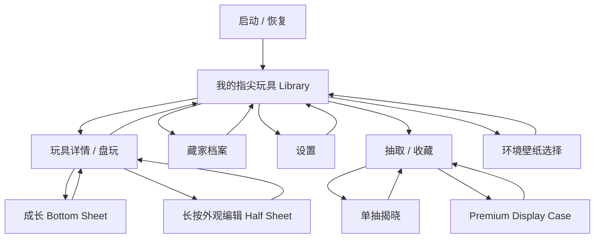
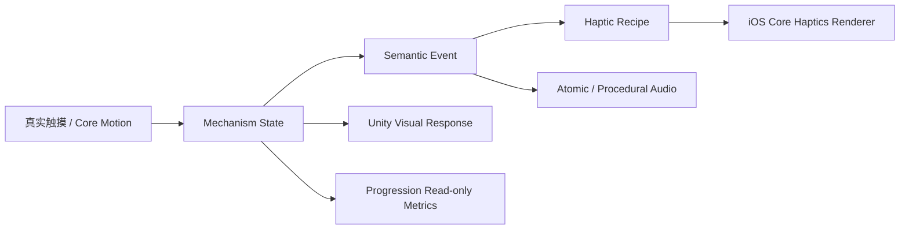
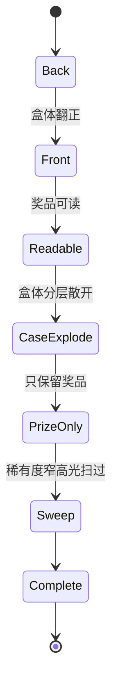

# Fidgeting App 产品设计圣经

> 本文是 `unity/FidgetingApp` 的产品、体验与视觉设计权威入口。它描述“应该做成什么”；实际代码、场景、测试、构建、安装与真机验收状态只由 [IMPLEMENTATION_STATUS.md](IMPLEMENTATION_STATUS.md) 证明。

## 0. 文档元数据与使用规则

| 字段 | 值 |
| --- | --- |
| 文档版本 | `1.0.1` |
| 状态 | 持续维护的 Canonical Design Authority |
| 最后对话同步 | 2026-08-17（Asia/Shanghai） |
| 对话覆盖范围 | 2026-08-01 至 2026-08-16；严格限定 `cwd=/Users/jiawei.zhou/Documents/Fidgeting app` |
| 覆盖规模 | 2026-08-16 冻结盘点为 280 个任务记录：27 个用户主任务、253 个关联子任务／审查／支持任务；27 个主任务含 671 条去除注入上下文后的用户消息事件（含本任务收到的后续明确设计决定） |
| shipping 产品 | `unity/FidgetingApp`；iOS 名称 `Fidget Spinner`；Bundle ID `com.jiaweizhou.fidgetspinner.codex` |
| 当前实现证据基线 | [IMPLEMENTATION_STATUS.md](IMPLEMENTATION_STATUS.md) 最后同步 2026-08-17；本文不会把其后的请求自动写成“已集成” |
| 语言 | 中文为主；保留类名、API、参数名、状态名和产品 ID |

### 0.1 权威关系

发生冲突时，按以下顺序裁决，低优先级来源不得覆盖高优先级来源：

1. 仓库根目录 [AGENTS.md](../../../AGENTS.md) 的产品、安全、物理与发布硬约束。
2. 用户较晚、明确且针对当前产品的决定或批准。
3. 用户针对具体 shipping Unity／shipping SwiftUI 预览的视觉批准。
4. 当前运行时代码、场景接线、自动化测试和 [IMPLEMENTATION_STATUS.md](IMPLEMENTATION_STATUS.md) 的集成证据。
5. Codex、子任务或外部参考提出的方案；没有用户接受证据时，只能标为 `Current Request` 或 `Pending Approval`。

构建成功、签名成功、安装成功、启动成功，以及“推手机”之类执行授权，均不自动等于视觉批准或真机手感接受。

### 0.2 双轴状态

| 轴 | 状态 | 精确定义 |
| --- | --- | --- |
| `DecisionState` | `Locked` | 用户已明确接受，或属于 AGENTS 硬约束；后续不得静默改变 |
|  | `Current Request` | 当前要实现的方向明确，但还没有对应最终视觉／手感接受 |
|  | `Pending Approval` | 已有候选，需要用户针对准确 shipping 预览批准 |
|  | `Superseded` | 曾经有效，但被较晚方案替代；只留在历史附录 |
|  | `Rejected` | 用户明确否决；不得重新混入当前规格 |
| `DeliveryState` | `Specified` | 只有本设计要求或专项规格 |
|  | `Partially Integrated` | 有部分 runtime、接线或测试，但未满足完整 Definition of Done |
|  | `Integrated & Tested` | runtime、场景／coordinator 接线、自动化测试均有证据 |
|  | `Installed` | 已进入签名 shipping App 并安装；仍不代表真机接受 |
|  | `Device Accepted` | 用户已在目标 iPhone 上明确接受该项视觉或手感 |

### 0.3 来源和要求 ID

- 可执行要求使用稳定 ID：`FDB-<DOMAIN>-NNN`。现有 ID 不因排序变化而重编号；修改语义时更新同一条，另起需求时新增 ID。
- 对话来源写为 `[T01]`—`[T27]`，完整索引见第 12 章；不记录临时 rollout 路径。
- 专项文档写为 `[S-*]`，批准图片写为 `[V01]`—`[V08]`。
- `Locked` 必须能回溯到用户明确原话、AGENTS 硬约束或已经冻结的产品契约；`Integrated & Tested` 必须回溯到状态文档中的代码、接线和测试证据。

## 1. 产品愿景与不可破坏原则

Fidgeting App 是一款可持续扩展的高级数字指尖玩具收藏与体感交互 App。它不是自动播放的陀螺动画集合，也不是把网页调参面板包进手机；核心价值是把实体高级 EDC 玩具的金属质感、预压、脱档、跨档、吸附、惯性和停稳，转换为可信、可反复把玩的视听触体验。[T03][T04][T07][T13][T22]

| ID | 当前要求 | DecisionState | DeliveryState | 来源 |
| --- | --- | --- | --- | --- |
| FDB-PRD-001 | 所有新玩具只加入唯一 shipping App，不新增 Unity 工程、Bundle ID 或并存手机 App。 | Locked | Installed | AGENTS；[T22]；[S-STATUS] Build 39 |
| FDB-PRD-002 | 体验优先模拟真实机械因果：用户先输入，机构才运动；机械状态先变化，反馈随后由语义事件产生。 | Locked | Integrated & Tested | AGENTS；[T04][T07]；[S-HAPTIC] |
| FDB-PRD-003 | 零输入时转子、推牌、扇牌和盲盒机构都必须静止；Reset 后角速度严格为零。 | Locked | Integrated & Tested | AGENTS；[T03][T22]；[S-HAPTIC] |
| FDB-PRD-004 | 视觉必须服务于“可触摸的真实物件”：结构、材质、灯光、相机、声音和 Haptic 共同描述同一个质量与表面。 | Locked | Partially Integrated | [T08][T11][T12][T20][T22] |
| FDB-PRD-005 | 产品不声称制造级 CAD 精度；尺寸有实物依据，预览与实现可验证，推断项必须标明。 | Locked | Specified | [T08][T17][T25] |
| FDB-PRD-006 | 所有成长、外观、抽取和收藏奖励不得修改机械物理、惯性、碰撞、Haptic 授权或真实输入收益边界。 | Locked | Integrated & Tested | [T13][T18][T22]；[S-BADGE] |
| FDB-PRD-007 | 设计变化必须先展示真实 shipping 实现预览；视觉批准后才能进入包含该视觉变化的手机安装。 | Locked | Integrated & Tested | AGENTS；[T22]；[S-STATUS] |

## 2. 设计偏好、产品定义与拒绝准则

本章是新方案进入设计、制作和发布流程前的决策框架。它不是“高级感、好看、顺滑”之类通用建议，而是从 27 个主任务中反复出现的用户修改、批准、否决与真机反馈提炼出的项目偏好。后续实现若与本章冲突，应先停止扩展并回到这里裁决。

### 2.1 核心产品定义

Fidgeting App 不是一般陀螺模拟器，也不是把 UI、小游戏、抽卡和模型预览拼在一起的功能 Demo。它是一个以“真实可感的数字玩具”为核心、以收藏和长期关系为外层的产品：

1. **模型是物件本体**：真实比例、机械轴心、层级、材质和 artwork 让用户相信它能被拿在手里。
2. **输入与物理建立因果**：只有真实触摸或设备动作授权运动；预压、脱档、跨档、吸附、惯性和停稳连续可解释。
3. **Haptic 与音效让机构可感**：它们读取同一机械状态和语义事件，不独立“演戏”，不以热闹掩盖错误物理。
4. **相机、灯光与环境让物件被看懂**：构图展示结构和表面，背景提供空间而不抢主角。
5. **成长记录真实关系**：等级、Combo、Badge、皮肤和离线回收记录持续把玩，但不购买物理优势，也不伪造活跃。
6. **收藏与展示延长价值**：抽取、Gallery 和 Premium Display Case 让已拥有内容有展示意义；它们服务玩具，不反客为主。

只增加功能却不加强上述闭环的方案，应默认视为范围扩张；只有用户明确要求后才能成为当前产品规格。

| ID | 锁定偏好／产品定义 | 后续实现的判定方式 | DecisionState | DeliveryState | 来源 | 置信度 |
| --- | --- | --- | --- | --- | --- | --- |
| FDB-PREF-001 | 主角永远是可触摸、可理解、可收藏的数字物件，而不是设置面板、任务列表、商城或动画特效。 | 首屏、详情和核心循环中，3D 玩具的可见性、可操作性和反馈因果必须高于辅助系统。 | Locked | Specified | [T01][T03][T08][T13][T22] | 高；多轮明确要求 |
| FDB-PREF-002 | “高级感”来自正确比例、结构、表面、灯光、声音和手感共同成立，不靠金色、发光、玻璃叠层或粒子数量。 | 去掉装饰特效后，模型仍应凭轮廓、材质、机械层级和响应读成高级 EDC。 | Locked | Specified | [T08][T11][T12][T18][T20][T22] | 高；多次否决廉价／粗糙表现 |
| FDB-PREF-003 | 收藏、成长和抽卡只能延长对玩具的关系，不能取代真实盘玩。 | 购买、AUTO、预览和程序设姿不增加手动机制优势，不伪造 Badge／有效日／真实输入 XP。 | Locked | Specified | [T13][T18][T22]；[S-BADGE] | 高；明确规则 |
| FDB-PREF-004 | 单 App、统一目录、统一体验框架比“每款独立 Demo”更重要。 | 新内容必须复用 catalog、导航、设置、成长、展示盒和发布身份。 | Locked | Specified | [T01][T09][T11][T22]；[S-STATUS] Build 39 | 高；明确决定与退役证据 |

### 2.2 视觉与模型偏好

| ID | 锁定偏好 | 可验证标准 | DecisionState | DeliveryState | 来源 | 置信度 |
| --- | --- | --- | --- | --- | --- | --- |
| FDB-PREF-005 | 优先使用项目已有的真实／已批准模型、`.blend` 源、FBX、正式贴图、shader 和 artwork；不得用简化替代品或临时 primitive 冒充 shipping 内容。 | shipping scene 中的 Renderer、材质和内容 ID 可回溯到正式资产；placeholder、纯色替图、运行时临时几何在发布清单中为 0。 | Locked | Specified | [T08][T09][T11][T17][T20][T22][T25][T26] | 高；反复明确 |
| FDB-PREF-006 | 原始细节要被理解后保留：轴承、指盖、牌角、轨道、磁体、背面、刻蚀与装配层级不能因“做得更干净”而被抹掉。 | top/hero/oblique/low/back 逐项对照正式源；结构件有正确 parent、pivot、厚度和遮挡关系。 | Locked | Specified | [T08][T11][T20][T22]；[S-FAN] | 高；有自动门禁 |
| FDB-PREF-007 | 材质应读成真实金属、树脂、亚克力、织物或牌面，而不是平涂塑料。 | 金属有受控宽高光、粗糙度和微表面；暗部仍见层次；无纯白剪切、无随机高光点、无纯色替代贴图。 | Locked | Specified | [T11][T12][T20][T22]；[V01][V02][V03] | 高；批准与否决均有证据 |
| FDB-PREF-008 | 产品比例与机械轴心高于“每张卡看起来一样大”。 | 物理尺寸或权威 bounds 决定 framing；真实轴心投影稳定，模型不拉伸、不被统一 scale 伪放大。 | Locked | Specified | [T08][T11][T20][T22]；[S-STATUS] 轴心／双叶比例审计 | 高；明确修复请求 |
| FDB-PREF-009 | 相机要展示产品，而不是制造戏剧性畸变。 | Hero 能读到主结构；top/left/right/low 不裁切；长物件无横向透视压缩；跨产品切换不发生无依据的尺度跳变。 | Locked | Specified | [T06][T11][T12][T20][T22]；[V01][V03] | 高；多轮构图反馈 |
| FDB-PREF-010 | 灯光与背景必须帮助读取轮廓、材质和深度，不能抢主角。 | 主体亮部不剪白、暗部不糊死；背景低细节低饱和；平台、投影、IBL 与环境方向一致。 | Locked | Specified | [T12][T20][T22]；[V02][V04] | 高；批准方向 |
| FDB-PREF-011 | 收藏盒本身也要像真实高级产品包装，不能像粗糙原型、游戏宝箱或每款各做一套临时资产。 | 六款共享同一正式 prefab、相机、材质结构和 contentSlot；磁吸推牌真机接受基线像素级不回归。 | Locked | Specified | [T22]；[V07]；[S-STATUS] Build 36/37 | 高；有真机接受 |

### 2.3 交互、物理、Haptic 与声音偏好

| ID | 锁定偏好 | 可验证标准 | DecisionState | DeliveryState | 来源 | 置信度 |
| --- | --- | --- | --- | --- | --- | --- |
| FDB-PREF-012 | 真实输入授权优先于“看起来一直有动感”。 | 零输入／Reset／Library／AUTO／程序设姿不会给真实机构注入速度、Detent、声音或 Haptic。 | Locked | Specified | AGENTS；[T03][T04][T07][T22] | 高；硬约束 |
| FDB-PREF-013 | 响应要快，但不能靠扩大无边界热区、过度吸附或任意手势收尾制造“灵敏”。 | 输入延迟、命中率、误触率、breakaway、capture 与 cancel 分开测试；Orbit 和双指手势仍可达。 | Locked | Specified | [T03][T04][T06][T19][T20][T22] | 高；多轮手感修改 |
| FDB-PREF-014 | 每一枚 Haptic 和 click 都应能指出对应机械事件；少而准优于密而假。 | 事件日志能从 Detent/Breakaway/Capture/Collision 回溯到同帧反馈；停指静默，高速不堆 player。 | Locked | Specified | AGENTS；[T04][T07][T22][T24]；[S-HAPTIC] | 高；硬约束与专项规格 |
| FDB-PREF-015 | 拒绝“热闹但假”的反馈：持续震动、无事件粒子、重复 click、独立嗡声、自动收尾、过强镜头晃动和抢占输入。 | 无语义事件时反馈计数为 0；声音与 Haptic 不写物理；Reduce Motion 可得到稳定终态。 | Locked | Specified | [T04][T07][T13][T16][T20][T22][T24] | 高；多次否决与测试 |
| FDB-PREF-025 | 尽量利用设备陀螺仪、用户加速度、手指拨动速率与可用力度等真实输入，把数字玩具还原为可信物理世界，而不是只播放预设动画。 | 每种输入必须能追溯为一个经校准、归一化、限幅的机械量或状态，再由状态变化产生语义事件和反馈；设计评审必须展示这条因果链。 | Locked | Specified | [T27] 用户后续明确决定；[T04][T22]；[S-HAPTIC] | 高；用户明确锁定 |
| FDB-PREF-026 | 真实感需要可调校但有边界的产品参数；配置应表达机械手感，不把传感器原始数值或底层 Haptic 参数直接暴露给用户。 | 每项设置有单位／归一化语义、推荐默认值、有效范围、clamp、持久化和验收点；同一值不在 runtime、scene 与 native 重复漂移。 | Locked | Specified | [T27] 用户后续明确决定；[T04][T23]；AGENTS | 高；用户明确锁定 |
| FDB-PREF-027 | 禁止用原始传感器值直触发反馈，也禁止用无输入自转、随机震动、随机音效或无机械事件特效伪造真实感。 | 零输入和无语义事件测试中，真实机构速度及 Haptic／音频／视觉事件计数均为 0；原始输入层不得引用 renderer。 | Locked | Specified | [T27] 用户后续明确决定；AGENTS；[T03][T04][T07] | 高；用户明确锁定 |

### 2.4 UI、动效与信息层级偏好

| ID | 锁定偏好 | 可验证标准 | DecisionState | DeliveryState | 来源 | 置信度 |
| --- | --- | --- | --- | --- | --- | --- |
| FDB-PREF-016 | UI 应退后一步，让产品成为视觉中心；沉浸感必须有意图且可操作。 | 去掉非必要容器后，主操作、当前产品、状态与返回路径仍清楚；UI 不遮模型关键结构。 | Locked | Specified | [T06][T12][T15][T16][T22] | 高；多轮 UI 修改 |
| FDB-PREF-017 | Dark Mode + 克制 Liquid Glass + Oxanium 是既有语言；Glass 表达层级，不是每个卡片的装饰滤镜。 | 只有容器根有真实玻璃；子卡静态、对比达标；旧系统和 Reduce Transparency 有明确回退。 | Locked | Specified | [T15][T16][T18][T22]；[S-UI] | 高；shipping 方向 |
| FDB-PREF-018 | 信息层级由字号、位置、留白和真实状态建立，拒绝无关装饰、堆叠 icon、描边、发光、胶囊和模板化组件。 | 每个视觉元素能说明导航、状态、机械或奖励之一；无法说明者删除。文本 CTA 不混入装饰 icon。 | Locked | Specified | [T13][T15][T16][T18][T22] | 高；反复明确 |
| FDB-PREF-019 | 媒体必须等比、构图有目的、无无意义留白；不能为“塞进卡片”拉伸图片。 | 原始宽高比校验通过；cover/fit 选择有语义；焦点在裁切安全区，容器不留空 gutter。 | Locked | Specified | [T15][T16][T22]；[S-UI]；[S-STATUS] Build 39 | 高；明确修复 |
| FDB-PREF-020 | 动效追随手势与状态，强调一次明确变化；拒绝无法中断的模板动画和持续抢眼循环。 | Commit/Cancel/Reduce Motion 可测；动画结束状态与业务状态一致；遥测不触发整页重建。 | Locked | Specified | [T06][T12][T13][T16][T21][T22] | 高；多轮性能／动效证据 |

### 2.5 收藏、成长、抽卡与展示边界

| ID | 锁定偏好／边界 | 可验证标准 | DecisionState | DeliveryState | 来源 | 置信度 |
| --- | --- | --- | --- | --- | --- | --- |
| FDB-PREF-021 | 成长应奖励真实盘玩和长期熟悉，不把 App 变成任务清单。 | 核心详情随时可直接盘玩；任务、Badge 和离线结算不抢占输入，不强制领取，不伪造活跃。 | Locked | Specified | [T13][T18][T22] | 高；明确规则 |
| FDB-PREF-022 | 抽卡和商店是收藏入口，不是核心机械付费墙。 | 奖池不含物理／XP 增益；券、价格、保底与交易由权威数据驱动；无假按钮和假价格。 | Locked | Specified | [T22]；[S-GACHA]；[S-STATUS] Build 39 | 高；明确决定 |
| FDB-PREF-023 | 揭晓与展示必须继续尊重真实模型；不能为稀有度牺牲产品可读性。 | 奖品在可读阶段无遮挡，光色面积受限；盒体散开后保留真实奖品；相机不因 rarity 改变产品比例。 | Locked | Integrated & Tested | [T22][T27]；[S-GACHA]；[V07][V08] | 高；Build 42 shipping 视觉批准轮已锁定 |
| FDB-PREF-024 | 经济系统深度是否继续扩大，取决于它是否加强收藏关系而不干扰核心盘玩。 | 对蓝图、合金屑、定制和付费 SKU 的新增需独立产品决策与端到端验收。 | Current Request | Specified | [T22]；[S-GACHA] | 中；推断，不是已批准扩张 |

### 2.6 接受／拒绝／需要批准决策表

| 方案领域 | 可以直接进入设计／实现的特征 | 明确拒绝的反模式 | 必须先获用户批准或真机验证的灰区 |
| --- | --- | --- | --- |
| 新模型／模型修复 | 复用正式源资产、保留真实尺寸与机械层级、通过多视角门禁 | primitive 替身、纯色代贴图、错误轴心、额外悬浮环、用截图反推锁定尺寸 | 任何可见几何、比例、pivot、artwork、材质变化先出 shipping 多视角；手感再上 iPhone |
| 材质与灯光 | 表面类别明确、宽柔高光、暗部有层次、环境一致 | 纯白剪切、塑料平涂、随机亮点、为了“高级”全局染金／霓虹 | 新 shader、曝光、反射、灯位、环境主题先做当前 shipping scene 预览 |
| 相机与构图 | 按真实 bounds／尺寸 framing，Hero 能读结构，多角度不裁切 | 所有模型等大、长物件透视压扁、用戏剧畸变掩盖比例错误 | 详情、Library、展示盒的 FOV／角度／fit 改动先视觉批准；真机检查安全区与手持视差 |
| 输入与物理 | 真实输入先校准、归一化并映射为 torque／target／breakaway／orbit 等可解释机械量；帧率无关、可取消 | 自转、原始传感器直驱、随机力、自动开关动画、无界热区、任意拖动直接全开、UI 动画写物理 | 输入曲线、dead zone、clamp、阈值／阻尼／速度／热区变化需要测试；最终手感必须真机接受 |
| Haptic 与声音 | 同一机械状态产生同一语义事件并同帧协调 Haptic／音效／视觉；停指静默，高速有受控退化 | raw input 直震、随机震动／音效、持续 loop、重复 click、Haptic/音频各自猜档位 | Recipe 强度、锐度、音高、声部、高速阈值和传感器映射必须 iPhone 实听实摸 |
| UI 与动效 | 产品优先、Dark/Liquid Glass、原生控件、清晰层级、可中断 | 图标堆叠、装饰描边、模板胶囊、重复玻璃、图片拉伸、无意义 gutter | 原生 UI、布局、字体、图片裁切、转场、Reduce Motion 变化先 shipping SwiftUI 预览 |
| 成长／Badge | 只读真实盘玩、幂等奖励、辅助层级、可关闭 | AUTO 刷成就、购买物理增益、假完成率、强制领取、任务遮挡盘玩 | 新节奏、奖励动画、Badge 视觉先预览；跨级、迁移、性能需真机长用 |
| 抽卡／经济 | Unity 权威、券 only、真实价格、可恢复收据、奖品只为收藏 | 假 catalog、假价格、页面打开即 StoreKit、重复发奖、付费机械优势 | 新货币／蓝图关系需用户产品决定；真实交易与后台恢复必须 sandbox＋真机 |
| Premium Display Case | 单一正式盒、推牌基准、contentSlot、8% 留白、真实奖品 | 每款临时盒、假 2D 奖品、游戏宝箱、彩色 UI 投射、粗糙内胆 | 盒体、相机、fit、蚀刻、灯光改动先逐款 shipping 预览；六款分别真机接受 |
| 性能与发布 | 60 FPS 目标、离屏停更、正式脚本单 App 覆盖、证据归档 | 用 30 FPS 掩盖回归、并发污染 Unity、编译成功冒充验收 | 视觉先批准；触感、热、内存、长时滚动必须目标 iPhone 验证 |

### 2.7 使用规则与置信度

- 标为“锁定”的偏好有用户明确表达、重复否决、AGENTS 硬约束或具体 shipping／真机批准支撑。
- 标为“推断”的内容只能帮助评估，不得据此扩展范围；本版唯一明确推断项是上表末项。
- 如果新请求与锁定偏好冲突，以用户较晚且明确的新决定为准，同时把旧项改为 `Superseded` 或 `Rejected`，保留来源。
- 如果候选同时符合“可接受特征”和“灰区”，仍执行灰区门禁；自动化、编译、安装不能跳过预览或真机接受。

## 3. 信息架构与核心旅程

### 3.1 页面与返回关系

| ID | 当前要求 | DecisionState | DeliveryState | 来源 |
| --- | --- | --- | --- | --- |
| FDB-IA-001 | Library 是六款玩具的统一入口；详情页负责盘玩与 Reset，不建立每款独立 App。 | Locked | Installed | [T01][T22]；[S-STATUS] Build 39 |
| FDB-IA-002 | Library 顶部品牌写作小写 `fidgeting`；标题直接显示当前模型，副标题只保留皮肤／材质与简化等级。 | Locked | Installed | [T06][T15][T22] |
| FDB-IA-003 | Library、藏家档案和设置等覆盖面板使用可点、可下拖关闭的顶部 notch；详情、档案与设置均有明确返回路径。 | Locked | Installed | [T15][T16][T22] |
| FDB-IA-004 | Reset 属于当前玩具详情操作，不占独立主导航目的地。 | Locked | Installed | [T03][T22] |
| FDB-IA-005 | 点击底部成长卡进入“成就／Badge／外观”；藏家档案集中承载 Rank、7 日节奏、跨玩具成就与收藏。 | Locked | Installed | [T13][T18][T22] |
| FDB-IA-006 | 详情页长按命中模型进入统一外观编辑 Half Sheet，而不是跳入独立编辑页面。 | Locked | Installed | [T19][T22] |
| FDB-IA-007 | 抽取页使用两个顶层 Tab：“抽取／兑换”和“收藏”；规则为二级入口，单抽操作固定底部。 | Locked | Installed | [T22]；[S-GACHA]；[S-STATUS] Build 39 |
| FDB-IA-008 | 环境选择为有限壁纸轮播：当前页居中缩小、前后页露边、单一主 CTA；不得演变为无边界素材浏览器。 | Locked | Installed | [T12][T22]；[V05] |
| FDB-IA-009 | 首次从 Library 进入详情只展示一次 Quick Start；完成或跳过后不重复打断。 | Locked | Integrated & Tested | [T13][T22] |

### 3.2 Library 横向切换

- 手指左滑：当前产品同向向左退出，下一产品从右进入；右滑完全镜像。
- Unity 的 shipping 模型与原生分页必须共享同一 swipe session，不在异步加载完成后瞬切，也不依赖固定猜测窗口。
- 每张 Library 卡使用实时 3D 模型约 45° 产品角；Page Control 表达目录位置，不恢复底部五张旧缩略图栏。
- 跨产品尺度由真实 Renderer bounds、物理尺寸和 framing profile 共同决定；“同样 scale”与“同样屏占比”都不是目标。

## 4. 统一体验设计系统

### 4.1 视觉语言

| ID | 当前要求 | DecisionState | DeliveryState | 来源 |
| --- | --- | --- | --- | --- |
| FDB-UI-001 | 全局以纯黑／中性深灰为底，使用低对比、克制、产品级暗色界面；不得任意加入高饱和“AI 色”。 | Locked | Installed | [T12][T15][T16][T18][T22] |
| FDB-UI-002 | 原生层使用 SwiftUI Liquid Glass；旧系统回退系统材质。真实玻璃只放在需要层级分离的容器根部，子卡不重复叠毛玻璃。 | Locked | Installed | [T15][T16][T22]；[S-UI] |
| FDB-UI-003 | 产品级文本按钮只显示文字，不加入装饰 icon；系统导航、状态或机械模式可以使用语义明确的原生图标。 | Locked | Installed | [T15][T22]；[S-GACHA] |
| FDB-UI-004 | 默认不加描边、发光边框和多余容器；用层级、留白、材质与透明度建立关系。 | Locked | Installed | [T15][T16][T18] |
| FDB-UI-005 | 全局拉丁字体使用 Oxanium；不自定义 tracking／kerning；中文回退系统字体，数字优先等宽。 | Locked | Installed | [T15][T18][T22] |
| FDB-UI-006 | 数值 headline 必须强于标签；Speed、Intensity、Frequency 名称固定在半圆下方，不能被模型背景吞掉。 | Locked | Installed | [T13][T22] |
| FDB-UI-007 | 蓝／绿／紫／金只表达 Standard／Refined／Signature／Heirloom 稀有度或明确状态，不作为全页装饰色。 | Locked | Installed | [T18][T22]；[S-GACHA] |
| FDB-UI-008 | 图标和容器四周保留可感知呼吸空间；所有触摸目标遵守 iPhone 可达性与 safe area。 | Locked | Installed | [T15][T16]；[S-UI] |
| FDB-UI-009 | 所有图片保持原始宽高比：封面用等比 `scaledToFill/cover + clipped`，完整图用 `fit`；绝不拉伸、不留无意义白边。 | Locked | Installed | [T15][T22]；[S-UI]；[S-STATUS] Build 39 |
| FDB-UI-010 | Bottom Sheet 激活时必须遮挡底层操作并有 notch；关闭后才恢复底层点击与可访问性。 | Locked | Integrated & Tested | [T16][T22]；[S-STATUS] |
| FDB-UI-011 | Dropdown、Menu、Segmented Control、Slider 等优先使用原生 SwiftUI 组件，不搭建临时调参侧栏或网页式面板。 | Locked | Installed | [T04][T15][T16] |
| FDB-UI-012 | Reduce Motion 关闭高频轨道、视差、强位移动效，保留短淡化与可理解终态；Reduce Transparency 保持层级和可读性。 | Locked | Partially Integrated | [T12][T13][T15][T22]；[S-UI] |

### 4.2 仪表、Combo 与成长反馈

| ID | 当前要求 | DecisionState | DeliveryState | 来源 |
| --- | --- | --- | --- | --- |
| FDB-UI-013 | 底部三联仪表不重叠：中央 Speed/RPM 为唯一 Hero，左右 Intensity/Frequency 为弱一级翼表。 | Locked | Installed | [T13][T22] |
| FDB-UI-014 | 主表使用 180° 半圆、真实 RPM、20 Hz 大号等宽数字、活动弧与无超调响应；磁吸推牌不得伪装 RPM。 | Locked | Installed | [T13][T22] |
| FDB-UI-015 | Peak 只使用语义色和局部扫掠／光晕；独立火苗和覆盖翼表的高频火焰已移除。 | Locked | Installed | [T13][T22] |
| FDB-UI-016 | Combo 以数字为主、无边框无胶囊；普通增长紧凑，10/20/30/50 里程碑使用模型平面上的分层环、雾与咬合轨道。 | Locked | Installed | [T13][T22]；[V06] |
| FDB-UI-017 | 进度轨道与里程碑线宽一致，等级端点清楚，完成／当前／未完成依靠填充和透明度区分；动画克制。 | Locked | Installed | [T13][T18][T22] |
| FDB-UI-018 | 离线结算无“领取”CTA；自动关闭后恢复原页面，再把 XP 粒子飞向页面左上真实成长头像。 | Current Request | Integrated & Tested | [T13][T22]；[S-STATUS]“页面级 XP 回收”待批准 |

### 4.3 动效节奏

- 常规切换追随手指；Commit 后才完成余下位移，Cancel 回到原位。
- 详情进入用同一时间轴推进相机、远中近景和承托：当前批准节奏为约 `0.68 s`，从峡谷／都市入口进入内部空间。[V04]
- 长按外观编辑的相机轻弹总长 `0.22 s`：`0.075 s → 1.035×`、`0.150 s → 0.992×`、`0.220 s → 1.000×`；它只改 framing，不改模型 Transform 或物理。
- 反向输入停转目标为 `300 ms / ease-out`；实验翻转 `360° / 400 ms / ease-out / 10% overshoot` 默认关闭。
- 动效必须可中断、可重入，不得积压旧 generation；20 Hz 遥测更新不能重建大面积视觉树。

## 5. 输入、物理、音频与 Haptic 系统

### 5.1 唯一反馈数据流

`Tick`、`Detent`、`Snap`、`Pop`、`Burst`、`Breakaway`、`Capture` 是产品语义，不是 Apple Core Haptics event type。任何新代码不得从 raw touch、raw acceleration 或 UI 直接调用 `IosHaptics`。

真实输入映射必须在机制层可解释，不能把“传感器数值变化”本身当作产品事件：

| 真实输入 | 物理映射／调校边界 | 可产生的机制状态或语义 | 禁止做法 |
| --- | --- | --- | --- |
| 手指拨动位移、速率、方向 | 屏幕／世界坐标转换、dead zone、单帧限幅、响应曲线、torque 或目标位置、frame-rate independent damping | Rotor 角速度、Slider/Fan 手指目标、Breakaway、DetentCrossed、Capture、Release | 触摸一发生就震；按手指停留时长持续震；忽略方向与实际行程播放固定动画 |
| 可用 pressure／力度估计 | 设备能力检查、归一化 `0…1`、噪声滤波、clamp；无 pressure 时使用可解释的速率／行程 fallback | 输入力度、势垒负载、Combo Intensity、快速收尾授权 | 把 raw pressure 当 Haptic intensity；无能力设备随机补力度 |
| 陀螺仪 attitude／rotation rate | 进入页校准零点、unwrap／积分、灵敏度 preset、soft clamp、离屏停止、触摸互斥 | Camera Orbit、Device Twist、环境视差、重新校准 | wrapped Euler 相减；任意姿态变化直接发 Haptic；陀螺仪移动手指下机械轴 |
| `userAcceleration` | 去重力、进入／退出迟滞、方向／幅值阈值、cooldown、最大事件率 | Shake、惯性重量、RattleImpulse | raw accelerometer 直接震动；持续加速度无限连发；用随机震动补“重量” |

调校参数必须位于 App 产品语义层：例如“拖动响应”“陀螺仪灵敏度”“棘轮咬合”“Intensity/Sharpness preset”，而不是展示未解释的 sensor scale、Core Haptics primitive 或彼此覆盖的底层常量。默认值、serialized scene/prefab、native fallback 与测试验收点遵守同一 source of truth。

### 5.2 通用输入与机械要求

| ID | 当前要求 | DecisionState | DeliveryState | 来源 |
| --- | --- | --- | --- | --- |
| FDB-INT-001 | 自由轮只从明确触摸／设备输入获得角速度，随后按帧率无关 half-life 阻尼衰减。 | Locked | Integrated & Tested | AGENTS；[T03][T22]；[S-HAPTIC] |
| FDB-INT-002 | Reset 后角速度为零；历史 motor、idle loop、fallback 或展示动画不得给真实 Rigidbody 注入自转。 | Locked | Integrated & Tested | AGENTS；[T03][T22] |
| FDB-INT-003 | 通用触控兜底热区半径为屏幕短边 `36%`，可见模型约 `32%`；两侧保留约 `14%` Orbit 空白区。 | Locked | Integrated & Tested | [T03][T22]；[S-PLAN] |
| FDB-INT-004 | 模型碰撞体优先于屏幕兜底；中心死区和单帧角度限幅保留，旋转热区不得吞掉空白 Orbit。 | Locked | Integrated & Tested | [T03][T06] |
| FDB-INT-005 | Rigidbody 轴向约束是旋转权威；实验翻转期间才能临时切换为运动学动画。 | Locked | Integrated & Tested | [T03]；[S-HAPTIC] |
| FDB-INT-006 | 磁吸机构在 breakaway 以下保持当前井；跨过阈值才移动，低速时吸附最近档并以零速度结束。 | Locked | Integrated & Tested | AGENTS；[T04][T22]；[S-HAPTIC] |
| FDB-INT-007 | 物理档位数与 Haptic 档位数必须读取同一个 mechanism config，不得维护两份默认值。 | Locked | Integrated & Tested | AGENTS；[T04] |
| FDB-INT-008 | Shake 只读 `userAcceleration`，使用进入／退出迟滞和 cooldown；重力分量不得触发。 | Locked | Partially Integrated | AGENTS；[T04][T22] |
| FDB-INT-009 | Device Twist 使用展开后的 attitude 或积分 rotation rate；禁止 wrapped Euler 直接相减。 | Locked | Partially Integrated | AGENTS；[T04] |
| FDB-INT-010 | Core Motion 在进入页面建立当前姿态零点，离屏停止更新；触摸机构期间冻结视差，结束后重建参考。 | Locked | Partially Integrated | [T04][T12][T22] |
| FDB-INT-011 | 陀螺灵敏度只提供低／中／高三档，共享控制 Input Angle、Response、Lead 和 Orbit，并跨启动保存。 | Locked | Installed | [T04][T23]；[S-STATUS] |
| FDB-INT-012 | 长按模型阈值 `0.55 s`、移动不超过 `12 pt`；拖动、双指、空白长按和 Library 预览不得误触。 | Locked | Installed | [T19][T22] |
| FDB-INT-013 | 所有真实输入先经过能力检查、校准、坐标变换、滤波／迟滞、归一化与限幅，再映射为 torque、target、load、orbit 或 breakaway authorization。 | Locked | Partially Integrated | [T27] 用户后续明确决定；[T04][T22]；[S-HAPTIC] |
| FDB-INT-014 | 手指拨动速率、方向、累计行程和可用力度必须共同服务可解释机械状态；缺少 pressure 的设备只能使用确定性 fallback，不得随机补值。 | Locked | Partially Integrated | [T27] 用户后续明确决定；[T03][T20][T22][T24] |

### 5.3 Haptic Recipe 与设置

| ID | 当前要求 | DecisionState | DeliveryState | 来源 |
| --- | --- | --- | --- | --- |
| FDB-HAP-001 | Haptic 必须沿“输入 → 机械状态 → 语义事件 → Recipe → iOS Renderer”链路输出。 | Locked | Integrated & Tested | AGENTS；[T04][T22]；[S-HAPTIC] |
| FDB-HAP-002 | 日常设置只暴露有产品意义的力度、锐度、节奏、衰减、速度跟随、棘轮咬合和惯性，不暴露 Core Haptics 底层事件参数。 | Locked | Installed | [T04][T23]；[S-HAPTIC] |
| FDB-HAP-003 | `DETENT LAB` 独占四个预设：Vault、Camera Dial、Watch Bezel、Silk Ratchet；Camera Dial 默认 `12 / 1.0 / 0.72`。 | Locked | Installed | [T04][T23]；[S-PLAN] |
| FDB-HAP-004 | 预设、Intensity、Sharpness 与其他设置实时生效、节流试听并自动保存；保存并返回当前玩具路径明确。 | Locked | Installed | [T23]；[S-STATUS] |
| FDB-HAP-005 | 低速 Detent 使用离散 transient；跨档率超过 `30/s` 时才切到单个 continuous 高速纹理，避免 player 堆叠。 | Locked | Integrated & Tested | [T04][T22]；[S-HAPTIC] |
| FDB-HAP-006 | `userAcceleration ≥ 0.3g` 可触发独立低锐度惯性重量触点，最大 `8/s`，不得抢占 Detent。 | Locked | Partially Integrated | [T04]；[S-PLAN] |
| FDB-HAP-007 | Programmatic pose、Library、AUTO、Reset、预览和恢复状态全部静默，不伪造用户授权反馈。 | Locked | Integrated & Tested | [T04][T22]；[S-HAPTIC] |
| FDB-HAP-008 | Badge 解锁只产生 `BadgeUnlocked` 语义事件；展示层不得直接发 Haptic。 | Locked | Integrated & Tested | [T18][T22]；[S-BADGE] |
| FDB-HAP-009 | 原始 touch、attitude、rotation rate、pressure 或 acceleration 不得直接触发 Haptic／音效／视觉；三类反馈只消费同一机械状态产生的语义事件。 | Locked | Partially Integrated | [T27] 用户后续明确决定；AGENTS；[T04][T07][T22] |
| FDB-HAP-010 | App 允许在产品语义层配置真实感：preset、响应曲线、dead zone、threshold、clamp、Intensity／Sharpness 与速度跟随均有有效边界和持久化；底层 primitive 不直接暴露。 | Locked | Partially Integrated | [T27] 用户后续明确决定；[T04][T23]；[S-HAPTIC] |

### 5.4 音频系统

| ID | 当前要求 | DecisionState | DeliveryState | 来源 |
| --- | --- | --- | --- | --- |
| FDB-AUD-001 | 音频只消费真实机械速度与语义事件，不写 Rigidbody、不授权 Haptic。 | Locked | Integrated & Tested | [T07][T22] |
| FDB-AUD-002 | 棘轮每跨一个真实档位，同帧播放一次 `48–52 ms` 原子 click；5 个微 EQ／微音高变体，旋转玩具 12 声部。 | Locked | Integrated & Tested | [T07][T22]；[S-PLAN] |
| FDB-AUD-003 | click 不使用 timeline、sequence 或 scheduler；高速只改变真实事件密度与单击重量，不继承 Haptic `30/s` 模式切换。 | Locked | Integrated & Tested | [T07]；[S-PLAN] |
| FDB-AUD-004 | 自由轮使用低噪程序化切风／合金声，节奏严格为 `RPM × 叶片数 ÷ 60`，音高跟随真实 `20…400 RPM`。 | Locked | Integrated & Tested | [T07][T22]；[S-PLAN] |
| FDB-AUD-005 | shipping 音色为“明亮合金 100%／整体 +9 半音”；三层范围 `1125…1810 / 2588…4161 / 4669…7508 Hz`。 | Locked | Installed | [T07][T22]；[S-PLAN] |
| FDB-AUD-006 | 主段最长 `65 ms` 或在下一 blade-pass 前归零；静止严格静音，不允许连续 oscillator 形成嗡声。 | Locked | Integrated & Tested | [T07]；[S-PLAN] |
| FDB-AUD-007 | 默认总音量 `0.50`，mixer callback 即时生成，参数响应约 `4 ms`，DSP buffer `256 samples`。 | Locked | Installed | [T07]；[S-PLAN] |

## 6. 六款玩具逐款规格

### 6.1 共同模板与验收

每款玩具都必须同时交付：产品角色；真实或锁定尺寸；机械轴心与层级；正／背面 artwork；Library 与详情相机；材质／灯光；手势、物理、声音和 Haptic；成长、Badge、展示盒和抽取表现；状态与来源。任何外观变化的 shipping 预览至少覆盖 top、authored hero、left/right oblique、low-angle；贴纸变化还要覆盖 pictogram、text 和 thin-line。

| 产品 ID | 显示名 | shipping Scene | Mechanism |
| --- | --- | --- | --- |
| `blue-classic` | 经典蓝色 | `Assets/Scenes/FidgetSpinnerDemo.unity` | Rotor |
| `metal-three-blade` | 三叶金属 | `Assets/_Fidgeting/Scenes/ThreeBladeEDC.unity` | Rotor |
| `gold-four-wing` | 镜钢四翼 | `Assets/_ImportedSpinner/Scenes/ImportedSpinner.unity` | Rotor |
| `graphite-two-lobe` | 石墨双叶 | `Assets/_TwoLobeBar/Scenes/TwoLobeBar.unity` | Rotor |
| `magnetic-slide-tile` | 磁吸推牌 | `Assets/_EDC/Scenes/MeshyEDC.unity` | Linear Slider |
| `magnetic-fan-card` | 磁吸扇牌 | `Assets/_FanCard/Scenes/MagneticFanCard.unity` | Fan |

### 6.2 经典蓝色 `blue-classic`

| ID | 当前要求 | DecisionState | DeliveryState | 来源 |
| --- | --- | --- | --- | --- |
| FDB-BLU-001 | 作为最易理解的入门 Rotor：视觉直读三叶、中心指盖和旋转质量，不使用隐藏 motor。 | Locked | Installed | [T01][T03][T22] |
| FDB-BLU-002 | 保留蓝色金属身份与真实轴承／指盖层级；额外装饰轴圈不得与真实机械件竞争。 | Current Request | Integrated & Tested | [T08][T20][T22]；[S-STATUS] 轴圈候选待批准 |
| FDB-BLU-003 | Library 与详情按圆形 Rotor framing；旋转触控、Orbit、自由轮／棘轮模式与四款 Rotor 一致。 | Locked | Installed | [T06][T22] |
| FDB-BLU-004 | 成长、Badge、贴纸和展示盒读取 `blue-classic` 自己的数据，不借用三叶金属状态。 | Locked | Installed | [T13][T18][T22] |

### 6.3 三叶金属 `metal-three-blade`

| ID | 当前要求 | DecisionState | DeliveryState | 来源 |
| --- | --- | --- | --- | --- |
| FDB-TRI-001 | 产品角色是精密、明亮、可长期升级的主力金属 Rotor；Blender 源保留，Unity 负责装配与运行时。 | Locked | Installed | [T08][T09][T11][T17][T22] |
| FDB-TRI-002 | 三叶过渡圆润、无锯齿；动态转子、轴承外圈、固定指盖同轴，机械原点不随不对称 bounds 漂移。 | Locked | Integrated & Tested | [T08][T11][T20][T22] |
| FDB-TRI-003 | 顶盖可见中心是相机与贴纸共同焦点；旋转时 framing 不呼吸、不把非对称 AABB 当焦点。 | Current Request | Integrated & Tested | [T11][T18][T22]；[S-STATUS] |
| FDB-TRI-004 | 十档皮肤依次为原生雾银、枪灰拉丝、夜航刻度、钨金蜂巢、冰银回纹、蓝钢水波、赤铜回路、钛虹热变、星陨黑曜、镜铬极光。 | Locked | Installed | [T13][T18][T22] |
| FDB-TRI-005 | 皮肤只改变正式可见金属表面与纹理；不得添加悬空等级环、外露轴承球、刻度块或配重块，不改物理。 | Locked | Integrated & Tested | [T13][T18] |
| FDB-TRI-006 | 贴纸是顶盖表面共形激光刻痕，来源与缩略图共享稳定 ID；当前 V21 居中修复仍待批准，旧 V20 不再是当前证据。 | Pending Approval | Integrated & Tested | [T18][T22]；[S-STATUS] |

### 6.4 镜钢四翼 `gold-four-wing`

| ID | 当前要求 | DecisionState | DeliveryState | 来源 |
| --- | --- | --- | --- | --- |
| FDB-GLD-001 | 产品角色是镜面、雕塑感强的四翼高阶 Rotor；高光受控，不出现纯白剪切或廉价塑料感。 | Locked | Installed | [T08][T11][T20][T22] |
| FDB-GLD-002 | 可见主体、轴承外圈、固定指盖与真实旋转轴同心；不得用非对称外包围盒重新定位机械原点。 | Current Request | Integrated & Tested | [T20][T22]；[S-STATUS] 轴心修复待批准 |
| FDB-GLD-003 | 模型参考直径 `85 mm`；Library／详情按真实产品尺度取景，不用额外固定世界距离。 | Current Request | Integrated & Tested | [T20][T22] |
| FDB-GLD-004 | 真实指盖和轴承可以保留；额外 crown trim、bezel、shadow gap 或悬浮同心钢圈全部禁止。 | Current Request | Integrated & Tested | [T20][T22]；[S-STATUS] 轴圈候选待批准 |
| FDB-GLD-005 | Dragon Scale 只能作为该 catalog 槽位的受控主体替换；不得新建第七个 shipping App 或破坏原 ID 数据。 | Locked | Installed | [T20][T22]；[S-STATUS] Build 37 |

### 6.5 石墨双叶 `graphite-two-lobe`

| ID | 当前要求 | DecisionState | DeliveryState | 来源 |
| --- | --- | --- | --- | --- |
| FDB-GRA-001 | 产品角色是紧凑、克制、重量集中的双叶 EDC；表面为细腻石墨／珠砂金属。 | Locked | Installed | [T08][T11][T20] |
| FDB-GRA-002 | 实体基线约 `50 × 24 × 18.68 mm`，圆形指盖约 `Ø24 mm`；不得为了占满画面伪放大到 85 mm Rotor 体量。 | Current Request | Integrated & Tested | [T20][T22]；[S-STATUS] |
| FDB-GRA-003 | 详情与 Library 使用唯一 `50/85` 真实尺寸比派生 framing；模型根 world scale 保持 `1`。 | Current Request | Integrated & Tested | [T20][T22] |
| FDB-GRA-004 | 双叶轮廓、中心轴承与固定指盖同轴；不得添加可见额外轴圈、碰撞或装饰质量。 | Current Request | Integrated & Tested | [T20][T22] |
| FDB-GRA-005 | 音频 blade-pass 按真实两叶计算；成长、Badge 和展示盒仍使用独立 `graphite-two-lobe` 数据。 | Locked | Installed | [T07][T13][T22] |

### 6.6 磁吸推牌 `magnetic-slide-tile`

| ID | 当前要求 | DecisionState | DeliveryState | 来源 |
| --- | --- | --- | --- | --- |
| FDB-SLD-001 | 产品角色是可慢搓、可感受预压和清脆跨档的六档线性磁吸 EDC，不伪装成转子。 | Locked | Installed | [T04][T22][T24] |
| FDB-SLD-002 | 六个稳定井、中心距 `13.6 mm`、总行程 `68 mm`；默认第 3 井，左行程 `27.2 mm`、右行程 `40.8 mm`。 | Locked | Integrated & Tested | [T22][T24]；[S-PLAN] |
| FDB-SLD-003 | 手指目标质量 `55 g`，弹簧 `100 N/m`、阻尼 `5.0 Ns/m`、脱档 `0.44 N`、磁峰 `0.42 N`。 | Locked | Integrated & Tested | [T22][T24]；[S-PLAN] |
| FDB-SLD-004 | 捕获使用 `150 N/m`、`5.8 Ns/m`、`4 mm` 半径、`45 mm/s` 入井上限；完成速度严格为零。 | Locked | Integrated & Tested | [T22][T24]；[S-PLAN] |
| FDB-SLD-005 | 触摸时长不得驱动 sustained 反馈；手指停住即静默。30 ms 半衰期速度滤波以 `≤25 mm/s × 80 ms` 进入慢搓，以 `>40 mm/s × 40 ms` 退出。 | Locked | Integrated & Tested | [T22][T24]；[S-PLAN] |
| FDB-SLD-006 | 慢搓进入势垒 `55%–95%` 后，沿跨档方向速度上限由 `22` 降至 `5.5 mm/s`。 | Locked | Integrated & Tested | [T22][T24] |
| FDB-SLD-007 | 同一次接近只在负载 `0.72 / 0.84 / 0.94` 发三个有限触点；降到 `0.55` 以下才重置。 | Locked | Integrated & Tested | [T22][T24] |
| FDB-SLD-008 | 真实 `DetentCrossed` 发两枚有限脉冲：`0 ms 0.82/0.76`、`30 ms 0.38/0.48`，总长不超过 `60 ms`；Breakaway/Capture 不补第二次触觉。 | Locked | Integrated & Tested | [T22][T24] |
| FDB-SLD-009 | 同一 Detent 事件驱动 `0.18 mm` 横向、`0.05 mm` 高度、`0.08°`、24 Hz 衰减轻颤；半衰期 `24 ms`、硬上限 `80 ms`。 | Locked | Integrated & Tested | [T22][T24] |
| FDB-SLD-010 | 每个授权跨档播放一次 `766 Hz` 合金 click；6 声部可叠加，Breakaway/Capture/Library/AUTO/Reset 静默。 | Locked | Integrated & Tested | [T07][T22][T24] |
| FDB-SLD-011 | 详情固定正面 + 30° 顶视、长轴水平、约占可用宽度 `72%`；Library 使用独立距离补偿。 | Locked | Installed | [T20][T22]；[V01][V02] |
| FDB-SLD-012 | 隐形触摸体 `94 × 32 × 58 mm`，可见主体约 `80 × 16.86 × 47.18 mm`；命中体不得进入质量与磁力计算。 | Locked | Integrated & Tested | [T22][T24] |
| FDB-SLD-013 | 亮银金属与深色树脂分层、内部细面和柔光棚拍是当前方向；已批准的金属／柔光证据只锁定对应材质语言，不替代后续完整模型批准。 | Current Request | Integrated & Tested | [T20][T22]；[V01][V02]；[S-STATUS] |

### 6.7 磁吸扇牌 `magnetic-fan-card`

本款任何几何、轴心、滑轨、磁体、材质、牌面或预览变更，必须先遵循 [FanCardModelingGuardrails.md](FanCardModelingGuardrails.md) 和机器合同 `ArtSource/FanCard/fan_card_guardrails.json`；本节只做产品摘要，不复制或重算其坐标权威。

| ID | 当前要求 | DecisionState | DeliveryState | 来源 |
| --- | --- | --- | --- | --- |
| FDB-FAN-001 | 三片刚性牌单片 `63.5 × 88.9 × 2.5 mm`，层间空气 `1.0 mm`，AABB 不相交。 | Locked | Integrated & Tested | AGENTS；[T20][T22]；[S-FAN] |
| FDB-FAN-002 | 当前展示视角共同轴心位于右下圆角圆心；底片固定、中片 `45°q`、顶片 `90°q`。 | Locked | Integrated & Tested | [T20][T22]；[S-FAN] |
| FDB-FAN-003 | 四个全局稳定档为 `q=0, 1/3, 2/3, 1`；相邻层最大 `45°`，总展开 `90°`。 | Locked | Integrated & Tested | [T20][T22]；[S-FAN] |
| FDB-FAN-004 | TopCard 与 MiddleCard 背面各一条 45° 实体轨道和 3 枚磁体；BottomCard 无轨道，随动件只在 MiddleCard 与 BottomCard。 | Locked | Integrated & Tested | AGENTS；[T20][T22]；[S-FAN] |
| FDB-FAN-005 | 完整暗槽外轮廓含 `6.2 mm` 槽宽与圆头，距圆角牌身始终 `≥6.0 mm`；当前权威起点实测余量 `7.590 mm`。 | Locked | Integrated & Tested | AGENTS；[T20][T22]；[S-FAN] |
| FDB-FAN-006 | 金属网宽 `4.25 mm`，必须真实开孔并能看见下方磁体；轨道和网由 Blender 实体几何输出。 | Locked | Integrated & Tested | [T20][T22]；[S-FAN] |
| FDB-FAN-007 | 三张暖银面在轴孔处保持完整牌角；只显示一枚半径 `2.07 mm`、可见高 `0.65 mm` 的低矮抛光轴承帽。 | Locked | Installed | [T20][T22]；[S-FAN]；[S-STATUS] Build 37 |
| FDB-FAN-008 | 禁止环境亮斑穿孔、同心悬浮圆环、额外垫圈和带 Renderer 的结构轴标记。 | Locked | Integrated & Tested | [T20][T22]；[S-FAN] |
| FDB-FAN-009 | 每次由 Library 进入详情只在整组 `AAA` 与底／中／顶 `Q/K/A` 两种状态中 50/50 选择；不得逐层乱抽。 | Locked | Installed | [T20][T22]；[S-FAN] |
| FDB-FAN-010 | A/Q/K 使用 Oxanium 700 relief；每片左上与右下角标共享同一 rank mesh，右下整组旋转 180°，背面不复制正面字样。 | Locked | Integrated & Tested | [T20][T22]；[S-FAN] |
| FDB-FAN-011 | 手指目标沿当前展开质心的屏幕切线连续积分；真实机械仍绕右下轴孔，不要求用户画圆。 | Locked | Integrated & Tested | [T20][T22] |
| FDB-FAN-012 | 慢推参数：breakaway `0.050`、spring/damping `96/6.0`、magnetic/friction `6.4/0.38`；逐档跟随手指幅度。 | Locked | Integrated & Tested | [T20][T22]；[S-PLAN] |
| FDB-FAN-013 | 快速参数：breakaway `0.024`、spring/damping `220/5.2`、magnetic multiplier/friction `0.50/0.16`、max speed `5.0 s⁻¹`。 | Locked | Integrated & Tested | [T20][T22]；[S-PLAN] |
| FDB-FAN-014 | 只有快速／强力长划授权端点收尾；任意拖动不得退化为均速开／关动画。反向快速滑动可清脆收回。 | Locked | Partially Integrated | [T20][T22]；[S-STATUS] 真机待验 |
| FDB-FAN-015 | 每个真实 Detent 播放比基准低约 `2.6` 半音的厚合金 click，8 个 2D 声部；Haptic `0.92→1.00 / 0.76→0.90`。 | Locked | Integrated & Tested | [T07][T20][T22] |
| FDB-FAN-016 | 正面／Hero 看不到轨道；背面轨道清楚但不贴边；低角能读到三片厚度与两道空气层。 | Locked | Installed | [T20][T22]；[V03] |

## 7. 跨产品成长、Badge 与外观系统

### 7.1 玩具成长和藏家等级

| ID | 当前要求 | DecisionState | DeliveryState | 来源 |
| --- | --- | --- | --- | --- |
| FDB-GRW-001 | 六款玩具分别持久化 XP、Lv、装配阶段、AUTO 与外观；切换产品不得混用。 | Locked | Installed | [T13][T22] |
| FDB-GRW-002 | 每款 Lv.1–100，总曲线终点 `84,000 XP`；目标节奏约每天 12 分钟、约 14 天完成。 | Locked | Integrated & Tested | [T13][T22] |
| FDB-GRW-003 | XP 只来自真实输入后的实际绝对机械行程 × 归一化力度；Reset、Library 预览和未授权运动不计。 | Locked | Integrated & Tested | [T13][T22] |
| FDB-GRW-004 | 主装配里程碑为 Lv.1/20/50/75/100；小惊喜为 Lv.5/10/20/35/50/65/75/90/100。 | Locked | Installed | [T13][T18][T22] |
| FDB-GRW-005 | Combo 要求 Speed、Intensity、Frequency 同时达标；停顿 `2.4 s` 断连，XP 档为 `1.08×/1.18×/1.30×`。 | Locked | Integrated & Tested | [T13][T22] |
| FDB-GRW-006 | 后台离线收益最短 5 分钟、最长 16 小时；当地 22:00–08:00 部分有 25% 夜间加成。 | Locked | Integrated & Tested | [T13][T22] |
| FDB-GRW-007 | AUTO 只影响离线速度，当前单一 shipping 值 `1.75×`；不改变手动收益，不获 Collector/Combo 加成。 | Locked | Installed | [T13][T22]；[S-PLAN] |
| FDB-GRW-008 | Collector Rank 1–30 与单玩具等级分离；有效日需真实触摸 ≥60 s 且完成交互 ≥3 次。 | Locked | Integrated & Tested | [T13][T18][T22] |
| FDB-GRW-009 | 任意 7 日达 5 个有效日获得节奏奖励；Rank 30 全局 `+10%`、主玩 `+20%`，与 Combo 合计上限 `1.50×`。 | Locked | Integrated & Tested | [T13][T22] |
| FDB-GRW-010 | 收藏经验占比低且有总上限，购买不得替代真实把玩。 | Locked | Integrated & Tested | [T13][T22] |

### 7.2 Badge

| ID | 当前要求 | DecisionState | DeliveryState | 来源 |
| --- | --- | --- | --- | --- |
| FDB-BDG-001 | 每款玩具 21 枚 Toy Badge；Collector 13 枚；另有 4 个 UTC 周挑战模板与周期总章。 | Locked | Integrated & Tested | [T18][T22]；[S-BADGE] |
| FDB-BDG-002 | 机制统一为动力、积累、技巧、Combo、实际专注；名称按 Rotor/Slider/Fan 适配，不按显示字符串猜机制。 | Locked | Integrated & Tested | [T18][T22]；[S-BADGE] |
| FDB-BDG-003 | Badge 难度等级为 Ignition、Overdrive、Apex、Singularity；不得伪造玩家完成百分比。 | Locked | Installed | [T18][T22]；[S-BADGE] |
| FDB-BDG-004 | AUTO、Library 预览和程序运动不累计 Badge；技巧缺失历史数据时从零开始，不伪造完成。 | Locked | Integrated & Tested | [T18][T22]；[S-BADGE] |
| FDB-BDG-005 | 奖励按 Badge ID 或 `templateId@cycleIndex` 幂等；迁移批量解锁只显示汇总。 | Locked | Integrated & Tested | [T18][T22]；[S-BADGE] |
| FDB-BDG-006 | 视觉骨架为对称、竖向、圆角尖角章；已获得为受光金属，未获得为黑灰压暗，文字最多两行放在章下。 | Current Request | Installed | [T18][T22]；[S-BADGE] |
| FDB-BDG-007 | Badge 列表每行 3 枚、1:1 artwork、统一 padding；只在 Sheet 根使用玻璃，cell 使用可缓存静态 surface。 | Current Request | Integrated & Tested | [T18][T22]；[S-STATUS] Build 31 预览待批准 |
| FDB-BDG-008 | 分享卡不得包含用户名、设备 ID、精确位置或其他个人数据。 | Locked | Specified | [T18]；[S-BADGE] |

### 7.3 皮肤与贴纸

| ID | 当前要求 | DecisionState | DeliveryState | 来源 |
| --- | --- | --- | --- | --- |
| FDB-APP-001 | 外观编辑保留实时 3D 模型，以“皮肤／贴纸”两栏、两列圆角 Grid 展示当前、锁定与可装备项。 | Locked | Installed | [T18][T19][T22] |
| FDB-APP-002 | 贴纸目录含“无贴纸”与 24 个稳定 ID；Grid thumbnail、iOS bundle 和 Unity decal 读取同一视觉源。 | Locked | Installed | [T18][T22] |
| FDB-APP-003 | 贴纸／蚀刻必须贴合所属刚性表面，无悬浮、穿模、跨层、Collider、Rigidbody 或质量。 | Locked | Integrated & Tested | [T18][T20][T22] |

## 8. 环境、2.5D 布景与页面进入

| ID | 当前要求 | DecisionState | DeliveryState | 来源 |
| --- | --- | --- | --- | --- |
| FDB-SCN-001 | 默认环境是粗粝但抽象的深色峡谷：细节和色彩克制，可见夜空，背景 DOF 让模型保持主角。 | Locked | Installed | [T12][T22] |
| FDB-SCN-002 | 承托平台属于场景空间，不是漂浮 UI 卡；模型、平台、灯光、IBL 与投影要形成同一物理环境。 | Locked | Installed | [T12][T22] |
| FDB-SCN-003 | 2.5D 层级从远到近分开；近景位移较大且同向，远景较小且反向，模型与平台作为一组。 | Locked | Installed | [T12][T22] |
| FDB-SCN-004 | 进入详情时相机向内部推进，近景向两侧退出、远景分层放大；退出过程可逆且不瞬切。 | Locked | Installed | [T12][T22]；[V04]；[S-STATUS] Build 29 |
| FDB-SCN-005 | 赛博主题复用相同高度／深度和相机语法，以技术建筑与平台替换峡谷，不抢模型视觉。 | Locked | Installed | [T12][T22] |
| FDB-SCN-006 | 环境壁纸只有有限双页；长按当前环境进入 iPhone 式选择器，当前快照居中缩至约 60–70%，邻页露边。 | Locked | Installed | [T12][T22]；[V05]；[S-STATUS] Build 37 |
| FDB-SCN-007 | 选择器只保留一个主 CTA，不同时放 X、check 和重复确认控件；关闭回到当前选中玩具。 | Locked | Installed | [T12][T22]；[V05] |
| FDB-SCN-008 | Core Motion 的环境视差以当前持机姿势为零点，软限幅、离屏停止；Reduce Motion 提供静态退化。 | Locked | Partially Integrated | [T04][T12][T22] |

## 9. 商店、抽卡经济与 Premium Display Case

### 9.1 经济与商店

| ID | 当前要求 | DecisionState | DeliveryState | 来源 |
| --- | --- | --- | --- | --- |
| FDB-GAC-001 | Unity 是 catalog、余额、概率、保底、抽取结果、收据和拥有状态的唯一权威；SwiftUI 不二次 roll。 | Locked | Integrated & Tested | [T22]；[S-GACHA]；[S-STATUS] |
| FDB-GAC-002 | 首批 shipping 只开放单抽；十抽保留权威能力但 UI 显示“后续开放”。 | Locked | Installed | [T22]；[S-STATUS] Build 39 |
| FDB-GAC-003 | 抽取券是唯一抽取消耗；不得余额不足时自动改用齿轮币。 | Locked | Installed | [T22]；[S-GACHA]；[S-STATUS] Build 39 |
| FDB-GAC-004 | 进入商店不得初始化 StoreKit；只有用户主动进入充值，才加载商品与监听交易。 | Locked | Installed | [T22]；[S-GACHA]；[S-STATUS] Build 39 |
| FDB-GAC-005 | 商品价格必须来自 App Store `displayPrice`；没有 SKU、entitlement 和 availability 时不得伪造价格、上新日期或购买按钮。 | Locked | Partially Integrated | [T22]；[S-GACHA] |
| FDB-GAC-006 | 抽取结果只包含收藏／外观内容，不提供 XP、物理、概率或成长增益。 | Locked | Integrated & Tested | [T22]；[S-GACHA] |
| FDB-GAC-007 | 图纸是产品定向材料，目标规则为同款 `10/10` 可打造；与通用合金屑的迁移／并行关系仍需单独产品决定。 | Current Request | Specified | [T22]；[S-GACHA] |
| FDB-GAC-008 | 每次单抽使用唯一 `requestId`，并持久化 `Prepared → AwaitingAcceptance → Completed`；Prepare 只固定结果，用户“收下”后才一次提交 Gallery、保底、碎片与抽数。重复点击、查询、回包丢失或重启只恢复同一交易，不重抽、不重复扣取。 | Locked | Integrated & Tested | [T22][T27]；[S-GACHA]；[S-STATUS] Build 42；2026-08-17 Build 42 approval round |

### 9.2 揭晓状态机

| ID | 当前要求 | DecisionState | DeliveryState | 来源 |
| --- | --- | --- | --- | --- |
| FDB-GAC-010 | 对外叙事固定六拍：背面、翻正、可读、盒体散开、仅奖品、过光完成；内部 hold 不成为第七个产品状态。 | Locked | Integrated & Tested | [T22][T27]；[S-GACHA]；[S-STATUS] Build 42；[V08] |
| FDB-GAC-011 | 揭晓必须使用真实 3D 奖品和 Unity 展示盒，不用 SwiftUI 假盒或 2D 产品替身。 | Locked | Integrated & Tested | [T22][T27]；[S-GACHA]；[S-STATUS] Build 42；[V08] |
| FDB-GAC-012 | 默认只散开盒体八层，奖品保持完整；过光为约 0.5–0.8 s 窄高光，避免全屏过曝。 | Locked | Integrated & Tested | [T22][T27]；[S-GACHA]；[S-STATUS] Build 42；[V08] |
| FDB-GAC-013 | 背景／中断／关闭必须恢复原产品、相机、节点 parent/pose/scale/active，不重复扣券或发奖。 | Locked | Integrated & Tested | [T22][T27]；[S-GACHA]；[S-STATUS] Build 42 |
| FDB-GAC-014 | Build 42 内测模式固定为 `internalUnlimited`：使用 `fidgeting.gacha.internal.v2.*` 独立命名空间，余额显示 `∞ / 内测无限`，不扣正式券，不开放十抽或 StoreKit；确定性奖品序列只允许内测构建参数启用，production 编译时排除。 | Locked | Integrated & Tested | [T27] 用户明确 Build 42 计划；[S-STATUS] Build 42；2026-08-17 Build 42 approval round |
| FDB-GAC-015 | 首批八项奖品固定为三款三叶皮肤、两款真实 artwork 展示卡、板岩内衬、玄武岩底座和岭线暮色玻璃样板；展示实例等比 fit，且不得含 Rigidbody、Collider、自转、音频或 Haptic 副作用。 | Locked | Integrated & Tested | [T27] 用户明确 Build 42 计划；[S-STATUS] Build 42；[V08] |

### 9.3 统一 Premium Display Case

| ID | 当前要求 | DecisionState | DeliveryState | 来源 |
| --- | --- | --- | --- | --- |
| FDB-DSP-001 | 六款玩具共享一个 `PremiumDisplayCase` prefab 和唯一 `contentSlot`；不得每款重做不同包装。 | Locked | Installed | [T22]；[S-STATUS] Build 37 |
| FDB-DSP-002 | 磁吸推牌的盒体尺寸、正视相机、RoundedSquareDeep 内舱与 3D 角度是六款唯一基准。 | Locked | Device Accepted | [T22]；[V07]；[S-STATUS] Build 36 用户真机反馈 |
| FDB-DSP-003 | 内容按完整 Renderer bounds 三轴居中统一缩放，保留 `8%` 留白；无 Renderer 时才用 Collider fallback。 | Locked | Integrated & Tested | [T22]；[S-PLAN] |
| FDB-DSP-004 | 允许 compact／standard／deep 参数预设；六款 shipping 当前统一 `RoundedSquareDeep`、`initialEuler=(90,-8,0)`、idle `6 s`。 | Locked | Installed | [T22]；[S-STATUS] Build 37 |
| FDB-DSP-005 | Blender 源拆为前板、四紧固件、间隔框、中性胶囊、绒布内衬、后板、外盒、盒盖八层；1.35 s 可逆错峰动画。 | Locked | Integrated & Tested | [T22]；[S-PLAN] |
| FDB-DSP-006 | 奖品节点由调用方提供；替换／关闭时恢复原 parent、local pose、scale 和 active，不销毁奖品。 | Locked | Integrated & Tested | [T22]；[S-PLAN] |
| FDB-DSP-007 | 正面激光标识显示当前产品英文名、真实等级与最高 Toy Badge；无 Badge 时留空，不伪造。 | Locked | Installed | [T22]；[S-STATUS] Build 36/37 |
| FDB-DSP-008 | Badge 与文字为低饱和灰银物理蚀刻，受盒体光照；彩色 UI 投射、独立 glow 和等级染色已明确否决。 | Locked | Installed | [T22]；[S-STATUS] 2026-08-11 否决记录 |
| FDB-DSP-009 | 其他五款虽已按基准进入 Build 37，仍需逐款真机验收尺寸、方向、fit 和拖动；安装不等于接受。 | Current Request | Installed | [T22]；[S-STATUS] Build 37 |
| FDB-DSP-010 | 相机按 aspect 反算垂直 FOV，超长 iPhone 不裁左右亚克力；原生体验支持返回、拖转、捏合、拆解、重播与复位。 | Locked | Partially Integrated | [T22]；[S-PLAN] |
| FDB-DSP-011 | Build 42 的八项抽卡奖品全部复用磁吸推牌批准过的唯一盒体、内槽、相机、尺寸、角度与六阶段时序；只替换 `contentSlot` 内的 renderer-only 奖品，不得按奖品新建或覆盖 case profile。 | Locked | Integrated & Tested | [T27] 用户明确 Build 42 计划；[S-STATUS] Build 42；[V08]；2026-08-17 Build 42 approval round |

### 9.4 Pack 分级入口、磁吸推牌直接揭晓（本轮临时绕过 3D 揭晓）

用户在观看 Build 42 首版真实揭晓视频后明确要求：抽卡整体体验必须更顺滑、更有 gamification、有可操作性；单抽入口缺少 Pack 分级选择步骤；Pack 撕开到揭晓之间没有动画、转场生硬；磁吸推牌固定显示占位 "METAL THREE-BLADE"，与实际抽中奖品无关。用户随后明确确认：磁吸推牌直接显示真实抽中奖品，本版本先去掉 Unity 3D `PremiumDisplayCase` 揭晓这一步，"收下" 紧跟在推牌之后。

| ID | 当前要求 | DecisionState | DeliveryState | 来源 |
| --- | --- | --- | --- | --- |
| FDB-GAC-016 | 单抽入口点击后先进入表现层 Pack 分级 carousel（6 档，弹簧吸附选择），不触发任何抽取；只有确认分级后才调用既有的权威 `draw` 交易。Pack 分级为纯展示元数据，禁止从收据反推，且不得改变奖池、价格或概率。 | Locked | Integrated & Tested | 用户本轮明确要求（"你能不能……carousel……也没有做"）；round-trip XCUITest `testLibraryToAcceptedPrizeRoundTrip` |
| FDB-GAC-017 | 本 Build 磁吸推牌播放真实 `.riv` 揭晓动效并直接叠加真实抽中奖品的名称与稀有度／等级说明；不得继续显示与抽中结果无关的固定占位文案。 Unity 3D `PremiumDisplayCase` 揭晓 handoff 在本版本临时禁用（`requestRevealSetupIfNeeded`/`threeDRevealEnabled` 开关），"收下" 由推牌自身流程直接触发，不经过 3D 展示盒。**此条为 FDB-GAC-010／FDB-GAC-011（六拍 Unity 3D 揭晓为唯一叙事）在本 Build 的显式、可逆临时覆盖**，通过单一布尔开关实现，不是删除或重写 3D 揭晓能力；后续恢复 3D 揭晓只需还原该开关。 | Locked | Integrated & Tested | 用户本轮明确要求并确认（"是，Holder 直接显示真实奖品，先去掉 3D 展示柜"） |
| FDB-GAC-018 | 磁吸推牌 `.riv` 素材本身画面固定为占位分级卡片外观（含 "whatnot GEM/MINT 10 #00000001" 字样与空白图片窗口，不随奖品变化），且其 state machine 是一次性 "直播购买 toast" 动画（entrance → 短暂停留 → 回落到触发前的 idle 姿态），因此播放完毕后卡片本身会消失，只保留真实奖品文字说明与"收下"按钮。用户在查看本 Build 实拍截图后明确接受该占位美术与播放行为，作为本 Build 的已知限制，不阻塞交付。 | Current Request | Partially Integrated | 用户本轮查看实拍截图后明确回复"保留 Rive 可见，但先接受占位美术" |
| FDB-GAC-019 | 抽卡全部原生按钮统一改用产品设计系统的 `ProductPrimaryActionButton`／`ProductSecondaryActionButton`（52 pt 高、pill 圆角、`ProductActionState` 驱动禁用／loading／成功态），禁止继续保留尺寸不一致的自定义 `Button`。 | Locked | Integrated & Tested | 用户本轮明确要求（"我发现你现在的按钮大小都不一致……按照你的 design guideline"） |

## 10. 技术、性能与发布约束

### 10.1 Unity／SwiftUI 职责

| ID | 当前要求 | DecisionState | DeliveryState | 来源 |
| --- | --- | --- | --- | --- |
| FDB-TEC-001 | Unity 权威：3D、物理、机制状态、语义事件、成长与经济；SwiftUI 权威：产品级导航、Sheet、设置与可访问性。 | Locked | Installed | [T01][T15][T22] |
| FDB-TEC-002 | Native bridge 对 iOS API 提供 start/update/stop 生命周期；页面离开、App 后台和销毁必须停止。 | Locked | Partially Integrated | AGENTS；[T04][T22] |
| FDB-TEC-003 | 持久化键带 schema/version，迁移幂等，至少保留旧键一个发布周期；未知值安全回退。 | Locked | Integrated & Tested | [T13][T18][T22] |
| FDB-TEC-004 | 新模型使用独立命名空间／场景，注册到 `FidgetAppCoordinator`，关闭临时 Canvas，接统一 reset/input/haptic/motion/settings。 | Locked | Integrated & Tested | [T09][T11][T17][T22] |
| FDB-TEC-005 | Blender 负责可复现几何、UV、法线、PBR 与结构件；Unity 负责导入、材质、装配、运行时和 shipping 预览。 | Locked | Integrated & Tested | [T08][T09][T17][T25][T26] |
| FDB-TEC-006 | Image-to-3D 只能生成候选；必须清理、重拓扑、尺寸锁定、保留 `.blend` 源并输出 FBX/GLB 交付。 | Locked | Specified | [T08][T17][T25] |
| FDB-TEC-007 | 需要独立运动的零件保持独立 mesh、明确 pivot、parent 和命名；合并不得破坏动画与材质边界。 | Locked | Integrated & Tested | [T08][T11][T17] |

### 10.2 性能预算

| ID | 当前要求 | DecisionState | DeliveryState | 来源 |
| --- | --- | --- | --- | --- |
| FDB-PERF-001 | iPhone 目标至少稳定 60 FPS，不以降到 30 FPS 作为常规性能修复。 | Locked | Partially Integrated | [T05][T21][T22] |
| FDB-PERF-002 | 当前渲染基线为 2× MSAA、render scale `0.9`；视觉优化不得静默改变画质 source of truth。 | Locked | Installed | [T05][T21] |
| FDB-PERF-003 | 离屏页面停止 Core Motion、动态视觉与无用更新；Update／遥测路径禁止 per-frame allocation。 | Locked | Partially Integrated | [T05][T16][T21][T22] |
| FDB-PERF-004 | Badge 列表静态纹理化、后台降采样和有限缓存；catalog 256 px、detail 512 px、缓存上限 64 项／24 MB。 | Current Request | Integrated & Tested | [T18][T21][T22]；[S-STATUS] Build 31 待批准 |
| FDB-PERF-005 | 包体、内存、GPU／CPU、温升需以真机采样证明；短构建、模拟器或静态截图不能替代 30 分钟 soak。 | Locked | Partially Integrated | [T05][T21][T22] |

### 10.3 发布门禁

| ID | 当前要求 | DecisionState | DeliveryState | 来源 |
| --- | --- | --- | --- | --- |
| FDB-REL-001 | 仅使用根目录 `scripts/ios_build_and_install.sh`，并在 Unity manifest 与最终 `.app` 双重校验 Bundle ID。 | Locked | Integrated & Tested | [T02][T21][T22] |
| FDB-REL-002 | 新 build 只覆盖 `Fidget Spinner`，不得再安装独立模型 App 或视觉 Demo。 | Locked | Installed | [T22]；[S-STATUS] Build 39 |
| FDB-REL-003 | 外观、贴纸、材质、灯光、相机或原生 UI 变化必须先生成真实 shipping 预览并获得明确批准。 | Locked | Integrated & Tested | AGENTS；[T22] |
| FDB-REL-004 | 模型外观预览至少包含 top、hero、left/right oblique、low-angle；扇牌另含 back、轨道与交互状态。 | Locked | Integrated & Tested | AGENTS；[S-FAN] |
| FDB-REL-005 | `Integrated & Tested` 需要 runtime、场景/coordinator 接线、自动化测试；iOS API 还需要 native lifecycle。 | Locked | Specified | AGENTS |
| FDB-REL-006 | `Installed` 必须有导出、Release build、签名、安装与设备库存回读；`Device Accepted` 还要用户真机明确反馈。 | Locked | Specified | AGENTS；[S-STATUS] |
| FDB-REL-007 | 调整参数必须同时更新 runtime source、scene/prefab serialized value、native/UI fallback 和验收测试，禁止重复默认值漂移。 | Locked | Specified | AGENTS |
| FDB-REL-008 | Fan Card 变化必须重建 Blender、FBX、shipping scene，跑 source/full guardrail、Geometry Validator 和 FanCard EditMode tests。 | Locked | Integrated & Tested | AGENTS；[S-FAN] |

## 11. 当前产品状态矩阵

本表只做导航，详细证据仍在 [IMPLEMENTATION_STATUS.md](IMPLEMENTATION_STATUS.md)。“下一门禁”为空之前，不得把状态提升为 `Device Accepted`。

| Feature | DecisionState | DeliveryState | 当前证据 | 下一门禁 |
| --- | --- | --- | --- | --- |
| 唯一 shipping App 与正式商店 | Locked | Installed | Build 39：正式 Bundle、商店和 Library 手势已覆盖安装 | iPhone 连续滑动、返回、真实 receipt 防重复验收 |
| 四款 Rotor 零自转／自由轮／棘轮 | Locked | Installed | runtime、场景与 EditMode 证据；多个正式 Build | 四款逐一真机手感、音频、Haptic 与温升 |
| 语义 Haptic 管线 | Locked | Integrated & Tested | [S-STATUS] 语义路由与专项测试 | iPhone recipe 强度、节奏与生命周期 |
| 真实输入 → 物理映射 → 协同反馈总原则 | Locked | Partially Integrated | 已有 Rotor／Slider／Fan／Core Motion 分项实现与测试；本轮只锁定统一设计原则 | 逐机制审计原始输入隔离、参数 source of truth，并在 iPhone 调校速率／力度／陀螺仪手感 |
| 三联仪表／Combo | Locked | Installed | Build 19/20/29；预览和测试 | 实际高速连续盘玩、Reduce Motion、热功耗 |
| Library 同向分页 | Locked | Installed | Build 39 Simulator 左右往返与 XCUITest | 真机触摸延迟、快速连滑 |
| 环境双页与详情推进 | Locked | Installed | Build 29/37；[V04][V05] | 真机视差、转场节奏和 Reduce Motion |
| 磁吸推牌六档机制 | Locked | Installed | 物理／Haptic／音频测试与 Build 28+ | 真机慢搓三里程碑、跨档、静默路径 |
| 磁吸推牌材质与灯光 | Current Request | Integrated & Tested | [V01][V02]；后续树脂／柔光候选 | 对当前完整 shipping 候选再次视觉批准后再推机 |
| 磁吸扇牌几何与四档 | Locked | Installed | guardrail `7.590 mm`、FanCard tests、Build 37 | 真机慢推／快推、声触同帧、层间隙 |
| 三叶贴纸 V21 居中 | Pending Approval | Integrated & Tested | V21 shipping Unity 15 视角及专项测试 | 当前 V21 明确视觉批准；旧 V20 不可代替 |
| 六款成长与 Collector | Locked | Installed | Build 32/37 及成长／Badge tests | 真机跨级、离线回收、迁移与性能 |
| Badge 图鉴性能版 | Pending Approval | Integrated & Tested | Build 31 shipping SwiftUI 预览、typecheck；部分 Unity 门禁受许可证影响 | 当前视觉批准、完整回归、再安装与真机滚动 |
| 磁吸推牌展示盒基准 | Locked | Device Accepted | 用户真机明确反馈“只有磁吸推牌…正确” | 作为其余五款不变基准 |
| 六款统一展示盒 | Locked | Installed | Build 37，六款同 profile；25/25 测试 | 其余五款逐款真机视觉验收 |
| Build 42 内测无限单抽、可恢复交易与八项真实 3D 揭晓（首版） | Locked | Integrated & Tested | Unity `159/159`、八项六阶段 GPU shipping 门禁 `8/8`、主 App Simulator E2E `1/1`；[V08] 于 2026-08-17 获明确视觉批准 | Internal Device 构建与覆盖安装；随后 iPhone 逐项验收，安装不等于真机接受 |
| Build 42 Pack 分级 carousel + 磁吸推牌直接揭晓真实奖品（本版本临时绕过 3D 揭晓） | Locked | Integrated & Tested | Unity EditMode `393/393`；主 App Simulator round-trip XCUITest `testLibraryToAcceptedPrizeRoundTrip` 通过（carousel→分级选择→确认→撕开→推牌揭晓→收下→回商店，owned／draws 各 +1）；`gacha-pack-build42-main-app-full-acceptance-roundtrip.mp4` | 推牌 `.riv` 占位美术（FDB-GAC-018）与整体转场动效手感（用户要求的 gamification／顺滑度）仍需后续专项打磨；未做真机与视觉批准 |
| 图纸打造与定制经济 | Current Request | Specified | [S-GACHA] 差距审计 | 决定通用合金屑与产品定向蓝图关系 |
| 30 分钟热／内存 soak | Current Request | Partially Integrated | 短轮性能与结构优化证据 | 目标 iPhone 长时采样与阈值结论 |

## 12. 决策、来源与覆盖审计附录

### 12.1 当前保留的批准 shipping 视觉证据

这些图片是批准范围的证据，不是对后续任何修改的自动批准。图片均复制到稳定目录，保持原始宽高比；没有 `/tmp` 或易失附件路径。

| ID | Feature 与批准范围 | 批准／证据日期 | 来源任务 | 文件 | 限制 |
| --- | --- | --- | --- | --- | --- |
| V01 | 磁吸推牌抛光金属材质、多角度结构 | 2026-08-09 前后；状态文档记录“用户已批准” | [T22] 关联 EDC 任务 | [magnetic-slide-polished-approved.png](DesignBibleAssets/magnetic-slide-polished-approved.png) | 锁定金属材质语言；不自动批准后续树脂分层／相机变化 |
| V02 | 磁吸推牌更宽、更柔和的 shipping 高光 | 2026-08-09，Build 29 批准组 | [T22] | [magnetic-slide-soft-highlight-approved.png](DesignBibleAssets/magnetic-slide-soft-highlight-approved.png) | 锁定光照方向；后续完整材质候选仍按当前状态门禁 |
| V03 | 扇牌材质、层级与多角度呈现 | 2026-08-09，Build 29 批准组；Build 37 后续安装 | [T22] | [fan-card-approved-contact-sheet.png](DesignBibleAssets/fan-card-approved-contact-sheet.png) | 几何数值始终以 [S-FAN] 与 JSON 为准 |
| V04 | 峡谷／赛博详情进入的四阶段推进 | 2026-08-09，Build 29 批准组 | [T12][T22] | [detail-entrance-approved.png](DesignBibleAssets/detail-entrance-approved.png) | 仅批准该 shipping 转场方向与节奏 |
| V05 | iPhone 式有限双页环境选择器 | 2026-08-09 批准；Build 37 安装 | [T12][T22] | [environment-picker-approved.png](DesignBibleAssets/environment-picker-approved.png) | 真机手势与 Reduce Motion 仍待验收 |
| V06 | Combo 光晕按模型平面投影的多角度表现 | 2026-08-07 起批准并进入正式 Build | [T13][T22] | [combo-halo-angle-approved.png](DesignBibleAssets/combo-halo-angle-approved.png) | 后续咬合圆环若改视觉仍需新的 shipping 预览 |
| V07 | 磁吸推牌展示盒紧凑灰银基线 | 2026-08-11；用户真机只接受该款 | [T22] | [premium-display-case-slider-approved.png](DesignBibleAssets/premium-display-case-slider-approved.png) | 盒体／相机为六款基准；不等于其余五款已接受 |
| V08 | Build 42 八项奖品 × 六阶段真实 Unity 3D 揭晓、统一展示盒／内槽／相机／fit | 2026-08-17；Build 42 shipping 视觉批准轮 | [T27] `01a00ae6-e68a-70a3-933a-6b767ddf6d42` | [gacha-build42-reveal-approved-contact-sheet.png](DesignBibleAssets/gacha-build42-reveal-approved-contact-sheet.png) | 只批准该 Build 42 shipping 揭晓视觉；不代表已安装、真机接受，也不扩大装备／正式付费经济范围 |

素材完整性清单用于发现误压缩、拉伸或替换；复制文件与原批准源已逐字节 `cmp` 一致。

| 文件 | 原始像素 | SHA-256 |
| --- | ---: | --- |
| `magnetic-slide-polished-approved.png` | 1290 × 1864 | `c241a1f00d35ef247d41be152f06b2987beb03c2009e7cf56d822c278110ff79` |
| `magnetic-slide-soft-highlight-approved.png` | 1288 × 1398 | `34dad72434d627ca231580fe8ade96a66446922efb0cc7663b5fd7722fd218dd` |
| `fan-card-approved-contact-sheet.png` | 1200 × 1440 | `2e9fcfc405babb883090c3cfbbabd4448b8d10689b9cf4ce380e16c51071bc2e` |
| `detail-entrance-approved.png` | 1800 × 1600 | `409808dba796a30f3f0c3c3b2a0ff450241c97888005c14f6d34c3fd566520a4` |
| `environment-picker-approved.png` | 720 × 783 | `06ccd48d7571e7347c094454dfc44aa1b5697064ac1c84c5c244a72d89ab67f5` |
| `combo-halo-angle-approved.png` | 900 × 1304 | `e8807ab3416226324c68e4d70b70596f8bdfa85de8a72ec453c1ab80acfa406f` |
| `premium-display-case-slider-approved.png` | 942 × 2048 | `b6fd8fd028a5eaaf5f9ccf620c4a854b0ff2b0fd82e26e55455771201ae8282a` |
| `gacha-build42-reveal-approved-contact-sheet.png` | 720 × 1280 | `b8e5ee4373270029918203550bb1abf956abcab4ec900ae502b80c190abc51bc` |

没有进入本目录的典型材料：概念 mockup、失败的 Badge 轮次、被 V21 取代的贴纸 V20、无界推牌失败候选、Build 36 其余五款错误展示盒，以及只证明编译／安装而无视觉批准的截图。

### 12.2 已否决或被替代方向

| 旧方向 | 状态 | 原因 | 当前方向 |
| --- | --- | --- | --- |
| 每款模型一个 Unity App／独立 Demo 长期并存 | Rejected | 用户要求唯一正式 App；双 App 已退役 | `unity/FidgetingApp` 单 App、单 Bundle |
| 历史 motor／idle 自转／Reset 后保留速度 | Rejected | 破坏真实输入授权 | 零自转、输入后 half-life 衰减 |
| raw touch 直接调用 `IosHaptics` | Rejected | 物理、声音和触感会漂移 | 语义 Haptic pipeline |
| 触摸时长驱动推牌 sustained Haptic | Rejected | 手指不动仍持续震动，不像机械件 | 空间负载里程碑 + 有限跨档脉冲 |
| 自制网页式调参面板、重叠底层参数滑杆 | Superseded | 用户无法理解且参数互相覆盖 | 产品级设置分组 + DETENT LAB |
| 图片拉伸填满卡片 | Rejected | 形变且廉价 | 保持宽高比、cover/fit 有明确语义 |
| standalone 火苗与仪表重叠 | Rejected | 抢信息层级、视觉嘈杂 | Peak 语义色与局部光晕 |
| 三叶成长外挂环、配重球、冠环 | Rejected | 像悬空装饰且可能误读结构 | 真实表面换肤与可信装配位置 |
| Fan Card 轨道只查中心线／端点或贴边 | Rejected | 多轮回归，真实外轮廓净距不足 | 全轮廓 `≥6.0 mm` 自动门禁 |
| Fan Card 任意拖动等速开／关 | Rejected | 不读取幅度、速度与磁阻 | 慢推逐档，快速长划才授权收尾 |
| 展示盒按六款分别设计不同内舱和姿态 | Superseded | 真机只有磁吸推牌正确 | 单一推牌基准 + 唯一 contentSlot |
| 展示盒 Badge 使用彩色 UI 投射／glow | Rejected | 没有落在真实物体上的刻印感 | 低饱和灰银物理蚀刻 |
| 外扩哑黑厚壳展示盒 | Superseded | 体量笨重、遮挡奖品 | 薄型透明亚克力 + 中性内舱 |
| 贴纸 V20 作为当前批准证据 | Superseded | V21 修复素材内容不居中 | V21 shipping 预览待批准 |
| 旧轨道环、闪电、像素笑脸与竞速棋格占位贴纸 | Superseded | 已由 24 张正式稳定 ID 素材替代 | 只做幂等存档迁移，不恢复旧视觉 |
| 独立 Single Draw Demo 的假 catalog／假购买 | Rejected | 与真实经济、StoreKit 和单 App 冲突 | 正式 Unity 权威数据 + 延迟 StoreKit |
| SwiftUI 绘制二维假收藏盒并把临时 receipt 当揭晓内容 | Rejected | 没有接入真实 Unity 展示盒与 3D 奖品，回包中断后不可恢复 | Build 42 透明 native presentation + Unity `GachaRevealSession` + [V08] 批准视觉 |
| 揭晓前先扣券、写 Gallery／保底／抽数 | Superseded | 动画或 native 回包中断会造成已消费但无法恢复的交易 | `Prepared → AwaitingAcceptance → Completed`；“收下”才单次提交，重试查询原 `requestId` |
| 无界推牌 goggle 开孔候选 | Rejected | shipping 视觉门禁失败 | 保持现有六款目录，未来另起新候选 |
| Build 42 单抽直接调用权威 `draw`、无 Pack 分级选择步骤 | Superseded | 用户要求抽卡体验有 gamification／可操作性，缺少分级选择破坏心理预期与仪式感 | FDB-GAC-016：表现层 Pack 分级 carousel，确认分级后才调用 `draw` |
| 磁吸推牌固定占位 "METAL THREE-BLADE" 文案（与实际抽中奖品无关） | Superseded | 用户要求推牌必须直接体现真实抽中奖品 | FDB-GAC-017：推牌叠加真实收据来源的奖品名称与稀有度 |
| Build 42 揭晓固定经由 Unity 3D `PremiumDisplayCase`（FDB-GAC-010／FDB-GAC-011 原始唯一叙事） | Locked 规则本轮临时覆盖 | 用户要求磁吸推牌直接揭晓、跳过 3D 展示盒这一步；覆盖通过单一可逆开关（`threeDRevealEnabled`）实现，3D 揭晓能力本身未删除 | FDB-GAC-017；后续如需恢复 3D 揭晓需新的产品决定，而非默认回滚 |

### 12.3 27 个主任务覆盖索引

处置状态采用：`纳入当前规格`、`重复要求`、`被后续方案替代`、`用户明确否决`、`等待视觉批准`、`仅为执行命令或进度询问`、`不属于产品设计`。一个主任务可以包含多种状态，但其中每条用户消息事件只在工作审计中取一个主状态。671/671 已分配；未分类为 0。子任务只提取实现方案、验证证据和交付结论。

| Ref | 日期 | 原始任务标题（精简） | Thread ID | 用户消息 | 直接子任务 | 纳入结果 |
| --- | --- | --- | --- | ---: | ---: | --- |
| T01 | 08-01 | spawn 3 subagents | `019fbce5-0046-7c91-ae28-714b154c1981` | 25 | 12 | 工作角色／执行命令；产品职责边界纳入，其余不属于设计 |
| T02 | 08-01 | 排查 Unity TypeDB 警告 | `019fbdea-5145-73c2-b4e0-34a161cc0862` | 4 | 3 | 技术与发布约束；其余为执行证据 |
| T03 | 08-01 | 滑动、翻转、反向减速 | `019fbe00-0e66-79d1-ae84-15ab0ef85a4f` | 14 | 0 | 输入当前规格；早期重复参数按后续值替代 |
| T04 | 08-02 | Fidgetable Haptic 设置 | `019fc08d-df32-7102-9c93-3211830abad3` | 4 | 0 | Haptic／Core Motion 当前规格 |
| T05 | 08-02 | 包体、内存、发热 | `019fc09c-532c-7610-b100-3c614e966235` | 2 | 0 | 性能与验收门禁 |
| T06 | 08-02 | Jobs UI：45° 左右滑／模式 | `019fc0bc-c4ef-7f71-bdd3-89a79b779aa7` | 32 | 3 | Library／设置当前规格；多轮视觉重复合并 |
| T07 | 08-02 | 音频 | `019fc15c-013c-7262-b9ff-2691ce760473` | 41 | 0 | 音频当前规格；早期时长与音色被后续精确值替代 |
| T08 | 08-02 | 3D 拆解精准还原 | `019fc2c2-a6f0-70b0-bb37-5c2df17ea2a1` | 17 | 0 | 3D 管线与结构要求 |
| T09 | 08-03 | Unity 可编辑格式 | `019fc794-7e20-7530-8091-055bae678eae` | 12 | 2 | Blender／FBX／Unity 职责当前规格 |
| T10 | 08-04 | `/video use` | `019fcbd2-4d00-7f33-8cbd-1f7d80dcd55b` | 3 | 0 | 仅为工具／执行命令，不属于产品设计 |
| T11 | 08-04 | Unity 3D 建模大师 | `019fcbd3-895f-7bf2-82ea-2e6294564425` | 90 | 0 | 六款几何／轴心／材质；失败轮次进否决附录 |
| T12 | 08-04 | 场景大师：粗粝背景与光源 | `019fcd26-81ac-7130-8ebf-cd351b082a62` | 58 | 0 | 环境、相机、灯光当前规格；冲突方向按后续 shipping 决定替代 |
| T13 | 08-05 | 游戏玩法大师 | `019fd067-1cb2-73a0-ab64-0db79fd59e3b` | 28 | 0 | 成长、Combo、离线、仪表当前规格 |
| T14 | 08-05 | 3D 设计师 brief（归档） | `019fd0b3-755e-7091-b96e-0028fd8b32b4` | 5 | 0 | 重复的职责／brief；实现命令不属于当前设计 |
| T15 | 08-06 | Mobbin／Opal 组件库 | `019fd44f-0531-7f42-b076-99289b0cd64a` | 24 | 3 | Liquid Glass、字体、组件规范；外部参考本身不作为批准证据 |
| T16 | 08-06 | UI 左右滑闪动 | `019fd558-a113-70a1-8059-3c90cf96f927` | 68 | 2 | 原生层级、Sheet、图片和滑动；失败视觉轮次记为否决／替代 |
| T17 | 08-06 | Blender 管线 | `019fd57b-ffe8-7ea2-b93d-f29167b479a9` | 20 | 0 | DCC／Unity 交付当前规格 |
| T18 | 08-06 | 皮肤／Badge 视觉 | `019fd599-d02f-7d82-877f-0e8474568412` | 53 | 0 | 皮肤、贴纸、Badge 当前规格；多轮失败设计进附录 |
| T19 | 08-06 | 长按皮肤选择 | `019fd5a0-35be-7180-a387-d6fad4951aec` | 7 | 0 | 长按门槛、相机轻弹与 half sheet 当前规格 |
| T20 | 08-07 | 建模大师 2 | `019fda08-d117-7a93-ad4c-b5b7c82d68f4` | 19 | 0 | 六款模型、Fan Card 与展示要求；被否决轮次留档 |
| T21 | 08-07 | 紧急 bug／性能 | `019fdaed-152f-7081-a2a0-9d5cefd6e4eb` | 27 | 0 | 性能、构建安全和验收门禁 |
| T22 | 08-09 | 总控 | `019fe428-2cbf-7900-b51f-360d6a19502b` | 58 | 36 | 跨 feature 决策、批准、安装与验证证据；执行指令单独分类 |
| T23 | 08-10 | Haptic 设置保存 | `019fe9f1-df00-7782-8960-5b0eaaf2da8b` | 11 | 0 | 设置持久化当前规格；进度询问归执行类 |
| T24 | 08-10 | 无界推牌 | `019fea02-b582-77c1-b204-a9ecdccb1a4b` | 21 | 0 | 原推牌机制要求纳入；失败 goggle 候选明确否决／待新批准 |
| T25 | 08-10 | 现实物复刻 3D 管线 | `019fea0a-c843-7903-83a2-3978f926fd61` | 23 | 0 | 现实参考、重建和 DCC 交付当前规格 |
| T26 | 08-10 | Blender CLI 高质感陀螺 | `019feb8d-fd6a-7311-9690-7ae1ce85c3d4` | 2 | 0 | Blender／CLI 建模要求；执行命令单独分类 |
| T27 | 08-16—08-17 | 设计圣经规划与实施／Build 42 视觉批准 | `01a00ae6-e68a-70a3-933a-6b767ddf6d42` | 3 | 0 | 本文档治理、覆盖、状态和验收规则；锁定真实输入映射原则；2026-08-17 Build 42 shipping 视觉批准轮以 [V08] 记录（冻结消息统计不重算） |

关联证据统计：27 个主任务直接关联 61 个子任务；全树共发现 97 条 spawn 关系。253 个非主任务中约 112 个标题为审批／审查类重复记录，只计排除数量，不重复粘贴其完整上下文。系统提示、内部推理、自动审批转录、重复转发和无关工具输出均不属于“用户消息事件”。

### 12.4 专项规范索引

| Ref | 责任 |
| --- | --- |
| S-PLAN | 根目录 [PRODUCT_PLAN.md](../../../PRODUCT_PLAN.md)：兼容入口与工程速查；不再作为第二套设计权威 |
| S-HAPTIC | [FidgetingInteractionHapticsSystem.md](FidgetingInteractionHapticsSystem.md)：交互、机制、Core Motion、语义 Haptic 目标架构 |
| S-FEEL | [FidgetingProductFeelGuideline.md](FidgetingProductFeelGuideline.md)：产品手感语言 |
| S-TUNE | [InteractionTuningParameters.md](InteractionTuningParameters.md)：调参来源与范围 |
| S-UI | [LiquidGlassDesignGuideline.md](LiquidGlassDesignGuideline.md)：原生视觉、布局、媒体与无障碍 |
| S-BADGE | [BadgeSystemSpecification.md](BadgeSystemSpecification.md)：Badge 目录、奖励、迁移与安全约束 |
| S-FAN | [FanCardModelingGuardrails.md](FanCardModelingGuardrails.md)：扇牌机器可验证建模门禁 |
| S-GACHA | [GachaSingleDrawPrototypePlan.md](GachaSingleDrawPrototypePlan.md)：抽取、收藏、经济差距与分批门禁 |
| S-STATUS | [IMPLEMENTATION_STATUS.md](IMPLEMENTATION_STATUS.md)：唯一实现、测试、构建、安装与真机验收状态 |

### 12.5 “原始对话 → 当前规范 → 实现证据”人工抽查

本表验证可追溯链存在，不替代实现测试或真机验收。结果均为“链路可定位”；实际交付状态仍采用第 11 章。

| 抽查域 | 原始对话 | 当前规范 | 实现证据入口 |
| --- | --- | --- | --- |
| 经典蓝色 | [T03][T11][T22] | FDB-BLU 系列；零自转、圆形 framing、真实轴承层级 | [S-STATUS] 四款 Rotor、轴圈移除候选、shipping build 证据 |
| 三叶金属 | [T08][T11][T18][T22] | FDB-TRI 系列；同轴、十皮肤、顶盖贴纸 | [S-STATUS] 三叶轴心、贴纸 V21、Build 19/37 |
| 镜钢四翼 | [T11][T20][T22] | FDB-GLD 系列；85 mm、机械原点、无额外轴圈 | [S-STATUS] Dragon Scale 轴心与轴圈候选、Build 37 |
| 石墨双叶 | [T08][T20][T22] | FDB-GRA 系列；真实 50/85 尺度、根 scale=1 | [S-STATUS] 双叶真实比例审计与 52/52 聚焦回归 |
| 磁吸推牌 | [T07][T20][T22][T24] | FDB-SLD 系列；六井、慢搓、有限声触、正面 + 30° | [S-STATUS] EDC 物理／音频测试、Build 28+、[V01][V02] |
| 磁吸扇牌 | [T20][T22] | FDB-FAN 系列；四档、完整轮廓净距、AAA/QKA | [S-FAN] JSON／validator；[S-STATUS] Build 37 与 FanCard tests |
| UI／Library | [T06][T15][T16][T22] | FDB-IA、FDB-UI 与 UI 偏好系列 | [S-STATUS] Build 39 XCUITest、Swift typecheck 与正式预览 |
| 成长／Badge | [T13][T18][T22] | FDB-GRW、FDB-BDG、FDB-APP | [S-BADGE]；[S-STATUS] 成长／Badge tests 与 Build 37 |
| 抽卡 | [T22][T27] | FDB-GAC 系列；Unity 权威、Build 42 内测无限隔离、可恢复交易、八项真实 3D 六拍揭晓 | [S-GACHA]；[S-STATUS] Build 42；[V08] |
| Premium Display Case | [T22][T27] | FDB-DSP 系列；单 prefab、推牌基准、唯一 contentSlot；Build 42 八项奖品只替换内容 | [S-STATUS] Build 36/37/42、[V07][V08] |
| 环境 | [T12][T22] | FDB-SCN 系列；深色峡谷／赛博、有限双页、推进相机 | [S-STATUS] Build 29/37、[V04][V05] |
| 音频／Haptic | [T04][T07][T22][T24][T27] | FDB-INT、FDB-HAP、FDB-AUD；真实输入映射、语义事件、原子 click、高速退化 | [S-HAPTIC]；[S-STATUS] 语义路由与专项 EditMode；统一映射原则当前为部分集成 |
| 性能 | [T05][T16][T21][T22] | FDB-PERF 系列；60 FPS、离屏停更、缓存、真机 soak | [S-STATUS] Build 31 Badge 优化与各轮性能证据 |

## 13. 后续维护检查单

每次用户批准或改变设计时，负责该 feature 的任务必须完成以下动作：

1. 找到现有 requirement ID；语义相同则更新，语义新增则追加 ID，禁止复制第二条默认值。
2. 写清 `DecisionState`、来源任务 ID、日期和被替代／被否决的旧方向。
3. 如为视觉批准，将对应 shipping 预览复制到 `Docs/DesignBibleAssets/`，记录原始尺寸、来源和批准范围；禁止复制概念图。
4. 如有代码／场景变化，另在 [IMPLEMENTATION_STATUS.md](IMPLEMENTATION_STATUS.md) 写 runtime、接线、测试、构建、安装和真机证据。
5. 对视觉变化，状态保持“视觉批准待确认，未推送手机”，直到用户针对当前 shipping 预览明确批准。
6. 对装机后的功能，状态保持 `Installed`，直到用户在目标 iPhone 明确接受，才能标 `Device Accepted`。
7. 运行 requirement ID 唯一性、Markdown 链接、Mermaid、批准素材、宽高比、对话覆盖和 `git diff --check` 验证。
